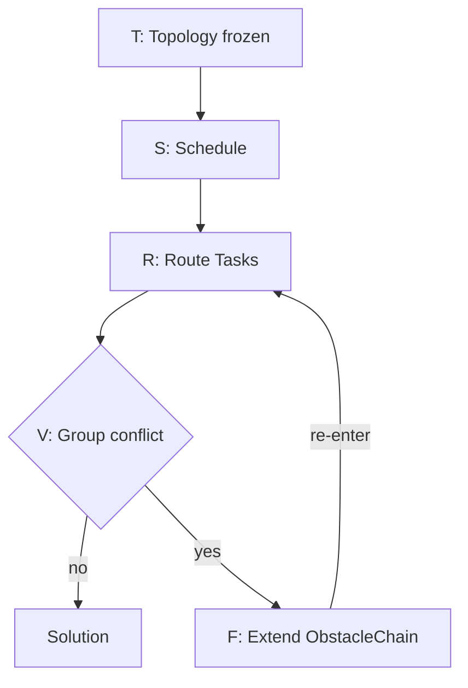
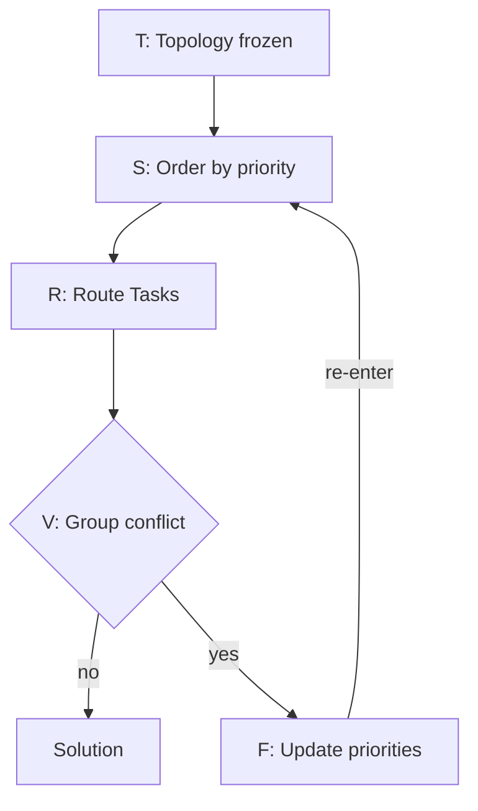
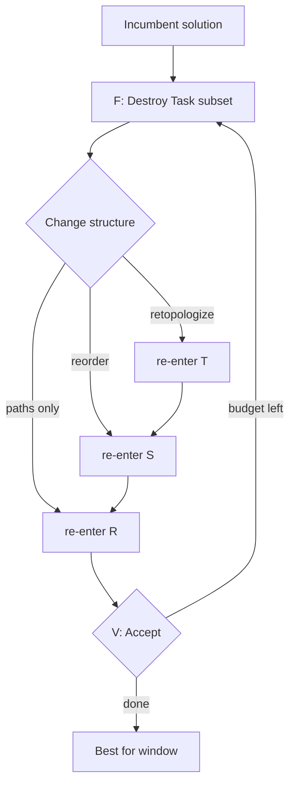
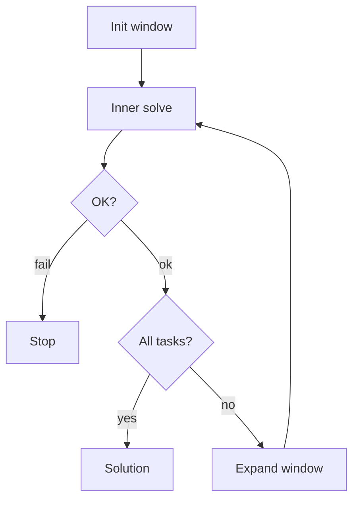

# pipe_design Roadmap

Framework for **automatic multi-group pipe routing** inside a bounded 3D design domain
(e.g. valve / manifold / equipment envelopes).

Unlike classical MAPF (multi-agent pathfinding), agents do **not** free space after moving:
once a pipe is routed it **permanently occupies** volume. Conflicts are therefore
**geometric** (radii / clearance), not time-space.

---

## 1. Problem Rules

1. **Application:** auto-design continuous pipe paths in a fixed 3D domain (static obstacles +
   already-routed pipes), not transient robot trajectories.
2. **Groups:** pipes are partitioned into **groups**. Occupancy conflict between
   **different groups** is forbidden.
3. **Permanent occupancy:** a routed pipe stays as an obstacle forever. There is no
   “pass and release” as in MAPF; later paths must clear earlier ones (and static geometry).
4. **Within a group:** sharing / branching policy is configurable (default: same-group paths
   may connect via multi-terminal topology — MST / spine / Steiner).
5. **Geometry:** obstacles and pipes have radii. Shapes are approximated by **spheres** and
   **capsules** (sphere swept along a segment). Blocked iff `clearance < pipe_radius`.
6. **Kinematics (when used):** no reverse gear — prefer **Dubins**, not Reeds-Shepp
   (relevant for Hybrid A* / minimum turning radius).

---

## 2. Architecture

```text
┌─────────────────────────────────────────────────────────────┐
│  Outer [W]      Incremental Task Expansion (active_set)     │
├─────────────────────────────────────────────────────────────┤
│  High-level     CBS / PBS / LNS / disjoint splitting        │
│                 (group-level conflict resolution)           │
├─────────────────────────────────────────────────────────────┤
│  Scheduling     ordered Task queue (pair-level, cross-group)│
│  + Topology     MST / Steiner / spine  (per group)          │
├─────────────────────────────────────────────────────────────┤
│  Middle-level   bi-dir, weighted/focal, adaptive step, …    │
├─────────────────────────────────────────────────────────────┤
│  Low-level      A* / Theta* / Hybrid-A* / …                 │
├─────────────────────────────────────────────────────────────┤
│  Heuristic      Euclidean, true-distance, Dubins, …         │
├─────────────────────────────────────────────────────────────┤
│  Grid + Geom    CompositeGrid = StaticClearance ⋈ Chain     │
└─────────────────────────────────────────────────────────────┘
```

**Design principle:** each layer talks through narrow interfaces so algorithms are swappable.

| Layer | Responsibility | Does *not* own |
|-------|----------------|----------------|
| `geom/` | `Vec3`, sphere/capsule, clearance math | Search |
| `grid/` | Domain occupancy query | Paths, groups |
| Low-level | One start→goal path | Conflict between groups |
| Middle | Speed / quality wrappers on low-level | Topology |
| Topology | Which terminal-pairs to route (per group) | Collision with other groups |
| Scheduling | **Order** of pair tasks (may interleave groups) | Geometry |
| High-level | Resolve residual group conflicts | Cell rasterization |
| Outer `[W]` | Grow `active_set` of Tasks; soft warm-start | Inner conflict proof |

### Suggested package layout

```text
pipe_design/
  include/
    geom/          # types + geometry utilities
    grid/          # StaticClearanceGrid, ObstacleChain, CompositeGrid
    heuristic/     # Heuristic, Manhattan, Euclidean, Octile, Dijkstra, …
    planner/
      open/        # OpenSet + heap backends
      motion/      # ActionModel, Six/Eight/TwentySixConnected, …
      low/         # A*, Theta*, Lazy Theta*, Path, SearchNode; Hybrid-A* planned
      middle/      # (planned) bi-dir, adaptive step, …
      topology/    # (planned) MST, Steiner, …
      schedule/    # (planned) Task, Scheduler
      high/        # (planned) CBS, PBS, LNS
      window/      # (planned) Incremental Task Expansion [W]
  src/…            # mirrors include/
  tests/
  ROADMAP.md
```

---

## 3. Core Interfaces (contracts)

Keep these stable; implement algorithms against them.

```text
# Occupancy (already sketched)
CompositeGrid::is_free(cell|point, pipe_radius) -> bool
CompositeGrid::clearance(cell|point) -> float          # full min; hot path prefers is_free

# Single-path low-level
LowLevelPlanner::search(grid, start, goal, pipe_radius, heuristic) -> Path | failure

# Topology (per group)
TopologyBuilder::build(terminals, edge_cost_fn) -> set of Pairs   # e.g. MST edges

# Scheduling (global)
Task = { group_id, pair(start,goal), radius, priority }
Scheduler::next(tasks, world_state) -> Task
# Ordering may be: all A then B, OR A1→B1→A2→… (pair-level interleaving)

# High-level
HighLevelPlanner::solve(groups, static_grid, low_level, scheduler) -> Solution | failure
# On conflict: add constraints into ObstacleChain (per CBS node) and replan affected tasks

# Outer window (optional scale / anytime)
WindowDriver::solve(all_tasks, ...) -> Solution | failure
# active_set grows over iterations; incumbent is soft reference, never frozen occupancy
```

**Collision model (everywhere):** blocked iff `clearance < pipe_radius`.

**CBS dynamic constraints:** store as `ObstacleChain` (`parent` + local delta). Do **not** deep-copy dense clearance fields per tree node.

---

## 4. Module Catalog & Priorities

Legend: **P0** must-have → **P4** later. ★ = preferred for this domain.

### 4.1 Grid / Geom — status: **P0 in progress**

| Item | Priority | Notes |
|------|----------|-------|
| `geom::Vec3`, Sphere, Capsule, signed clearance | Done | |
| `StaticClearanceGrid` (truncated DF bake) | Done | Shared read-only across CBS |
| `ObstacleChain` (parent + delta) | Done | CBS-friendly COW |
| `CompositeGrid` (`min` static ⋈ chain) | Done | Hot path: short-circuit `is_free` |
| Multi-resolution / corridor extraction | P3–P4 | Optional acceleration |
| KD-tree accelerate chain queries | P2 | When dynamic obstacle count is large |

### 4.2 Low-level planners

| Algorithm | Priority | Notes |
|-----------|----------|-------|
| ★ A\* (grid, 6/26-connect) | P0 | Baseline |
| Greedy best-first (`f=h`) | P0 | `GreedyBestFirst`; thin A\* variant |
| Dijkstra / UCS (`f=g`) | P0 | `planner::Dijkstra`; ≠ `heuristic::Dijkstra` |
| ★ Theta\* / Lazy Theta\* | P1 | Any-angle; good for pipes |
| ★ Hybrid A\* | P2 | Heading + min turning radius |
| Anytime / ARA\* / ANA\* | P2 | Feasible first, improve later |
| JPS / JPS+ | P2 | Weaker once radius/clearance dominates |
| PRM / Lazy PRM | P3 | Multi-query static domains |
| RRT\* / Informed-RRT\* | P3 | Open spaces; often worse in narrow ducts |
| ACO | P4 / experimental | Prefer anytime A\* or LNS instead |

### 4.3 Middle-level (optional wrappers)

| Technique | Priority | Notes |
|-----------|----------|-------|
| ★ Weighted / focal search | P1 | Suboptimality for speed |
| ★ Bidirectional search | P1 | When both ends fixed |
| ★ Clearance-adaptive step size | P1 | Large steps far from obstacles |
| Path smooth + clearance re-check | P1 | Post-process |
| Corridor / hierarchical abstraction | P3 | High-level supplies corridor |
| Dynamic resolution | P3 | Costly; after adaptive step |
| SIPP / time intervals | — | Not needed (no time dimension) |

### 4.4 Heuristics

| Heuristic | Priority | Notes |
|-----------|----------|-------|
| Manhattan / Euclidean / Octile / Chebyshev | P0 | Manhattan, Euclidean, Octile done; Chebyshev TBD |
| ★ True distance (Dijkstra/BFS on static grid) | P1 | `heuristic::Dijkstra` multi-source + relaxed bake |
| Clearance-aware / bend penalty in cost | P1 | Design quality ≠ pure length |
| Dubins length | P2 | For Hybrid A\* only |
| Landmark / ALT | P3 | Very large maps |

Cost should support a **weighted sum**: length + turn penalty + clearance penalty.

### 4.5 Topology + Scheduling (multi-component)

Two axes — do not collapse into “one MST per group then stop”:

1. **Topology (usually per group):** which pairs/edges to route.  
2. **Scheduling (global):** order of `Task`s; **may interleave pairs across groups**.

| Method | Priority | Notes |
|--------|----------|-------|
| ★ Sequential routing of MST edges | P1 | Practical default |
| MST on terminal distance graph | P1 | Fast topology |
| Spine / trunk then branches | P1 | Better design structure |
| Steiner / RSMT-style | P2 | Better topology, heavier |
| ★ Pair-level priority interleaving | P1 | e.g. A1→B1→A2… |
| Group-level priority only | P1 | Special case of scheduler |
| Dynamic reordering on failure | P2 | Bump priority / reshuffle |
| ★ Outer `[W]` incremental task expansion | P2–P3 | Grow `active_set`; soft incumbent (see §8.6) |

Conflict **rules** stay at **group** granularity.  
Construction **order** may be **pair** (or segment) granularity.  
**Window** controls **which Tasks are considered** in one inner solve.

### 4.6 High-level conflict resolution

| Algorithm | Priority | Notes |
|-----------|----------|-------|
| ★ CBS + geometric constraints | P2 | Constraint = sphere/capsule on `ObstacleChain` |
| ★ Disjoint splitting | P2 | Stronger CBS branching |
| ECBS | P2 | Bounded suboptimal |
| ★ PBS | P2 | Natural fit for design priorities |
| ★ LNS / ALNS | P3 | Scale-out when CBS explodes |
| ICTS | P3 | Porting cost high for permanent occupancy |
| ILP / SAT on candidates | P4 | Small instances only |

---

## 5. Implementation Phases

### Phase P0 — Foundation (current)

- [x] `geom/` types + clearance utilities  
- [x] `StaticClearanceGrid` + `ObstacleChain` + `CompositeGrid`  
- [ ] Grid unit tests expanded (bounds, capsule bake, chain early-exit)  
- [ ] `Path` / `CellCoord` I/O helpers  

### Phase P1 — Single pipe + multi-terminal

- [x] A\* on `CompositeGrid` (steppable; 6-connect)  
- [x] Greedy best-first (`f=h`) + Dijkstra/UCS (`f=g`)  
- [x] Theta\* / Lazy Theta\* (any-angle + LOS)  
- [x] Basic heuristics (Manhattan / Euclidean / Octile)  
- [x] True-distance heuristic on static field (`Dijkstra`)  
- [ ] Chebyshev heuristic  
- [ ] Weighted A\* + bidirectional (middle)  
- [ ] Adaptive step from clearance  
- [ ] Topology: MST → sequential pair routing (one group)  
- [ ] Scheduler API (even if only one ordering policy)

### Phase P2 — Multi-group

- [x] True-distance heuristic on static field (`Dijkstra`; landed with P1 heuristics)  
- [x] Theta\* or smooth+recheck  
- [ ] CBS with `ObstacleChain` constraints + disjoint split  
- [ ] PBS alternative  
- [ ] Pair-level cross-group interleaving in scheduler  

### Phase P3 — Quality & scale

- [ ] Hybrid A\* + Dubins (if turning radius required)  
- [ ] Anytime search  
- [ ] LNS over pairs/groups  
- [ ] Outer `[W]` incremental task expansion (soft reference, heuristic window growth)  
- [ ] KD-tree or local patches for large dynamic sets  

### Phase P4 — Advanced

- [ ] Multi-resolution / corridors  
- [ ] Steiner/RSMT topology  
- [ ] Landmark heuristics, PRM variants  

---

## 6. Development Guidelines

1. **Prefer composition over inheritance** for planners (strategy objects).  
2. **Hot path:** use `is_free` / `collides` (early exit), not full `clearance`, unless the algorithm needs the value (e.g. adaptive step).  
3. **Static vs dynamic:** bake static DF once; CBS nodes only extend `ObstacleChain`.  
4. **One concern per folder:** do not put CBS logic inside A\*, or MST inside the grid.  
5. **Tests:** each planner gets a small deterministic unit test (empty map, blocked map, two-group conflict).  
6. **Legacy:** `pathSearch_pkg(legacy)` is reference only; new code lives in `pipe_design/`.  
7. When adding an algorithm, update this file’s checklist and the catalog table.

### Build / test

```bash
cd pipe_design/build && cmake .. && cmake --build . -j && ctest --output-on-failure
```

---

## 7. Glossary

| Term | Meaning |
|------|---------|
| Group | Set of pipes that must not conflict with other groups |
| Pair / Task | One start–goal routing job (often an MST edge), tagged with `group_id` |
| Clearance | Distance from query point to nearest obstacle *surface* |
| ObstacleChain | Immutable linked constraint list for CBS branching |
| Permanent occupancy | Routed pipe stays as obstacle forever (no “time free”) |
| Re-entry point | Stage (`[T]`/`[S]`/`[R]`/`[W]`) jumped to after `[F]` (or after a successful window) |
| `active_set` | Task subset considered by one inner solve under outer `[W]` |
| Incumbent (soft) | Previous window’s paths used as reference only; may be fully re-routed |

---

## 8. Reference Flow & Mental Model

**Thesis:** the solver is a **nested loop**.

- **Inner loop:** `[T]→[S]→[R]→[V]→[F]→…` on a fixed Task set. CBS / PBS / LNS differ by **re-entry point** and what `[F]` mutates.
- **Outer loop `[W]`:** Incremental Task Expansion — grow `active_set`, use the previous solution as a **soft reference** (not frozen), until all Tasks are covered.

### 8.1 Shared stages

```text
terminals per group
    → TopologyBuilder (MST / Steiner / spine)
    → list of Tasks
    → Scheduler orders Tasks (group- or pair-level, possibly interleaved)
    → for each Task: LowLevel(+Middle) on CompositeGrid
    → if group conflict: HighLevel (CBS/PBS/LNS) adds chain constraints / reorders / repairs
    → Solution paths
  
 [W] Window       choose / grow active_set ⊆ all Tasks
 [T] Topology     terminals → Task set (usually frozen during one inner episode)
 [S] Schedule     Task set  → ordered Task list (group- or pair-level)
 [R] Route        each Task → Path via LowLevel(+Middle) on CompositeGrid
 [V] Validate     paths     → OK | group-group geometric conflicts
 [F] Fix          mutate state, then re-enter [T] / [S] / [R]
```

Inner solve on a window: `[T]→[S]→[R]→[V]` (+ `[F]` on conflict).  
Outer success: expand `active_set` and run the inner loop again with soft incumbent.

### 8.2 Unified loop (mental graph)

```text
                         ┌──────────── outer [W] ────────────────────────┐
                         │                                               │
   all Tasks ──► [W] select active_set                                   │
                         │                                               │
                         ▼                                               │
                      [T] Topology (for groups in window)                │
                         │                                               │
                         ▼                                               │
                      [S] Schedule                                       │
                         │                                               │
                         ▼                                               │
                      [R] Route  ◄── soft reference from                 │
                         │           incumbent (optional)                │
                         ▼                                               │
                      [V] Validate                                       │
                         │                                               │
                ┌────────┴────────┐                                      │
                │                 │                                      │
             conflict            OK                                      │
                │                 │                                      │
                ▼                 ▼                                      │
             [F] Fix         window success                              │
                │                 │                                      │
                │                 ├─ active_set == all? ──► Solution     │
                │                 │                                      │
                │                 └─ expand active_set ──────────────────┘
                │
                ├─ CBS → re-enter [R]
                ├─ PBS → re-enter [S]
                └─ LNS → re-enter [T] / [S] / [R]
```

| Method | Primary state mutated in `[F]` | Typical re-entry |
|--------|-------------------------------|------------------|
| **CBS** | `ObstacleChain` per group | **`[R]`** |
| **PBS** | priority / Task order | **`[S]`** then `[R]` |
| **LNS** | destroy Paths; optional reorder / retopologize | **`[S]`** or **`[T]`**, then `[R]` |
| **`[W]`** | grow `active_set`; refresh soft incumbent | **`[W]`→[S]/[R]`** (topology often kept) |

### 8.3 CBS re-entry (constraint-centric)

CBS keeps topology fixed. A conflict becomes geometric constraints on child nodes; only routing is redone for the constrained group(s).

```text
  [T] once (root) ──► Tasks (frozen for this window)
         │
         ▼
  [S] initial order ──► root paths via [R]
         │
         ▼
  [V] find group conflict (e.g. A vs B at spheres)
         │
         ▼
  [F] branch:
        child1: chain_A.extend(conflict_as_obstacle)
        child2: chain_B.extend(conflict_as_obstacle)
         │
         ▼
  re-enter ──► [R]  only for the constrained group’s Tasks
                (CompositeGrid = static ⋈ that group’s ObstacleChain
                 ⋈ other groups’ current paths as occupancy)
         │
         └──────► [V] again ──► … until conflict-free or fail
```



### 8.4 PBS re-entry (order-centric)

PBS treats priority as permission to claim space first. Fixing a conflict means changing who goes first, then scheduling and routing again.

```text
  [T] once ──► Tasks (frozen)
         │
         ▼
  [S] order by current priorities (group- or pair-level)
         │
         ▼
  [R] → [V]
         │
      conflict between lower and higher priority
         │
         ▼
  [F] raise / assign priority (or add precedence constraint)
         │
         ▼
  re-enter ──► [S]  rebuild order from priorities
                 └─► [R]  → [V] …
```



### 8.5 LNS re-entry (destroy–repair)

LNS assumes a complete (or partial) incumbent. It tears out a subset of Tasks’ paths, optionally changes topology/order, then repairs.

```text
  incumbent Solution (from any method / previous window)
         │
         ▼
  [F] Destroy: pick Task subset 𝒯 (conflict-heavy / random / related)
       clear their Paths from occupancy
         │
         ├─ optional: retopologize groups touched by 𝒯     ──► re-enter [T]
         ├─ optional: reshuffle 𝒯 (and maybe neighbors)    ──► re-enter [S]
         └─ default: keep Tasks & order for 𝒯              ──► re-enter [R]
         │
         ▼
  [R] repair only 𝒯 (rest of paths stay as occupancy)
         │
         ▼
  [V] accept if better / feasible ──► loop until budget
```



### 8.6 Outer loop `[W]`: Incremental Task Expansion

Partial solutions help the full problem **conditionally**: good for early infeasibility detection, anytime output, and soft warm-start — **not** if paths are frozen or the window order is wrong.

Keep `[W]` **minimal**: only grow `active_set` and pass a soft incumbent. Do **not** put reshuffle / subset-retry / destroy–repair here — that belongs to **LNS** (or PBS reordering) inside the inner loop.

```text
Outer Loop: Incremental Task Expansion
─────────────────────────────────────
Initialize:
  active_set = select_first_k(all_tasks)   # heuristic pick, not raw list prefix
  incumbent  = ∅

For each iteration:
  1. Solve(active_set, reference=incumbent)
       # inner loop [T]→[S]→[R]→[V]→[F]… (CBS / PBS / LNS)
       # reference = soft (cost / priority / focal hint); window Tasks may all be re-routed
  2. If fail → stop
       (current active_set infeasible under the inner solver;
        if the window was chosen well, full set is often hard / infeasible too)
  3. If success:
       incumbent  = solution               # soft reference only; do NOT freeze occupancy
       active_set = active_set ∪ next_m    # heuristic expansion (spine → branch, large radius, …)
  4. Until active_set == all_tasks → return incumbent
```



**Rules of thumb**

| Do | Don't |
|----|--------|
| Select window by spine / large radius / bottleneck pairs | Blind “first k in list” |
| Treat incumbent as soft reference; allow full re-route in window | Freeze early paths as hard obstacles for later Tasks |
| On window failure: stop (leave recovery to LNS/PBS if desired later) | Reshuffle / retry subsets inside `[W]` |
| Expand by layers (trunk → branches → tips) | Grow by arbitrary +m with no structure |

**When partial solutions help:** early infeasibility pruning; structural prior (who should own a corridor); anytime UX; faster repair via warm-start.  
**When they hurt:** wrong Task order fills narrow ducts; “reference” implemented as hard freeze.

### 8.7 One driver, two nesting levels

```text
window_loop:                                    # [W] — keep dumb
  while active_set != all_tasks:
    result = inner_solve(active_set, soft_ref=incumbent)
    if fail: return FAILURE
    incumbent = result
    expand active_set
  return incumbent

inner_solve(active_set):                        # [T][S][R][V][F]
  ensure Tasks / Order for active_set
  route(dirty_tasks)
  conflicts = validate()
  if conflicts empty: return OK
  fix(conflicts)   # CBS | PBS | LNS  (complex recovery lives here)
  mark_dirty(...)  # defines re-entry [R] / [S] / [T]
  repeat
```

| Strategy | Marks dirty | Next starts at |
|----------|-------------|----------------|
| CBS | affected group Tasks + chain | `[R]` |
| PBS | schedule (± Tasks) | `[S]` |
| LNS | destroyed Tasks (± topology/schedule) | `[T]` / `[S]` / `[R]` |
| Window expand | new Tasks + soft incumbent | `[W]` → inner again |

### 8.8 One-line summary

> **Outer `[W]` only grows `active_set` with a soft incumbent (fail → stop). Inner loop `[T]→[S]→[R]→[V]→[F]` does the real work; CBS→`[R]`, PBS→`[S]`, LNS→`[T]`/`[S]`/`[R]`.**

