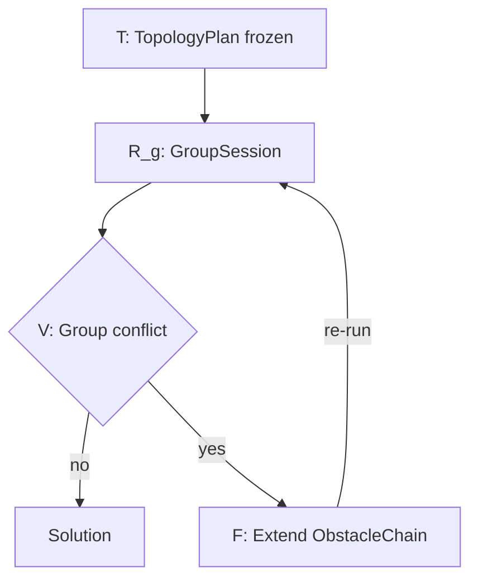
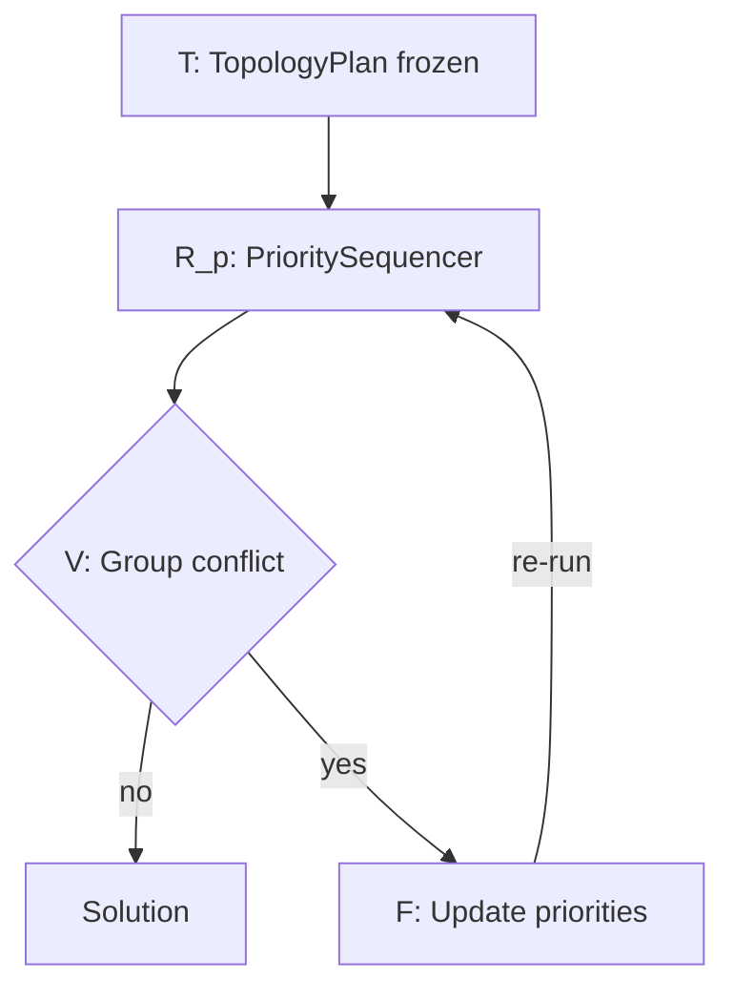
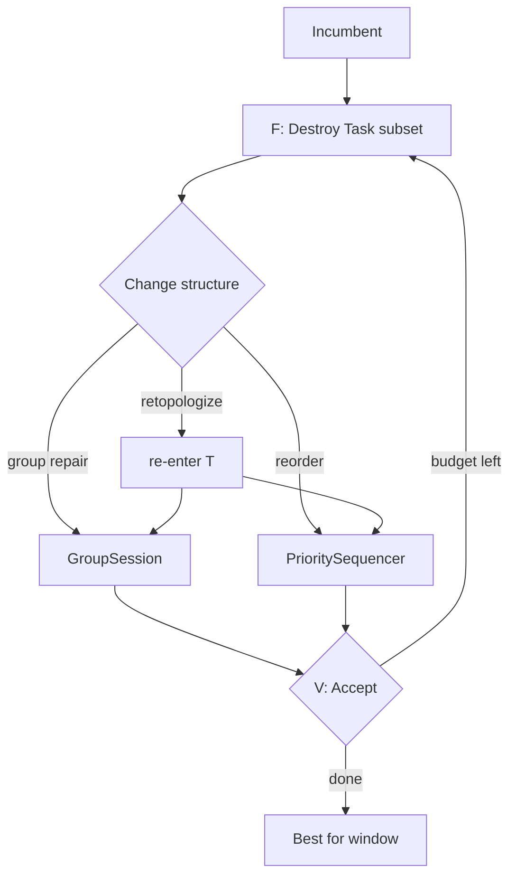
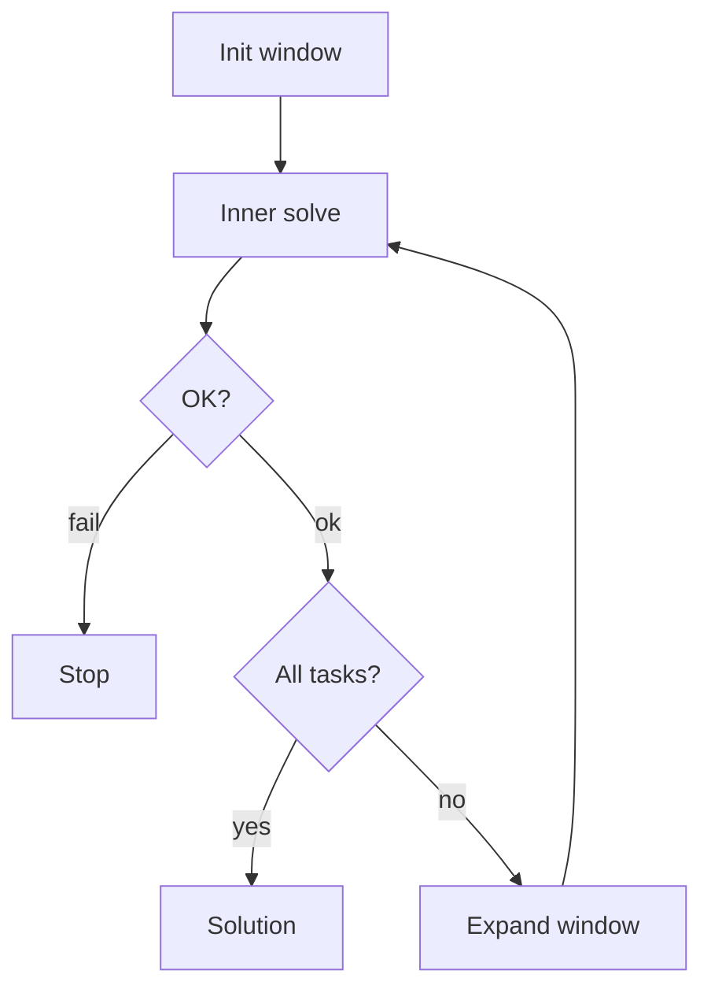

# pipe_design Roadmap

Framework for **automatic multi-group pipe routing** inside a bounded 3D design domain
(e.g. valve / manifold / equipment envelopes).

Unlike classical MAPF (multi-agent pathfinding), agents do **not** free space after moving:
once a pipe is routed it **permanently occupies** volume. Conflicts are therefore
**geometric** (radii / clearance), not time-space.

---

## 1. Problem Rules

1. **Application:** auto-design continuous pipe paths in a fixed 3D domain (static obstacles +
   already-routed pipes), not transient robot trajectories.
2. **Groups:** pipes are partitioned into **groups**. Occupancy conflict between
   **different groups** is forbidden.
3. **Permanent occupancy:** a routed pipe stays as an obstacle forever. There is no
   “pass and release” as in MAPF; later paths must clear earlier ones (and static geometry).
4. **Within a group:** sharing / branching policy is configurable (default: same-group paths
   may connect via multi-terminal topology — MST / spine / Steiner).
5. **Geometry:** obstacles and pipes have radii. Shapes are approximated by **spheres** and
   **capsules** (sphere swept along a segment). Blocked iff `clearance < pipe_radius`.
6. **Kinematics (when used):** no reverse gear — prefer **Dubins**, not Reeds-Shepp
   (relevant for Hybrid A* / minimum turning radius).

---

## 2. Architecture

```text
┌─────────────────────────────────────────────────────────────┐
│  Outer [W]      Incremental Task Expansion (active_set)     │
├─────────────────────────────────────────────────────────────┤
│  High-level     CBS / PBS / LNS / disjoint splitting        │
│                 (group-level conflict resolution)           │
├─────────────────────────────────────────────────────────────┤
│  Topology [T]   GroupTopologyPlan / GlobalTopologyPlan      │
│  multi/         GroupSession · PrioritySequencer            │
├─────────────────────────────────────────────────────────────┤
│  Low-level      A* / Bi-dir / Focal / Theta* / Hybrid-A* / …│
├─────────────────────────────────────────────────────────────┤
│  Heuristic      Euclidean, true-distance, Dubins, …         │
├─────────────────────────────────────────────────────────────┤
│  Grid + Geom    CompositeGrid = StaticClearance ⋈ Chain     │
└─────────────────────────────────────────────────────────────┘
```

**Design principle:** each layer talks through narrow interfaces so algorithms are swappable.

| Layer | Responsibility | Does *not* own |
|-------|----------------|----------------|
| `geom/` | `Vec3`, sphere/capsule, clearance math | Search |
| `grid/` | Domain occupancy query | Paths, groups |
| Low-level | One start→goal path (incl. bi-dir, weighted, adaptive step) | Multi-query session state |
| Topology `[T]` | Terminals → `TopologyPlan`(s) (edges + intra-group `grow_order`) | Grid search, group conflicts |
| `planner/multi/` | Multi-query drivers: ConnectedSets / obstacle updates across rounds | Conflict tree (CBS/PBS) |
| High-level | Resolve residual group conflicts (chain / priority / LNS) | Cell rasterization |
| Outer `[W]` | Grow `active_set` of Tasks; soft warm-start | Inner conflict proof |

Cross-group **Task order** matters for PBS (`PrioritySequencer`), not for a lone CBS `GroupSession` (obstacles fixed; only intra-group `grow_order` shapes the tree).

### Suggested package layout

```text
pipe_design/
  include/
    geom/          # types + geometry utilities
    grid/          # StaticClearanceGrid, ObstacleChain, CompositeGrid
    heuristic/     # Heuristic, Manhattan, Euclidean, Octile, Dijkstra, …
    topology/      # (planned) MST, RadiusSpine — see topology/ROADMAP.md
    planner/
      open/        # OpenSet + heap backends
      motion/      # ActionModel, Six/Eight/TwentySixConnected, AdaptiveShell, …
      low/         # A*, BidirectionalAStar, FocalAStar, Theta*, AdaptiveStepAStar, …
      multi/       # GroupSession, PrioritySequencer — see multi/ROADMAP.md
      high/        # (planned) CBS, PBS, LNS
      window/      # (planned) Incremental Task Expansion [W]
  src/…            # mirrors include/
  tests/
  ROADMAP.md
```
---

## 3. Core Interfaces (contracts)

Keep these stable; implement algorithms against them.

```text
# Occupancy (already sketched)
CompositeGrid::is_free(cell|point, pipe_radius) -> bool
CompositeGrid::clearance(cell|point) -> float          # full min; hot path prefers is_free

# Single-path low-level
LowLevelPlanner::search(grid, start, goal, pipe_radius, heuristic) -> Path | failure

# Topology [T] (per group → GroupTopologyPlan; assemble → GlobalTopologyPlan)
Terminal / TopologyEdge / GroupTopologyPlan / GlobalTopologyPlan
TopologyBuilder::build(terminals, cost_fn) -> GroupTopologyPlan

# Multi-query drivers (planner/multi/)
GroupSession::reset(GroupTopologyPlan, CompositeGrid&, low, …)
PrioritySequencer::reset(GlobalTopologyPlan, order?, CompositeGrid&, low, …)  # temp view per step
# Same-group paths → ConnectedSet (starts/goals); other-group (PBS) → obstacles

# High-level
HighLevelPlanner::solve(...) -> Solution | failure
# CBS: mutate ObstacleChain → re-run GroupSession for affected group(s)
# PBS: mutate priority / order → re-run PrioritySequencer

# Outer window (optional scale / anytime)
WindowDriver::solve(...) -> Solution | failure
# active_set grows over iterations; incumbent is soft reference, never frozen occupancy
```

**Collision model (everywhere):** blocked iff `clearance < pipe_radius`.

**CBS dynamic constraints:** store as `ObstacleChain` (`parent` + local delta). Do **not** deep-copy dense clearance fields per tree node.

---

## 4. Module Catalog & Priorities

Legend: **P0** must-have → **P4** later. ★ = preferred for this domain.

### 4.1 Grid / Geom — status: **P0 in progress**

| Item | Priority | Notes |
|------|----------|-------|
| `geom::Vec3`, Sphere, Capsule, signed clearance | Done | |
| `StaticClearanceGrid` (truncated DF bake) | Done | Shared read-only across CBS |
| `ObstacleChain` (parent + delta) | Done | CBS-friendly COW |
| `CompositeGrid` (`min` static ⋈ chain) | Done | Hot path: short-circuit `is_free` |
| Multi-resolution / corridor extraction | P3–P4 | Optional acceleration |
| KD-tree accelerate chain queries | P2 | When dynamic obstacle count is large |

### 4.2 Low-level planners

| Algorithm | Priority | Notes |
|-----------|----------|-------|
| ★ A\* (grid, 6/26-connect) | P0 | Baseline |
| Greedy best-first (`f=h`) | P0 | `GreedyBestFirst`; thin A\* variant |
| Dijkstra / UCS (`f=g`) | P0 | `planner::Dijkstra`; ≠ `heuristic::Dijkstra` |
| ★ Focal A\* (`A*_ε`) | P1 | `FocalAStar`; FOCAL by `h`; needs lazy open |
| ★ Theta\* / Lazy Theta\* | P1 | Any-angle; good for pipes |
| ★ Clearance-adaptive step size | P1 | `AdaptiveStepAStar` + `AdaptiveShell`; planner sets `s` from clearance |
| ★ Bidirectional A\* | P1 | `BidirectionalAStar`; when both ends fixed |
| ★ Weighted A\* | P1 | `AStar::set_heuristic_weight` (`f=g+w·h`) |
| ★ Stitching replan | P1 | Anchors `a→b` on broken path; see `include/planner/low/REPLAN_ROADMAP.md` |
| ★ Local repair replan | P1 | Invalidate only cells hit by new/removed obstacles; re-expand locally |
| ★ LPA\* | P1–P2 | Lifelong Planning A\*; repair `g` under edge-cost / free-set changes |
| ★ D\* Lite | P1–P2 | Incremental replan toward fixed goal; natural for CBS constraint add |
| Focused D\* / D\* | P2 | Classic dynamic replan; heavier than D\* Lite for our grid+chain |
| AD\* (Anytime D\*) | P2–P3 | Anytime + dynamic; only if both qualities needed in one loop |
| Anytime / ARA\* / ANA\* | P2 | `ARAStar`, `ANAStar` done; fixed map quality ladder, not chain reuse |
| ★ Hybrid A\* | P2 | Heading + min turning radius |
| JPS / JPS+ | P2 | Weaker once radius/clearance dominates; JPS+ bake breaks on chain edits |
| PRM / Lazy PRM | P3 | Multi-query static domains; edge validity checks help mild dynamics |
| RRT\* / Informed-RRT\* | P3 | Open spaces; often worse in narrow ducts |
| ACO | P4 / experimental | Prefer LNS / incremental repair instead |

Corridor / hierarchical abstraction and dynamic resolution (P3) stay optional accelerations under high-level or motion — no separate middle package.

### 4.3 Heuristics

| Heuristic | Priority | Notes |
|-----------|----------|-------|
| Manhattan / Euclidean / Octile / Chebyshev | P0 | Manhattan, Euclidean, Octile done; Chebyshev TBD |
| ★ True distance (Dijkstra/BFS on static grid) | P1 | `heuristic::Dijkstra` multi-source + relaxed bake |
| Clearance-aware / bend penalty in cost | P1 | Design quality ≠ pure length |
| Dubins length | P2 | For Hybrid A\* only |
| Landmark / ALT | P3 | Very large maps |

Cost should support a **weighted sum**: length + turn penalty + clearance penalty.

### 4.4 Topology + multi-query drivers

Two products from `[T]`, then two drivers in `planner/multi/` — do **not** collapse into one “schedule then A\*”:

1. **`[T]` Topology:** terminals → `GroupTopologyPlan` (edges + intra-group `grow_order`); assemble `GlobalTopologyPlan`.
2. **`GroupSession`:** route **one** group with **fixed** obstacles; same-group paths update ConnectedSets (starts/goals).
3. **`PrioritySequencer`:** route **mixed** groups in a global Task order; same-group → ConnectedSets, other-group → obstacles.

| Method | Priority | Notes |
|--------|----------|-------|
| ★ `GroupTopologyPlan` / `GlobalTopologyPlan` | P0 | See `topology/ROADMAP.md` |
| MST / Radius-spine / Steiner builders | P1–P2 | Topology catalog |
| ★ `GroupSession` | P1 | CBS / single-group; order = intra-group only |
| ★ `PrioritySequencer` | P1–P2 | PBS; cross-group order matters |
| ★ Outer `[W]` incremental task expansion | P2–P3 | Grow `active_set`; soft incumbent (see §8.6) |

Conflict **rules** stay at **group** granularity.  
**Intra-group** lay order ∈ `grow_order` / `GroupSession`.  
**Cross-group** lay order ∈ PBS / `PrioritySequencer` only.  
**Window** controls **which Tasks are considered** in one inner solve.

### 4.5 High-level conflict resolution

| Algorithm | Priority | Notes |
|-----------|----------|-------|
| ★ CBS + geometric constraints | P2 | Constraint = sphere/capsule on `ObstacleChain`; replan via `GroupSession` |
| ★ Disjoint splitting | P2 | Stronger CBS branching |
| ECBS | P2 | Bounded suboptimal |
| ★ PBS | P2 | Replan via `PrioritySequencer` |
| ★ LNS / ALNS | P3 | Scale-out when CBS explodes |
| ICTS | P3 | Porting cost high for permanent occupancy |
| ILP / SAT on candidates | P4 | Small instances only |

---

## 5. Implementation Phases

### Phase P0 — Foundation (current)

- [x] `geom/` types + clearance utilities  
- [x] `StaticClearanceGrid` + `ObstacleChain` + `CompositeGrid`  
- [ ] Grid unit tests expanded (bounds, capsule bake, chain early-exit)  
- [ ] `Path` / `CellCoord` I/O helpers  

### Phase P1 — Single pipe + multi-terminal

- [x] A\* on `CompositeGrid` (steppable; 6-connect)  
- [x] Greedy best-first (`f=h`) + Dijkstra/UCS (`f=g`)  
- [x] Theta\* / Lazy Theta\* (any-angle + LOS)  
- [x] Basic heuristics (Manhattan / Euclidean / Octile)  
- [x] True-distance heuristic on static field (`Dijkstra`)  
- [ ] Chebyshev heuristic  
- [x] Weighted A\* (`set_heuristic_weight`) + bidirectional (`BidirectionalAStar`)  

- [x] Adaptive step from clearance (`AdaptiveStepAStar`)  
- [ ] Topology: `GroupTopologyPlan` + MST / radius-spine  
- [ ] `GroupSession` (multi-query; one group)  

### Phase P2 — Multi-group

- [x] True-distance heuristic on static field (`Dijkstra`; landed with P1 heuristics)  
- [x] Theta\* or smooth+recheck  
- [ ] `PrioritySequencer` (cross-group order → obstacles)  
- [ ] CBS with `ObstacleChain` + `GroupSession` replan + disjoint split  
- [ ] PBS via `PrioritySequencer`  

### Phase P3 — Quality & scale

- [ ] Hybrid A\* + Dubins (if turning radius required)  
- [x] Anytime search (`ARAStar`, `ANAStar`)  
- [ ] LNS over pairs/groups  
- [ ] Outer `[W]` incremental task expansion (soft reference, heuristic window growth)  
- [ ] KD-tree or local patches for large dynamic sets  

### Phase P4 — Advanced

- [ ] Multi-resolution / corridors  
- [ ] Steiner/RSMT topology  
- [ ] Landmark heuristics, PRM variants  

---

## 6. Development Guidelines

1. **Prefer composition over inheritance** for planners (strategy objects).  
2. **Hot path:** use `is_free` / `collides` (early exit), not full `clearance`, unless the algorithm needs the value (e.g. adaptive step).  
3. **Static vs dynamic:** bake static DF once; CBS nodes only extend `ObstacleChain`.  
4. **One concern per folder:** do not put CBS logic inside A\*, or MST inside the grid.  
5. **Tests:** each planner gets a small deterministic unit test (empty map, blocked map, two-group conflict).  
6. **Legacy:** `pathSearch_pkg(legacy)` is reference only; new code lives in `pipe_design/`.  
7. When adding an algorithm, update this file’s checklist and the catalog table.

### Build / test

```bash
cd pipe_design/build && cmake .. && cmake --build . -j && ctest --output-on-failure
```

---

## 7. Glossary

| Term | Meaning |
|------|---------|
| Group | Set of pipes that must not conflict with other groups |
| Terminal | Endpoint / port (`id`, pos, radius, optional role) |
| TopologyEdge | Proposed segment (`u`, `v`, radius, level/kind) |
| `GroupTopologyPlan` | One group’s `[T]` result: terminals, edges, `grow_order` |
| `GlobalTopologyPlan` | Aggregate of per-group plans (for sequencers / window) |
| Task | Schedulable unit derived from a `TopologyEdge` + `group_id` |
| ConnectedSet | Session map: prior same-group geometry used as later starts/goals |
| `GroupSession` | Multi-query driver for one group; obstacles fixed |
| `PrioritySequencer` | Multi-query driver; cross-group order updates obstacles |
| Clearance | Distance from query point to nearest obstacle *surface* |
| ObstacleChain | Immutable linked constraint list for CBS branching |
| Permanent occupancy | Routed pipe stays as obstacle forever (no “time free”) |
| Re-entry point | What high-level re-invokes after `[F]` (`GroupSession` / sequencer / `[T]`) |
| `active_set` | Task subset considered by one inner solve under outer `[W]` |
| Incumbent (soft) | Previous window’s paths used as reference only; may be fully re-routed |

---

## 8. Reference Flow & Mental Model

**Thesis:** `[T]` builds **TopologyPlan(s)**; **`planner/multi/`** turns plans into paths via multi-round low-level search; **high-level** only mutates constraints or priority and re-invokes the right driver. CBS and PBS are **not** the same `[S]→[R]` loop.

- **`[T]`** → `GroupTopologyPlan` / `GlobalTopologyPlan` (usually frozen inside one high-level episode).
- **Route** → `GroupSession` **or** `PrioritySequencer` (never a single shared “schedule stage” for both CBS and PBS).
- **Outer `[W]`:** grow `active_set`, soft incumbent.

### 8.1 Shared pipeline

```text
terminals per group
    → [T] TopologyBuilder → GroupTopologyPlan(s) → GlobalTopologyPlan
    → route via planner/multi/:
         GroupSession(plan_g, ctx)              # CBS / single-group
         OR PrioritySequencer(global, order)  # PBS
    → [V] group–group geometric conflicts
    → [F] high-level fix → re-invoke the matching driver (or rebuild [T])

 [W] Window              choose / grow active_set
 [T] TopologyPlan        terminals → GroupTopologyPlan(s)
 [R_g] GroupSession      one group; fixed obstacles; ConnectedSets
 [R_p] PrioritySequencer mixed groups; order updates obstacles
 [V] Validate            paths → OK | group–group conflicts
 [F] Fix                 CBS chain | PBS priority | LNS destroy…
```

### 8.2 Two route drivers (do not unify)

```text
GroupSession (CBS-style leaf)
────────────────────────────
  ctx.obstacles fixed for whole session
  for edge in grow_order:
      starts/goals ← ConnectedSets
      LowLevel.search
      merge path → ConnectedSets
  Cross-group Task order: irrelevant here

PrioritySequencer (PBS-style)
─────────────────────────────
  for task in global_order:
      same-group priors → ConnectedSets (starts/goals)
      other-group priors → obstacles
      LowLevel.search
      commit
  Cross-group order: determines the solution
```

```text
                         ┌──────────── outer [W] ────────────────────────┐
                         │                                               │
   plans/tasks ──► [W] select active_set                                 │
                         │                                               │
                         ▼                                               │
                      [T] TopologyPlan(s)                                │
                         │                                               │
            ┌────────────┴────────────┐                                  │
            ▼                         ▼                                  │
     [R_g] GroupSession      [R_p] PrioritySequencer                     │
            │                         │                                  │
            └────────────┬────────────┘                                  │
                         ▼                                               │
                      [V] Validate                                       │
                         │                                               │
                ┌────────┴────────┐                                      │
             conflict            OK                                      │
                │                 │                                      │
                ▼                 ▼                                      │
             [F] Fix         window success                              │
                │                 ├─ active_set == all? ──► Solution     │
                │                 └─ expand active_set ──────────────────┘
                │
                ├─ CBS → re-run [R_g] for affected group(s)
                ├─ PBS → re-run [R_p] with new order
                └─ LNS → optional [T], then [R_g] and/or [R_p]
```

| Method | Primary state mutated in `[F]` | Re-invoke |
|--------|-------------------------------|-----------|
| **CBS** | `ObstacleChain` per group | **`GroupSession`** for constrained group(s) |
| **PBS** | priority / Task order | **`PrioritySequencer`** |
| **LNS** | destroy Paths; optional retopologize / reorder | **`[T]`** and/or `[R_g]`/`[R_p]` |
| **`[W]`** | grow `active_set`; soft incumbent | inner solve again |

### 8.3 CBS (constraint-centric → GroupSession)

Topology frozen. Conflict → geometric constraints on child nodes; **only the constrained group** is re-routed with `GroupSession`. Cross-group lay order is not a CBS branch variable.

```text
  [T] once ──► GroupTopologyPlan per group (frozen)
         │
         ▼
  Initial paths: GroupSession each group (ctx = static ⋈ others’ paths ⋈ empty/local chain)
         │
         ▼
  [V] group conflict
         │
         ▼
  [F] branch: extend chain_A or chain_B
         │
         ▼
  re-run GroupSession(affected group, ctx with new chain)
         └──────► [V] …
```



### 8.4 PBS (order-centric → PrioritySequencer)

Priority = who may claim space first. Fixing a conflict changes order, then **`PrioritySequencer`** runs again.

```text
  [T] once ──► GlobalTopologyPlan (frozen)
         │
         ▼
  [R_p] PrioritySequencer(order from priorities)
         │
         ▼
  [V] conflict involving lower vs higher priority
         │
         ▼
  [F] update priorities / precedence
         │
         ▼
  re-run [R_p] with new order → [V] …
```



### 8.5 LNS re-entry (destroy–repair)

LNS tears out a Task subset, optionally rebuilds TopologyPlan or order, then repairs via the matching multi/ driver.

```text
  incumbent
    → [F] Destroy 𝒯
    → optional [T] for touched groups
    → repair with GroupSession and/or PrioritySequencer
    → [V] accept if better / feasible
```



### 8.6 Outer loop `[W]`: Incremental Task Expansion

Partial solutions help **conditionally**: early infeasibility, anytime output, soft warm-start — **not** if paths are frozen or the window order is wrong.

Keep `[W]` **minimal**: only grow `active_set` and pass a soft incumbent. Recovery (reshuffle / destroy–repair) belongs to **LNS** or PBS inside the inner solve.

```text
Outer Loop: Incremental Task Expansion
─────────────────────────────────────
Initialize:
  active_set = select_first_k(...)   # heuristic; not raw list prefix
  incumbent  = ∅

For each iteration:
  1. Solve(active_set, reference=incumbent)
       # [T] → GroupSession and/or PrioritySequencer → [V] → [F]…
  2. If fail → stop
  3. If success:
       incumbent  = solution               # soft only
       active_set = active_set ∪ next_m
  4. Until active_set covers all → return incumbent
```



**Rules of thumb**

| Do | Don't |
|----|--------|
| Select window by spine / large radius / bottleneck pairs | Blind “first k in list” |
| Treat incumbent as soft reference; allow full re-route in window | Freeze early paths as hard obstacles for later Tasks |
| On window failure: stop (leave recovery to LNS/PBS if desired later) | Reshuffle / retry subsets inside `[W]` |
| Expand by layers (trunk → branches → tips) | Grow by arbitrary +m with no structure |

**When partial solutions help:** early infeasibility pruning; structural prior; anytime UX; warm-start.  
**When they hurt:** wrong Task order fills narrow ducts; “reference” implemented as hard freeze.

### 8.7 Nesting summary

```text
window_loop:                                    # [W]
  while active_set incomplete:
    result = inner_solve(active_set, soft_ref=incumbent)
    if fail: return FAILURE
    incumbent = result
    expand active_set
  return incumbent

inner_solve:
  [T] ensure TopologyPlan(s) for active_set
  route via GroupSession and/or PrioritySequencer
  if [V] conflicts: [F] then re-invoke matching driver
```

| Strategy | Marks dirty | Next |
|----------|-------------|------|
| CBS | affected group + chain | `GroupSession` |
| PBS | priority / order | `PrioritySequencer` |
| LNS | destroyed Tasks (± topology) | `[T]` and/or multi/ drivers |
| Window expand | new Tasks + soft incumbent | `[W]` → inner again |

### 8.8 One-line summary

> **`[T]` builds TopologyPlan(s). Route with `GroupSession` (CBS / single-group) or `PrioritySequencer` (PBS). Outer `[W]` only grows `active_set` with a soft incumbent.**
