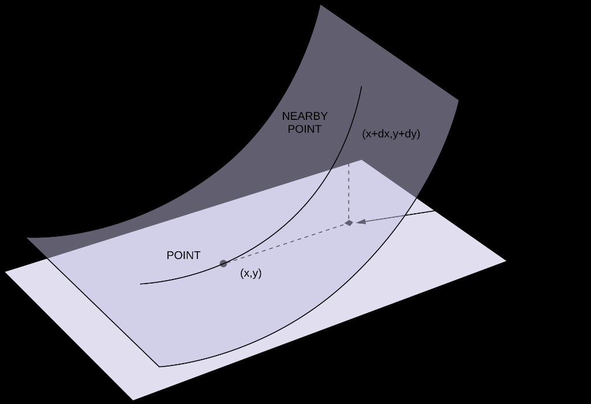
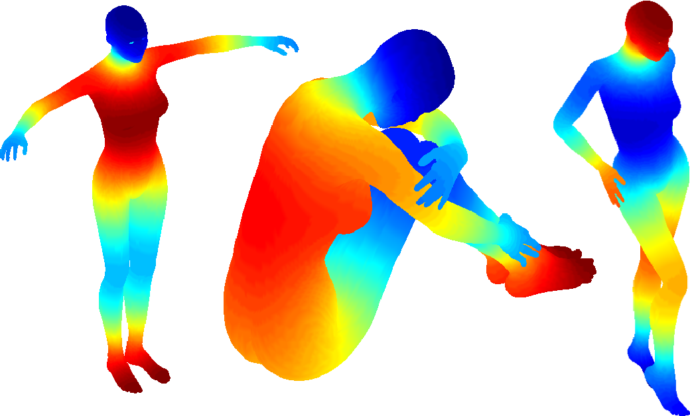
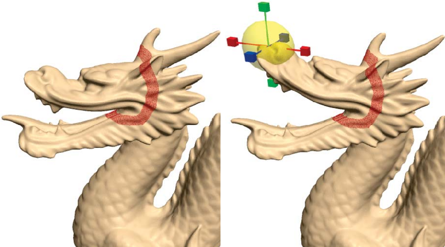
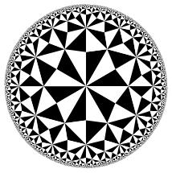
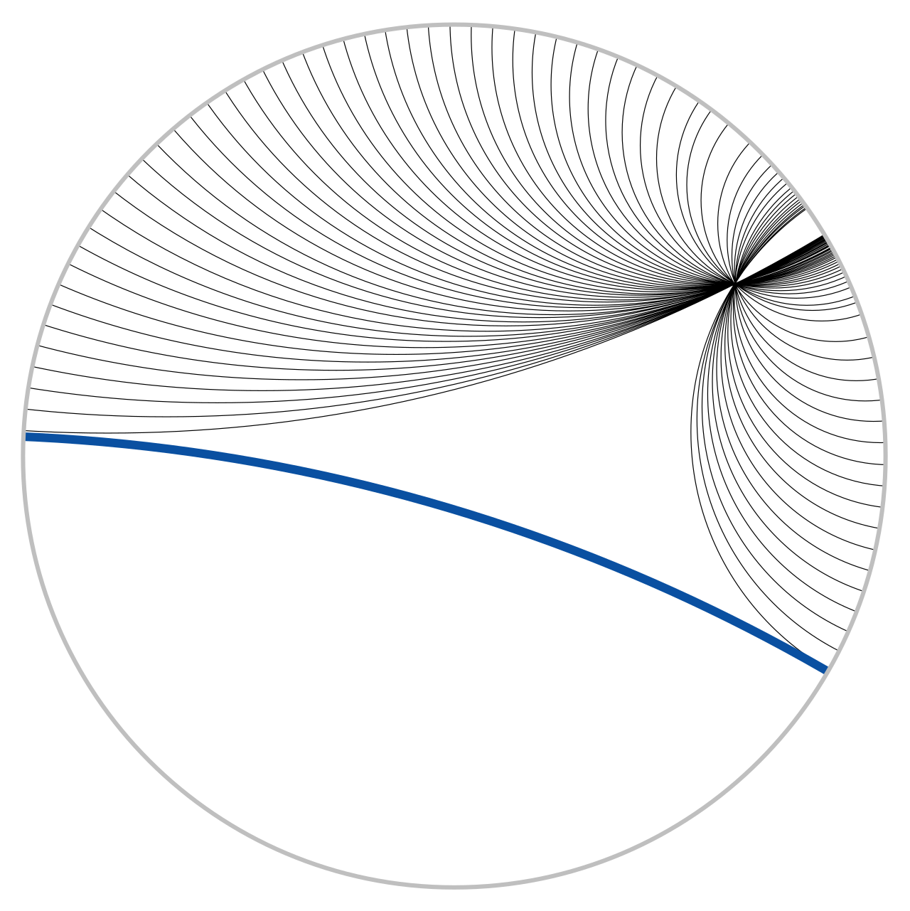
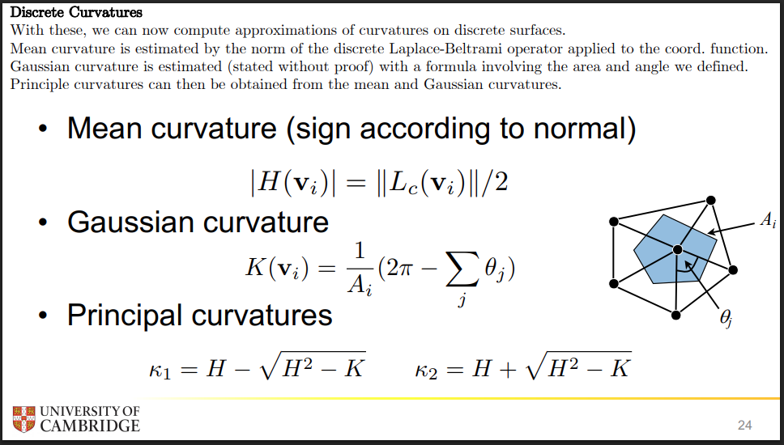

# Background: Differentiable Geometry of Surfaces

Notation follows a regular parametric patch
$$
\mathbf{r}\colon\Omega\subset\mathbb{R}^2\to\mathbb{R}^3,\qquad
\mathbf{r}(u,v)=\bigl(x(u,v),\,y(u,v),\,z(u,v)\bigr).
$$
Partial derivatives: $\mathbf{r}_u=\partial_u\mathbf{r}$, $\mathbf{r}_v=\partial_v\mathbf{r}$, $\mathbf{r}_{uu}=\partial_{uu}\mathbf{r}$, etc. Assume $\mathbf{r}_u\times\mathbf{r}_v\neq\mathbf{0}$ (regular / immersion).

Unit normal
$$
\mathbf{n}=\frac{\mathbf{r}_u\times\mathbf{r}_v}{\|\mathbf{r}_u\times\mathbf{r}_v\|}.
$$
In the fit path this is the geometric normal of $S(\cdot\,;\,P)$; for a scalar field $f$, a reference normal is $n^\ast=\nabla f/\|\nabla f\|$ on $\{f=\tau\}$.

---

## 1. First fundamental form

**Type.** At each point $p$ of the surface $N$, the first fundamental form is a map
$$
\mathrm{I}_p\colon T_pM\times T_pM\to\mathbb{R}
$$

The **first fundamental form** is the inner product on the tangent plane induced by the Euclidean dot product of $\mathbb{R}^3$:
$$
\mathrm{I}(\mathbf{x},\mathbf{y})=\langle\mathbf{x},\mathbf{y}\rangle.
$$
It acts on **two** tangent vectors, not on a single “$\mathrm{d}\mathbf{r}$” by default.

### 1.1 Definition (two tangent vectors)

Write any tangent vectors in the basis $\{\mathbf{r}_u,\mathbf{r}_v\}$ with scalar coefficients $a,b,c,d$:
$$
\mathbf{x}=a\,\mathbf{r}_u+b\,\mathbf{r}_v,\qquad
\mathbf{y}=c\,\mathbf{r}_u+d\,\mathbf{r}_v.
$$
Then
$$
\begin{aligned}
\mathrm{I}(\mathbf{x},\mathbf{y})
&=\mathrm{I}\bigl(a\mathbf{r}_u+b\mathbf{r}_v,\,c\mathbf{r}_u+d\mathbf{r}_v\bigr)\\
&=ac\,\langle\mathbf{r}_u,\mathbf{r}_u\rangle+(ad+bc)\,\langle\mathbf{r}_u,\mathbf{r}_v\rangle+bd\,\langle\mathbf{r}_v,\mathbf{r}_v\rangle\\
&=E\,ac+F\,(ad+bc)+G\,bd,
\end{aligned}
$$
where the **coefficients of the first fundamental form** are
$$
\begin{aligned}
E&=g_{11}=\langle\mathbf{r}_u,\mathbf{r}_u\rangle,\\
F&=g_{12}=\langle\mathbf{r}_u,\mathbf{r}_v\rangle,\\
G&=g_{22}=\langle\mathbf{r}_v,\mathbf{r}_v\rangle.
\end{aligned}
$$
In matrix form, if $\mathbf{x}$ and $\mathbf{y}$ have coordinate columns $(a,b)^\top$ and $(c,d)^\top$,
$$
\mathrm{I}(\mathbf{x},\mathbf{y})
=
\begin{pmatrix}a&b\end{pmatrix}
\begin{bmatrix}E&F\\F&G\end{bmatrix}
\begin{pmatrix}c\\d\end{pmatrix}.
$$

**One-argument shorthand.** $\mathrm{I}(\mathbf{v})$ means the vector with itself:
$$
\mathrm{I}(\mathbf{v})=\langle\mathbf{v},\mathbf{v}\rangle=\|\mathbf{v}\|^2.
$$

### 1.2 Line element: $du$, $dv$ replace the coefficients

An infinitesimal displacement on the surface is the **single** tangent vector
$$
\mathrm{d}\mathbf{r}=\mathrm{d}u\,\mathbf{r}_u+\mathrm{d}v\,\mathbf{r}_v
$$
— so its coefficients in $\{\mathbf{r}_u,\mathbf{r}_v\}$ are $(a,b)=(\mathrm{d}u,\mathrm{d}v)$. The squared length is the quadratic form $\mathrm{I}(\mathrm{d}\mathbf{r})=\mathrm{I}(\mathrm{d}\mathbf{r},\mathrm{d}\mathbf{r})$:
$$
\mathrm{d}s^2
=E\,\mathrm{d}u^2+2F\,\mathrm{d}u\,\mathrm{d}v+G\,\mathrm{d}v^2.
$$
Here $\mathrm{d}u,\mathrm{d}v$ are **not** a different object from $a,b$: they are the calculus notation for those coordinate components when the tangent vector is an infinitesimal. For two **different** tangents one keeps four scalars $a,b,c,d$; for the line element one sets $(a,b)=(c,d)=(\mathrm{d}u,\mathrm{d}v)$.

Along a curve $\mathbf{r}(u(t),v(t))$, replace $\mathrm{d}u\to u'\,\mathrm{d}t$, $\mathrm{d}v\to v'\,\mathrm{d}t$ (or write $du/dt$, $dv/dt$).

### 1.3 Lengths and areas

- **Arc length** of $\mathbf{r}(u(t),v(t))$:
  $$
  L=\int\sqrt{E\Bigl(\frac{du}{dt}\Bigr)^2+2F\frac{du}{dt}\frac{dv}{dt}+G\Bigl(\frac{dv}{dt}\Bigr)^2}\,\mathrm{d}t.
  $$
- **Area element** (Lagrange identity):
  $$
  A=\iint_\Omega\|\mathbf{r}_u\times\mathbf{r}_v\|\,\mathrm{d}u\,\mathrm{d}v
  =\iint_\Omega\sqrt{EG-F^2}\,\mathrm{d}u\,\mathrm{d}v.
  $$

$\mathrm{I}$ is **intrinsic**: lengths and angles on the surface; isometries preserve $\mathrm{I}$.

### 1.4 Orthonormal tangent frame

When $F=0$ and $E=G=1$, $\{\mathbf{r}_u,\mathbf{r}_v\}$ is orthonormal. In general Gram–Schmidt $\mathbf{r}_u,\mathbf{r}_v$ to unit tangents $\mathbf{t}_1,\mathbf{t}_2$ for SD fitting: $\varepsilon_\alpha=(p-S)\cdot\mathbf{t}_\alpha$.

---

## 2. Second fundamental form

The **second fundamental form** $\mathrm{I\!I}$ (shape tensor) is a quadratic form on the tangent plane. With $\mathrm{I}$, it determines extrinsic curvatures (principal curvatures). Geometrically it measures how the surface bends **away from its tangent plane**.

*Figure (Wikipedia): at a point of tangency, a nearby surface point sits a vertical height above the tangent plane. That leading height is quadratic in the tangential displacement $(dx,dy)$ — this quadratic form is $\mathrm{I\!I}$.*

### 2.1 Motivation (graph + second-order Taylor)

**Step 1 — second-order Taylor (general).** Locally write the surface as a graph $z=f(x,y)$ with $f$ twice continuously differentiable. Expand at $(0,0)$:
$$
\begin{aligned}
f(x,y)
&=f(0,0)
+f_x(0,0)\,x+f_y(0,0)\,y\\
&\quad+\tfrac12 f_{xx}(0,0)\,x^2+f_{xy}(0,0)\,xy+\tfrac12 f_{yy}(0,0)\,y^2
+o(x^2+y^2).
\end{aligned}
$$

**Step 2 — local tangent coordinates.** Translate/rotate so the contact point is the origin and the **tangent plane is $z=0$**. The reason the first-order terms vanish is geometric: we take the tangent plane itself as the coordinate plane, so the two tangent vectors span the $(x,y)$-plane and the surface has **zero slope** relative to that plane at the origin. Equivalently $f_x=f_y=0$ there (and we place the origin on the surface so $f(0,0)=0$):
$$
f(0,0)=0,\qquad
f_x(0,0)=0,\qquad
f_y(0,0)=0.
$$
(The function is not identically zero — only value and first derivatives vanish at the contact point; bending appears at order two.)

**Step 3 — simplify equation.** Substituting Step 2 into Step 1 leaves only the quadratic (and higher) part:
$$
z=f(x,y)
=\tfrac12 f_{xx}(0,0)\,x^2+f_{xy}(0,0)\,xy+\tfrac12 f_{yy}(0,0)\,y^2
+o(x^2+y^2).
$$

Set
$$
L:=f_{xx}(0,0),\qquad
M:=f_{xy}(0,0),\qquad
N:=f_{yy}(0,0).
$$
Then
$$
z=L\frac{x^2}{2}+M\,xy+N\frac{y^2}{2}+\text{higher-order terms}.
$$
In the figure, the vertical dashed segment from the nearby point down to the tangent plane is this height $z$ (to leading order).

**Step 4 — read off the quadratic form $\mathrm{I\!I}$.** For an infinitesimal tangential displacement $(\mathrm{d}x,\mathrm{d}y)$, the same quadratic part is written as the second fundamental form
$$
\mathrm{I\!I}
=L\,\mathrm{d}x^2+2M\,\mathrm{d}x\,\mathrm{d}y+N\,\mathrm{d}y^2,
$$
so that the leading height is
$$
dz=\tfrac12\,\mathrm{I\!I}(\mathrm{d}x,\mathrm{d}y)+o(\mathrm{d}x^2+\mathrm{d}y^2)
$$

### 2.2 Classical notation (parametric surface)

For a regular patch $\mathbf{r}(u,v)$, take the unit normal
$$
\mathbf{n}=\frac{\mathbf{r}_u\times\mathbf{r}_v}{\|\mathbf{r}_u\times\mathbf{r}_v\|}.
$$
The coefficients of $\mathrm{I\!I}$ are
$$
L=\mathbf{r}_{uu}\cdot\mathbf{n},\qquad
M=\mathbf{r}_{uv}\cdot\mathbf{n},\qquad
N=\mathbf{r}_{vv}\cdot\mathbf{n}.
$$

**Why $\cdot\mathbf{n}$ (not $\mathbf{r}_{uu}$ alone).** The second derivative $\mathbf{r}_{uu}$ is a vector in $\mathbb{R}^3$. Split it into a part in the tangent plane and a part along $\mathbf{n}$:
$$
\mathbf{r}_{uu}
=\underbrace{\mathbf{r}_{uu}^{\parallel}}_{\in\mathrm{span}\{\mathbf{r}_u,\mathbf{r}_v\}}
+(\mathbf{r}_{uu}\cdot\mathbf{n})\,\mathbf{n}.
$$
In the graph picture of §2.1, the height $z$ above the tangent plane is measured **only along the normal**. The tangential piece $\mathbf{r}_{uu}^{\parallel}$ stays in the plane and does **not** contribute to $z$; only the normal component does. The same holds for $\mathbf{r}_{uv}$ and $\mathbf{r}_{vv}$. (These match $L=f_{xx}$, $M=f_{xy}$, $N=f_{yy}$ when the surface is $z=f(x,y)$ and $\mathbf{n}$ points along $z$.)

**Quadratic form / matrix.** With those coefficients, and with $\mathrm{d}u,\mathrm{d}v$ the coordinate components of a tangent vector in $\{\mathbf{r}_u,\mathbf{r}_v\}$ (as in §1.2),
$$
\mathrm{I\!I}=L\,\mathrm{d}u^2+2M\,\mathrm{d}u\,\mathrm{d}v+N\,\mathrm{d}v^2
=
\begin{pmatrix}\mathrm{d}u&\mathrm{d}v\end{pmatrix}
\begin{bmatrix}L&M\\M&N\end{bmatrix}
\begin{pmatrix}\mathrm{d}u\\\mathrm{d}v\end{pmatrix}.
$$

**Type.** Like $\mathrm{I}$, the second fundamental form is a map
$$
\mathrm{I\!I}_p\colon T_pM\times T_pM\to\mathbb{R}.
$$
The graph picture uses the **diagonal** (same vector twice); the full object is the polarized bilinear form (two possibly different tangent vectors):

| Usage | Input | Meaning |
|-------|-------|---------|
| Geometric height / normal curvature | Same $\mathbf{v}$ twice: $\mathrm{I\!I}(\mathbf{v},\mathbf{v})$ | Leading height $z\sim\tfrac12\,\mathrm{I\!I}(\mathbf{v},\mathbf{v})$ along direction $\mathbf{v}$; for unit $\mathbf{t}$, $\kappa_n(\mathbf{t})=\mathrm{I\!I}(\mathbf{t},\mathbf{t})$ |
| Full tensor / Weingarten | Two vectors $\mathbf{X},\mathbf{Y}$: $\mathrm{I\!I}(\mathbf{X},\mathbf{Y})$ | Bilinear form; recovers $\mathrm{I\!I}(\mathbf{X},\mathbf{Y})=\mathrm{I}\bigl(S(\mathbf{X}),\mathbf{Y}\bigr)$ |

Equivalently $\mathrm{I\!I}=-\mathrm{d}\mathbf{r}\cdot\mathrm{d}\mathbf{n}$ after differentiating $\mathbf{n}\cdot\mathbf{r}_u=\mathbf{n}\cdot\mathbf{r}_v=0$.

**For an SDF** $s$ with Hessian $\mathbf{H}$ (useful when the target is $\{\phi=\tau\}$):
$$
L=-\mathbf{r}_u\cdot\mathbf{H}\cdot\mathbf{r}_u,\quad
M=-\mathbf{r}_u\cdot\mathbf{H}\cdot\mathbf{r}_v,\quad
N=-\mathbf{r}_v\cdot\mathbf{H}\cdot\mathbf{r}_v.
$$

### 2.3 Shape operator and curvatures

#### 2.3.1 Weingarten map

**Type.** At each point $p$,
$$
S_p\colon T_pM\to T_pM
$$

Here $\mathbf{n}$ is the **unit normal** of the surface. The **shape operator** / **Weingarten map** is that linear map, given by the directional derivative
$$
S(\mathbf{v})=-D_{\mathbf{v}}\mathbf{n},
$$
i.e. it measures how $\mathbf{n}$ changes as you move along the surface in the tangent direction $\mathbf{v}$. Differentiating $\mathbf{n}\cdot\mathbf{n}=1$ shows $D_{\mathbf{v}}\mathbf{n}\perp\mathbf{n}$, so $S(\mathbf{v})$ stays in $T_pM$. It is linked to the two fundamental forms by
$$
\mathrm{I\!I}(\mathbf{X},\mathbf{Y})=\mathrm{I}\bigl(S(\mathbf{X}),\mathbf{Y}\bigr)
$$
for tangent vectors $\mathbf{X},\mathbf{Y}$. In the $(\mathbf{r}_u,\mathbf{r}_v)$-basis its matrix is
$$
\bigl(S^i{}_j\bigr)
=
\begin{pmatrix}E&F\\F&G\end{pmatrix}^{-1}
\begin{pmatrix}L&M\\M&N\end{pmatrix}
=(\mathrm{I})^{-1}(\mathrm{I\!I}).
$$
Normal curvature in a unit tangent direction $\mathbf{t}$ is the associated Rayleigh quotient:
$$
\kappa_n(\mathbf{t})=\mathrm{I\!I}(\mathbf{t},\mathbf{t})=\mathrm{I}\bigl(S(\mathbf{t}),\mathbf{t}\bigr).
$$

#### 2.3.2 Eigenvalues and eigenvectors (principal curvatures / directions)

Diagonalize $S$ on the tangent plane. The **eigenvalues** are the **principal curvatures** $\kappa_1,\kappa_2$ — the maximum and minimum of the normal curvature $\kappa_n(\mathbf{t})$ over unit tangent directions $\mathbf{t}$.

The corresponding **eigenvectors** are the **principal directions**: the tangent directions you follow to attain that maximum or minimum curvature (orthogonal w.r.t. $\mathrm{I}$ when $\kappa_1\neq\kappa_2$).

| Quantity | Formula |
|----------|---------|
| Normal curvature | $\kappa_n(\mathbf{t})=\mathrm{I\!I}(\mathbf{t},\mathbf{t})=\mathrm{I}\bigl(S(\mathbf{t}),\mathbf{t}\bigr)$ for unit tangent $\mathbf{t}$ |
| Mean curvature | $H=\tfrac12(\kappa_1+\kappa_2)=\dfrac{LG-2MF+NE}{2(EG-F^2)}$ |
| Gaussian curvature | $K=\kappa_1\kappa_2=\dfrac{LN-M^2}{EG-F^2}=\dfrac{\det\mathrm{I\!I}}{\det\mathrm{I}}$ |
| Principal radii | $\rho_i=1/\kappa_i$ (Pottmann–Hofer SD weights) |

**Meusnier.** Let $\gamma$ be a curve on the surface through $p$ with unit tangent $\mathbf{t}$, ordinary curvature $\kappa=\bigl|\frac{\mathrm{d}\theta}{\mathrm{d}s}\bigr|$, and let $\varphi$ be the angle between the curve's principal normal and the surface normal $\mathbf{n}$. Then
$$
\kappa_n(\mathbf{t})=\kappa\cos\varphi.
$$

### 2.4 Link to fairness energies

Thin-plate fairness
$$
E_{\mathrm{fair}}=\int_\Omega\bigl(\|\mathbf{r}_{uu}\|^2+2\|\mathbf{r}_{uv}\|^2+\|\mathbf{r}_{vv}\|^2\bigr)\,\mathrm{d}u\,\mathrm{d}v
$$
penalizes all second derivatives of $\mathbf{r}$. $\mathrm{I\!I}$ keeps only the **normal** parts ($\mathbf{r}_{uu}\cdot\mathbf{n}$, etc.). Membrane energy $\int(\|\mathbf{r}_u\|^2+\|\mathbf{r}_v\|^2)$ is first-order and ties to $\mathrm{I}$.

### 2.5 Euler's theorem: principal planes are orthogonal and parameterization-independent

Symbols from §1–§2.3:

| Symbol | Meaning |
|--------|---------|
| $\mathrm{I}$ | First fundamental form (metric on $T_pM$) |
| $\mathrm{I\!I}$ | Second fundamental form (bending / height Hessian) |
| $S_p$ | Shape operator (Weingarten map): $S_p(\mathbf{v})=-D_{\mathbf{v}}\mathbf{n}$ |
| $\kappa_n(\mathbf{t})$ | Normal curvature along unit tangent $\mathbf{t}$: $\mathrm{I\!I}(\mathbf{t},\mathbf{t})$ |
| $\kappa_1,\kappa_2$ | Principal curvatures $=\max/\min$ of $\kappa_n$ |
| $\mathbf{e}_1,\mathbf{e}_2$ | Principal directions (eigenvectors of $S_p$) |
| non-umbilic | $\kappa_1\neq\kappa_2$ |

**Claim** (non-umbilic): principal directions are orthogonal, and both $\{\kappa_i\}$ and those directions are parameterization-independent — because $S_p$ is self-adjoint on $(T_pM,\mathrm{I})$.

**Lemma (self-adjoint).** On a **smooth** surface / manifold ($C^2$ immersion so mixed partials commute), for any tangent $\mathbf{u},\mathbf{v}$,
$$
S_p(\mathbf{u})\cdot\mathbf{v}
=\mathbf{u}\cdot S_p(\mathbf{v}).
$$
Requires smoothness: $\mathbf{r}_{uv}=\mathbf{r}_{vu}$ $\Rightarrow$ $\mathrm{I\!I}$ symmetric. Without $C^2$, self-adjointness (and thus the orthogonality argument below) need not hold.

#### 2.5.1 Orthogonality of principal directions

**Why $S_p(\mathbf{e}_1)=\kappa_1\mathbf{e}_1$.** For a generic unit tangent $\mathbf{v}$, moving along $\mathbf{v}$ can tilt $\mathbf{n}$ with a tangential component not parallel to $\mathbf{v}$ — i.e. $S_p(\mathbf{v})=-\nabla_{\mathbf{v}}\mathbf{n}$ need not be parallel to $\mathbf{v}$ ("sideways" twist in $T_pM$). Principal directions are the extrema of $\kappa_n$ (ridge / valley): there the normal tilts only in the plane $\mathrm{span}\{\mathbf{n},\mathbf{e}_i\}$, so $S_p(\mathbf{e}_i)$ is parallel to $\mathbf{e}_i$:
$$
S_p(\mathbf{e}_i)=\lambda_i\mathbf{e}_i.
$$
For any **unit** $\mathbf{u}$, $\kappa_n(\mathbf{u})=\mathrm{I}\bigl(S_p(\mathbf{u}),\mathbf{u}\bigr)=S_p(\mathbf{u})\cdot\mathbf{u}$. Along a principal direction ($\|\mathbf{e}_1\|=1$),
$$
\kappa_n(\mathbf{e}_1)
=S_p(\mathbf{e}_1)\cdot\mathbf{e}_1
=(\lambda_1\mathbf{e}_1)\cdot\mathbf{e}_1
=\lambda_1.
$$
Thus the eigenvalue **is** the principal curvature: $\lambda_1=\kappa_1$ (a scalar, not the vector $\mathbf{e}_1$). Same for $\mathbf{e}_2,\kappa_2$. (Rigorous route: constrained critical points of $\mathbf{u}\mapsto S_p(\mathbf{u})\cdot\mathbf{u}$ on $\|\mathbf{u}\|=1$ are exactly the eigenvectors of the self-adjoint $S_p$.)

Let $\mathbf{e}_1,\mathbf{e}_2$ be unit eigenvectors for distinct principal curvatures:
$$
S_p(\mathbf{e}_1)=\kappa_1\mathbf{e}_1,\qquad
S_p(\mathbf{e}_2)=\kappa_2\mathbf{e}_2
\qquad(\kappa_1\neq\kappa_2).
$$
Dot the first equation with $\mathbf{e}_2$:
$$
S_p(\mathbf{e}_1)\cdot\mathbf{e}_2
=\kappa_1\,(\mathbf{e}_1\cdot\mathbf{e}_2).
$$
Self-adjointness moves $S_p$:
$$
S_p(\mathbf{e}_1)\cdot\mathbf{e}_2
=\mathbf{e}_1\cdot S_p(\mathbf{e}_2)
=\kappa_2\,(\mathbf{e}_1\cdot\mathbf{e}_2).
$$
Equate:
$$
\kappa_1\,(\mathbf{e}_1\cdot\mathbf{e}_2)
=\kappa_2\,(\mathbf{e}_1\cdot\mathbf{e}_2)
\quad\Rightarrow\quad
(\kappa_1-\kappa_2)\,(\mathbf{e}_1\cdot\mathbf{e}_2)=0.
$$
Non-umbilic $\Rightarrow\kappa_1\neq\kappa_2\Rightarrow\mathbf{e}_1\cdot\mathbf{e}_2=0$: the **principal directions are orthogonal**. The **planes of principal curvature** $\mathrm{span}\{\mathbf{n},\mathbf{e}_1\}$ and $\mathrm{span}\{\mathbf{n},\mathbf{e}_2\}$ are then mutually orthogonal as well.

#### 2.5.2 Euler's curvature formula

With orthonormal principal frame $\{\mathbf{e}_1,\mathbf{e}_2\}$, any unit tangent is
$$
\mathbf{u}=\cos\theta\,\mathbf{e}_1+\sin\theta\,\mathbf{e}_2,
$$
where $\theta$ is the angle from $\mathbf{e}_1$. Then
$$
\begin{aligned}
\kappa_n(\mathbf{u})
&=S_p(\mathbf{u})\cdot\mathbf{u}\\
&=S_p\bigl(\cos\theta\,\mathbf{e}_1+\sin\theta\,\mathbf{e}_2\bigr)
\cdot\bigl(\cos\theta\,\mathbf{e}_1+\sin\theta\,\mathbf{e}_2\bigr)\\
&=\bigl(\kappa_1\cos\theta\,\mathbf{e}_1+\kappa_2\sin\theta\,\mathbf{e}_2\bigr)
\cdot\bigl(\cos\theta\,\mathbf{e}_1+\sin\theta\,\mathbf{e}_2\bigr)\\
&=\kappa_1\cos^2\theta+\kappa_2\sin^2\theta.
\end{aligned}
$$
**Euler's theorem** says: we can write any curvature as a linear combination of the principle curvatures. Extremal when $\theta=0$ or $\pi/2$: $\kappa_n\in\{\kappa_1,\kappa_2\}$.

---

## 3. Geodesics

A **geodesic** is a curve on a surface that is **as straight as possible**: among nearby curves on the surface connecting the same endpoints, it critically minimizes length (locally the shortest path).

### 3.1 Length from the first fundamental form

Let $\gamma(t)=\mathbf{r}\bigl(u(t),v(t)\bigr)$ be a curve on the patch. Its speed comes from $\mathrm{I}$ (§1.2):
$$
\Bigl\|\frac{\mathrm{d}\gamma}{\mathrm{d}t}\Bigr\|
=\sqrt{\mathrm{I}\Bigl(\frac{\mathrm{d}\gamma}{\mathrm{d}t},\frac{\mathrm{d}\gamma}{\mathrm{d}t}\Bigr)}
=\sqrt{E\Bigl(\frac{\mathrm{d}u}{\mathrm{d}t}\Bigr)^2+2F\frac{\mathrm{d}u}{\mathrm{d}t}\frac{\mathrm{d}v}{\mathrm{d}t}+G\Bigl(\frac{\mathrm{d}v}{\mathrm{d}t}\Bigr)^2}.
$$
Arc length is the integral of that speed:
$$
L[\gamma]
=\int_{t_0}^{t_1}\sqrt{E\Bigl(\frac{\mathrm{d}u}{\mathrm{d}t}\Bigr)^2+2F\frac{\mathrm{d}u}{\mathrm{d}t}\frac{\mathrm{d}v}{\mathrm{d}t}+G\Bigl(\frac{\mathrm{d}v}{\mathrm{d}t}\Bigr)^2}\,\mathrm{d}t.
$$
(Equivalently one often minimizes the **energy** $\mathcal{E}[\gamma]=\int\mathrm{I}(\mathrm{d}\gamma/\mathrm{d}t,\mathrm{d}\gamma/\mathrm{d}t)\,\mathrm{d}t$; constant-speed critical points of $\mathcal{E}$ are the same as those of $L$.)

### 3.2 Euler–Lagrange $\rightarrow$ geodesic equations

Treat $L$ (or $\mathcal{E}$) as a calculus-of-variations functional in the unknowns $u(t),v(t)$. The **Euler–Lagrange equations** for that Lagrangian yield the **geodesic equations**: a system of **second-order ODEs** for $\bigl(u(t),v(t)\bigr)$ (not a PDE on the surface field). In Christoffel form,
$$
\begin{aligned}
\frac{\mathrm{d}^2u}{\mathrm{d}t^2}
+\Gamma^u_{uu}\Bigl(\frac{\mathrm{d}u}{\mathrm{d}t}\Bigr)^2
+2\Gamma^u_{uv}\frac{\mathrm{d}u}{\mathrm{d}t}\frac{\mathrm{d}v}{\mathrm{d}t}
+\Gamma^u_{vv}\Bigl(\frac{\mathrm{d}v}{\mathrm{d}t}\Bigr)^2
&=0,\\[0.5em]
\frac{\mathrm{d}^2v}{\mathrm{d}t^2}
+\Gamma^v_{uu}\Bigl(\frac{\mathrm{d}u}{\mathrm{d}t}\Bigr)^2
+2\Gamma^v_{uv}\frac{\mathrm{d}u}{\mathrm{d}t}\frac{\mathrm{d}v}{\mathrm{d}t}
+\Gamma^v_{vv}\Bigl(\frac{\mathrm{d}v}{\mathrm{d}t}\Bigr)^2
&=0.
\end{aligned}
$$
The Christoffel symbols are determined by $E,F,G$ and their first derivatives (intrinsic — from $\mathrm{I}$ alone). Write $W=EG-F^2$ and subscripts for partials ($E_u=\partial_u E$, etc.):
$$
\begin{aligned}
\Gamma^u_{uu}&=\frac{GE_u-2FF_u+FE_v}{2W},&
\Gamma^u_{uv}&=\frac{GE_v-FG_u}{2W},&
\Gamma^u_{vv}&=\frac{2GF_v-GG_u-FG_v}{2W},\\[0.5em]
\Gamma^v_{uu}&=\frac{2EF_u-EE_v-FE_u}{2W},&
\Gamma^v_{uv}&=\frac{EG_u-FE_v}{2W},&
\Gamma^v_{vv}&=\frac{EG_v-2FF_v+FG_u}{2W}.
\end{aligned}
$$

**Geometric meaning.** The ambient acceleration $\mathrm{d}^2\gamma/\mathrm{d}t^2$ has no tangential component: it is parallel to the surface normal $\mathbf{n}$ (geodesic curvature vanishes). Equivalently, the covariant derivative of $\mathrm{d}\gamma/\mathrm{d}t$ along $\gamma$ is zero: $\nabla_{\mathrm{d}\gamma/\mathrm{d}t}(\mathrm{d}\gamma/\mathrm{d}t)=0$.

### 3.3 Remarks

- Geodesics are **intrinsic**: they depend only on $\mathrm{I}$, not on $\mathrm{I\!I}$.
- Great circles on a sphere are geodesics; straight lines in the plane are geodesics.
- Existence/uniqueness: for each point and each initial tangent direction there is a unique geodesic through that point in that direction (locally).

---

## 4. Riemannian manifold (symbol background)

Abstract language behind §§1–3. A surface patch in $\mathbb{R}^3$ is the main example used in this note.

- **Manifold $M$ (what it is).** A **manifold** is **not** a scalar field and **not** a level-set function. It is the **set of spatial points** that make up a shape (with a smooth structure, shape is manifold): think of the surface itself as the points that form the object — not a 3D grid of field values filling the space around it. Locally the shape carries its **own coordinates / parameters** — e.g. $(u,v)$ on a surface — and a parametrization (embedding)
  $$
  \mathbf{r}(u,v)=\bigl(x(u,v),\,y(u,v),\,z(u,v)\bigr)
  $$
  maps those parameters to points in $\mathbb{R}^3$. An SDF / density may *select* the point set via $\{\phi=\tau\}$, but the manifold is that point set itself (plus charts), not the field $\phi$. Dimension: a curve is 1D ($t$), a surface 2D $(u,v)$, etc.

  **Conclusion — manifold vs metric (shell vs soul).** A bare smooth manifold $M$ is only the **shell**: continuity and charts, like clay or a blank coordinate grid — **no** length, angle, or area. The **metric** $g$ is the **soul**: the local scale that turns grid numbers into physical distance. A **Riemannian manifold** is the bound pair $(M,g)$. The same shell $M$ can carry many metrics; each choice $g_1,g_2,\ldots$ makes a different geometry (flat, sphere-like, etc.). Once a metric is fixed, lengths / angles / curvature are fixed — that $(M,g)$ has one geometric reality. Consequence: if two setups have the **same** metric matrix in the **same** coordinates, they are **not** “different manifolds with different shapes”; same $g$ means the same geometry. Physical stretch (rubber sheet pulled in $x$) with the **grid held fixed** changes $g\to\tilde{g}$ on the same $M$ and same coordinates — that is a true metric change, not a coordinate rename.

- **Metric $g$ (what it adds).** In a Riemannian manifold the **metric** (Riemannian metric / metric tensor $g$; in a chart its components are the **metric matrix** $(g_{ij})$) is the tool that defines geometric measurements on a curved space. Without a metric, a smooth manifold still has charts, coordinates, and tangent spaces — you can talk about smoothness and differentials — but you **cannot** measure lengths, angles, or volumes. Equipping $M$ with $g$ introduces distance, angle, and volume, and turns an abstract smooth manifold into a **geometric** one (a Riemannian manifold $(M,g)$). On a surface patch in $\mathbb{R}^3$, this $g$ is exactly the first fundamental form $\mathrm{I}$ of §1: $(g_{ij})=\begin{pmatrix}E&F\\F&G\end{pmatrix}$. Formal axioms and the component matrix are below under $(M,g)$.

  - **Vector $X^i$ (what you displace).** A **vector** is an arrow: it has a **direction** and a **length**, and it represents a **displacement** at a point (how you move on the manifold). Notation: **upper index** $X^i$ means vector (contravariant) components. Those chart numbers are not yet physical lengths until the metric measures them (see polar example below).

  - **Covector $\alpha_i$ (ruler).** A **covector** is not another arrow. Think of it as a **ruler**: it reads a vector’s coordinate coefficients and, together with the metric matrix, turns those distorted chart numbers into a true geometric measurement (length / angle). Notation: **lower index** $\alpha_i$ means covector (covariant) components. On a warped chart the raw coefficients lie; the ruler + metric correct them (see polar example below). The metric turns a vector into a covector by
    $$
    \alpha_i = g_{ij}\,X^j
    \qquad\text{(matrix form: }\alpha = g\,X\text{)}.
    $$
    Dual conversion (raise index): the inverse metric turns a covector back into a vector,
    $$
    X^i = g^{ij}\,\alpha_j
    \qquad\text{(matrix form: }X = g^{-1}\alpha\text{)},
    $$
    where $(g^{ij})=(g_{ij})^{-1}$.

  - **Why the plain Euclidean dot product fails in non-Cartesian coordinates.** In **Cartesian** coordinates the distance element is
    $$
    \mathrm{d}s^2=\mathrm{d}x^2+\mathrm{d}y^2,
    \qquad
    (g_{ij})=\begin{pmatrix}1&0\\0&1\end{pmatrix}.
    $$
    Here $g$ is the identity: it has **no correction effect**; $\mathrm{d}x,\mathrm{d}y$ already are physical lengths. In **polar** coordinates $(r,\theta)$ the position is labeled by radius and angle. The naive sum $\mathrm{d}r^2+\mathrm{d}\theta^2$ is **not** distance — those numbers alone mean nothing as a length.

    **polar coordinates $(r,\theta)$ (flat plane, warped chart).** The plane is still flat, but the polar grid is uneven (cells grow with $r$). Infinitesimal Pythagoras: a radial step $\mathrm{d}r$ has length $\mathrm{d}r$; an angular step $\mathrm{d}\theta$ has arc length $r\,\mathrm{d}\theta$. So
    $$
    \mathrm{d}s^2=\mathrm{d}r^2+(r\,\mathrm{d}\theta)^2=\mathrm{d}r^2+r^2\,\mathrm{d}\theta^2,
    \qquad
    g=\begin{pmatrix}1&0\\0&r^2\end{pmatrix}.
    $$
    The matrix **depends on where you stand**: larger $r$ weights the $\theta$-direction more.

    **Concrete step.** Stand at $r=5$, so $g=\begin{pmatrix}1&0\\0&25\end{pmatrix}$. Take a vector (upper index)
    $$
    X=\begin{pmatrix}X^r\\X^\theta\end{pmatrix}=\begin{pmatrix}1\\2\end{pmatrix}
    \quad(\Delta r=1,\;\Delta\theta=2).
    $$
    Lower the index (make the ruler):
    $$
    gX=\begin{pmatrix}1&0\\0&25\end{pmatrix}\begin{pmatrix}1\\2\end{pmatrix}=\begin{pmatrix}1\\50\end{pmatrix}.
    $$

    **Measure the step with its own ruler:**
    $$
    X^\top(gX)=\begin{pmatrix}1&2\end{pmatrix}\begin{pmatrix}1\\50\end{pmatrix}=1+100=101,
    \qquad
    \|X\|=\sqrt{101}\approx 10.05.
    $$
    Naive chart dot product without $g$: $1^2+2^2=5$ — **wrong**, because it ignores that angular grid cells are large far from the origin. Role of $g$: first build the ruler $gX$, then $X^\top(gX)=X^\top g\,X$ gives the true squared length. Same idea as on a Riemannian manifold; only the chart is polar.

    **Metric matrix as the correction for distorted coordinates.** Write any two tangent vectors in coordinates as $X=X^i\partial_i$, $Y=Y^j\partial_j$. The Riemannian inner product is
    $$
    g(X,Y)=g_{ij}\,X^i Y^j
    =
    \begin{pmatrix}X^1&\cdots&X^n\end{pmatrix}
    (g_{ij})
    \begin{pmatrix}Y^1\\\vdots\\Y^n\end{pmatrix}.
    $$

    So the informal picture is right in spirit, with one clean split of roles:

    | Object | Role |
    |---|---|
    | Vector $X^i\partial_i$ | displacement in coordinate units |
    | Covector $dx^i$ | measure machine: reads off component $i$ |
    | Metric matrix $(g_{ij})$ | correction table: turns raw component products into true length / angle / volume |

  - **Property of $g^{-1}\tilde{g}$.** Here $g$ and $\tilde{g}$ may come from different manifolds $(M,g)$ and $(N,\tilde{g})$. The object is the matrix product $g^{-1}\tilde{g}$ (lower with $\tilde{g}$, raise with $g$). Rules:

   **1. Both metric and coordinates differ $\Rightarrow$ meaningless.** If the two manifolds use **different metrics and different coordinate systems**, with no shared chart / identification of tangent bases, you cannot multiply the two matrices: their indices live in unrelated frames. Then $g^{-1}\tilde{g}$ has **no meaning**.
    
    

- **$T_pM$ (tangent space).** For a smooth manifold $M$ and a point $p\in M$, $T_pM$ is the **tangent space** at $p$: the vector space of all tangent vectors to $M$ at $p$. It is a **space**, not a single vector; an individual tangent vector is $\mathbf{v}\in T_pM$. On a parametric patch, $T_pM=\mathrm{span}\{\mathbf{r}_u,\mathbf{r}_v\}$ at $p=\mathbf{r}(u,v)$.

- **Coordinate basis $\dfrac{\partial}{\partial x^j}$.** In a local chart $(x^1,\ldots,x^n)$, the vectors
  $$
  \partial_j=\frac{\partial}{\partial x^j},\qquad j=1,\ldots,n,
  $$
  form the **coordinate basis** of $T_pM$. Any tangent vector can be written $X=X^j\partial_j$. (On a surface patch with parameters $(u,v)$, these are $\partial_u,\partial_v$, corresponding to $\mathbf{r}_u,\mathbf{r}_v$ in $\mathbb{R}^3$.)

- **$(M,g)$ (Riemannian manifold).** A pair where $M$ is a **smooth manifold** (the underlying shape / point set) and $g$ is a **Riemannian metric**: at each $p\in M$,
  $$
  g_p\colon T_pM\times T_pM\to\mathbb{R}.
  $$

  $g_p$ satisfies, for all $p\in M$:
  1. **Bilinearity:** $g_p(aX+bY,Z)=a\,g_p(X,Z)+b\,g_p(Y,Z)$ (and likewise in the second slot).
  2. **Symmetry:** $g_p(X,Y)=g_p(Y,X)$.
  3. **Positive definiteness:** $g_p(X,X)>0$ for $X\neq 0$.
  4. **Smoothness:** $g_p$ varies smoothly with $p$.

  In local coordinates $(x^1,\ldots,x^n)$, write the coordinate basis vectors $\partial_i=\partial/\partial x^i$. Then $g_{ij}$ is the metric pairing of basis vector $i$ with basis vector $j$:
  $$
  g_{ij}(x)=g(\partial_i,\partial_j)=g\Bigl(\frac{\partial}{\partial x^i},\frac{\partial}{\partial x^j}\Bigr).
  $$

  **Input / output.** $g_p$ takes **two tangent vectors** $X,Y\in T_pM$ and returns a **scalar** $g_p(X,Y)\in\mathbb{R}$ (their inner product). It does **not** return a vector, and it is **not** “the partial derivative of a function $f$” — even though the coordinate basis vectors $\partial_i$ can *act on* functions by differentiation, feeding $\partial_i,\partial_j$ into $g$ only produces the number $g_{ij}$.

  Collecting all components gives **one** $n\times n$ symmetric positive-definite matrix. Each entry $g_{ij}$ is a **scalar** at $x$ (not a small matrix):
  $$
  (g_{ij})
  =
  \begin{pmatrix}
  g_{11}&g_{12}&\cdots&g_{1n}\\
  g_{21}&g_{22}&\cdots&g_{2n}\\
  \vdots&\vdots&\ddots&\vdots\\
  g_{n1}&g_{n2}&\cdots&g_{nn}
  \end{pmatrix},
  \qquad
  g_{ij}(x)\in\mathbb{R}.
  $$
  One also writes $g=g_{ij}(x)\,dx^i\otimes dx^j$. On a surface patch, $n=2$ and
  $$
  (g_{ij})=\begin{pmatrix}E&F\\F&G\end{pmatrix}=\mathrm{I}.
  $$

  **What $g$ gives you.** Once you have $g$, you can measure geometric quantities:

  | Concept | Formula using $g$ |
  |---|---|
  | Length of a vector $X$ | $\|X\|=\sqrt{g(X,X)}$ |
  | Length of a curve $\gamma$ | $L(\gamma)=\int\sqrt{g(\dot\gamma,\dot\gamma)}\,dt$ |
  | Angle between $X,Y$ | $\cos\theta=\dfrac{g(X,Y)}{\|X\|\,\|Y\|}$ |
  | Volume element | $dV_g=\sqrt{\det(g_{ij})}\,dx^1\wedge\cdots\wedge dx^n$ (wedge product builds the oriented coordinate volume form; $\sqrt{\det g_{ij}}$ corrects when the coordinate basis is not orthonormal — including non-orthogonal bases — so the parallelepiped volume matches $g$) |
  | Gradient of a function | $g^{ij}\partial_j f$ |
  | Laplacian | $\Delta f=\dfrac{1}{\sqrt{\det g}}\,\partial_i\!\left(\sqrt{\det g}\,g^{ij}\partial_j f\right)$ |
  | Christoffel symbols | $\Gamma^k_{ij}=\tfrac12 g^{kl}(\partial_i g_{jl}+\partial_j g_{il}-\partial_l g_{ij})$ |
  | Curvature | Computed from the $\Gamma$'s (and their derivatives) |

- **Tensor product $\otimes$.** The tensor product combines objects into a higher-order multilinear object: scale every entry of the second factor by each entry of the first, then arrange the results (Kronecker / outer style). Easy examples:

  - **Scalar $\times$ vector:**
    $$
    2\otimes[u,v,w]=[2u,\,2v,\,2w].
    $$
  - **Vector $\times$ vector:**
    $$
    [a,b]\otimes[u,v,w]=[au,\,av,\,aw,\,bu,\,bv,\,bw]
    $$
    (or as a matrix outer product $\begin{pmatrix}a\\b\end{pmatrix}\begin{pmatrix}u&v&w\end{pmatrix}=\begin{pmatrix}au&av&aw\\bu&bv&bw\end{pmatrix}$).
  - **Vector $\times$ matrix:** scale the whole matrix by each vector entry and stack:
    $$
    [a,b]\otimes\begin{pmatrix}p&q\\r&s\end{pmatrix}
    =
    \begin{pmatrix}a p&a q\\a r&a s\\b p&b q\\b r&b s\end{pmatrix}.
    $$
  - **Matrix $\times$ matrix** (Kronecker product): each entry of the first multiplies the whole second matrix as a block:
    $$
    \begin{pmatrix}a&b\\c&d\end{pmatrix}
    \otimes
    \begin{pmatrix}p&q\\r&s\end{pmatrix}
    =
    \begin{pmatrix}
    a\begin{pmatrix}p&q\\r&s\end{pmatrix}&
    b\begin{pmatrix}p&q\\r&s\end{pmatrix}\\[0.3em]
    c\begin{pmatrix}p&q\\r&s\end{pmatrix}&
    d\begin{pmatrix}p&q\\r&s\end{pmatrix}
    \end{pmatrix}
    =
    \begin{pmatrix}
    ap&aq&bp&bq\\
    ar&as&br&bs\\
    cp&cq&dp&dq\\
    cr&cs&dr&ds
    \end{pmatrix}.
    $$

  In manifold notation the same product appears as $dx^i\otimes\partial/\partial y^\alpha$ in $df$ below: a covector from $M$ tensored with a basis vector on $N$.

- **Tangent map / differential $df$.** Given a smooth map $f\colon M\to N$ between (Riemannian) manifolds, the **differential** (tangent map) of $f$ at $p\in M$ is the induced linear map
  $$
  df_p\colon T_pM\to T_{f(p)}N.
  $$
  In local coordinates $x^i$ on $M$ and $y^\alpha$ on $N$, with $f=(f^1,\ldots,f^m)$,
  $$
  df=\sum_{i=1}^{n}\sum_{\alpha=1}^{m}\frac{\partial f^\alpha}{\partial x^i}\,dx^i\otimes\frac{\partial}{\partial y^\alpha}.
  $$
  With Einstein summation convention one usually writes
  $$
  df=\frac{\partial f^\alpha}{\partial x^i}\,dx^i\otimes\frac{\partial}{\partial y^\alpha}.
  $$
  The coefficient matrix $\bigl(\partial f^\alpha/\partial x^i\bigr)$ is the **Jacobian** of $f$; acting on $v=v^i\partial_i$ gives $df(v)=(\partial f^\alpha/\partial x^i)\,v^i\,\partial/\partial y^\alpha$.

  **Emphasis.** In local coordinates, $df$ **is** the Jacobian: the abstract linear map $df_p$ is completely determined by — and usually identified with — the Jacobian matrix $J_f=\bigl(\partial f^\alpha/\partial x^i\bigr)$. Writing $df=J_f$ in a chart is standard; changing charts conjugates $J_f$ by the transition Jacobians, while $df_p$ itself remains the same map $T_pM\to T_{f(p)}N$.

---

## 5. Laplace–Beltrami operator

The Euclidean Laplacian $\Delta f=\sum_i\partial^2 f/\partial x_i^2$ is correct only in orthonormal Cartesian coordinates. On a Riemannian manifold $(M,g)$, or in an arbitrary chart, one uses the **Laplace–Beltrami operator**
$$
\Delta_g f
=\frac{1}{\sqrt{\det g}}\,\partial_i\!\left(\sqrt{\det g}\,g^{ij}\partial_j f\right)
$$
(Einstein sum on $i,j$).

| Symbol | Meaning |
|--------|---------|
| $\Delta_g$ | Laplace–Beltrami operator associated with the metric $g$ |
| $f$ | Scalar function $f\colon M\to\mathbb{R}$ |
| $(M,g)$ | Riemannian manifold: shape / domain $M$ with metric $g$ |
| $x^i$ | Local coordinates / chart on $M$ (e.g. $(u,v)$ on a surface) |
| $g_{ij}$ | Components of the metric matrix (first fundamental form on a surface) |
| $g^{ij}$ | Inverse metric: $(g^{ij})=(g_{ij})^{-1}$; raises indices / contracts with gradients |
| $\det g$ | Determinant of the matrix $(g_{ij})$ |
| $\partial_i,\partial_j$ | Partial derivatives $\partial/\partial x^i$, $\partial/\partial x^j$ in the chart |
| Einstein sum on $i,j$ | Repeated indices are summed (here over $1,\ldots,\dim M$) |

**Main point.** $\Delta_g$ is the coordinate-invariant extension of the Euclidean Laplacian. Naively writing $\sum_i\partial^2 f/\partial x_i^2$ in a general chart misestimates diffusion whenever the coordinate basis is not orthonormal. Analogous to the volume form $dV_g=\sqrt{\det g}\,dx^1\wedge\cdots\wedge dx^n$, the factors $\sqrt{\det g}$ and $g^{ij}$ rescale the derivatives so that $\Delta_g f$ is intrinsic (independent of the chart). When $g_{ij}=\delta_{ij}$, one recovers $\Delta f=\sum_i\partial^2 f/\partial x_i^2$. For $f\colon M\to\mathbb{R}$, harmonic means $\Delta_g f=0$ (the flat-target case of §6).

In short: the Laplace–Beltrami operator is the Laplacian done properly on a curved space (or in non-Cartesian coordinates).

**Link to curvature.** For a smooth immersion $\mathbf{r}\colon M\to\mathbb{R}^3$, apply $\Delta_g$ **componentwise** to the coordinate / position functions. The result is the **mean curvature vector**
$$
\Delta_g\mathbf{r}
=2H\,\mathbf{n}
=\bigl(\Delta_g r^1,\,\Delta_g r^2,\,\Delta_g r^3\bigr).
$$

| Symbol | Meaning |
|--------|---------|
| $\mathbf{r}$ | Smooth immersion $\mathbf{r}\colon M\to\mathbb{R}^3$ (position / embedding map); in a chart, $\mathbf{r}(u,v)=(x,y,z)$ |
| $H$ | Mean curvature (scalar): average of principal curvatures $H=\tfrac12(\kappa_1+\kappa_2)$ (§2) |
| $\mathbf{n}$ | Unit surface normal |

So “Laplacian of the surface” here means **mean curvature** (extrinsic bending magnitude along $\mathbf{n}$), not Gaussian curvature $K$.

### 5.1 Eigenvalues and eigenfunctions (core spectral property)

With the sign convention that $\Delta_g$ (as written above) is **negative semi-definite**, the eigenvalue problem is
$$
\Delta_g\phi=-\lambda\phi.
$$
Here $\phi\not\equiv 0$ is an **eigenfunction** and $\lambda$ is the corresponding **eigenvalue**. (Some texts write $-\Delta_g\phi=\lambda\phi$ with a positive Laplacian; the content is the same.)

**$\phi$ vs $f$ — do not conflate them.** In §5 the letter $f$ means an **arbitrary** scalar $f\colon M\to\mathbb{R}$ (any temperature / height / coordinate channel you choose). By contrast, an eigenfunction $\phi$ is **not** free data: it is a special solution of $\Delta_g\phi=-\lambda\phi$, so it is **determined by the geometry $(M,g)$** (and by boundary conditions if $\partial M\neq\emptyset$). Same $(M,g)$ $\Rightarrow$ same spectrum $\{\lambda_i\}$ and same eigenspaces; change $g$ (stretch the surface) and the $\phi_i$ change. Up to the usual spectral ambiguities — scaling, sign $\phi\mapsto-\phi$, and orthonormal rotations inside a repeated eigenspace — the eigenfunctions belong to the manifold, whereas $f$ does not.

#### Discrete spectrum and non-negativity

On a compact Riemannian manifold (closed, or compact with suitable boundary conditions; see below):

- Eigenvalues are **discrete** (countable) and tend to infinity:
  $$
  0=\lambda_0<\lambda_1\le\lambda_2\le\cdots\to\infty
  $$
  (each $\lambda$ of finite multiplicity).
- The smallest eigenvalue is $\lambda_0=0$; its eigenfunction $\phi_0$ is a **constant** (complete equilibrium / no oscillation).
- All eigenvalues are **non-negative**: $\lambda\ge 0$.

#### Orthonormal basis — the core geometric property

The eigenfunctions form an **orthonormal basis** of $L^2(M,dV_g)$:

- **Orthogonality.** Distinct eigenvalues give orthogonal eigenfunctions:
  $$
  \int_M\phi_i\phi_j\,dV_g=0\qquad(i\neq j).
  $$
  (Same-eigenvalue spaces can be orthonormalized.)
- **Completeness.** Any $f\in L^2(M)$ admits a unique expansion
  $$
  f=\sum_{i=0}^\infty c_i\phi_i,
  \qquad
  c_i=\int_M f\,\phi_i\,dV_g.
  $$

This is the perfect extension of the **Fourier transform** to manifolds: the $\phi_i$ play the role of “sines / cosines” on $M$.

#### When do eigenfunctions exist?

1. **Compact, no boundary (closed).** Eigenfunctions **must exist**, infinitely many. By the spectral theorem, the resolvent / Green operator of $\Delta_g$ is compact and self-adjoint on $L^2$, hence a pure **discrete spectrum** and a complete orthonormal eigenbasis.

2. **Compact with boundary.** Examples: a disk, a mesh with holes. Writing only $\Delta\phi=-\lambda\phi$ is not enough — one must prescribe conditions on $\partial M$:
   - **Dirichlet:** $\phi|_{\partial M}=0$ (fixed boundary, like a drum);
   - **Neumann:** $\partial\phi/\partial n|_{\partial M}=0$ (no flux through the boundary).
   With either condition, the spectral theorem still applies and eigenfunctions **exist**.

3. **Non-compact.** Examples: $\mathbb{R}^n$, $\mathbb{H}^n$. In $L^2(M)$, **strict** eigenfunctions usually do **not** exist (except $0$). The spectrum is typically **continuous**. E.g. on $\mathbb{R}$, solutions of $\Delta\phi=-\lambda\phi$ include plane waves $e^{ikx}$, but $\int|e^{ikx}|^2=\infty$, so they are not in $L^2$; they are **generalized eigenfunctions**.

### 5.2 Scalar LBO vs maps: eigenfunctions stay scalar

Two different objects are easy to confuse:

| Object | Type | Output at each $p\in M$ |
|--------|------|-------------------------|
| Scalar function | $f\colon M\to\mathbb{R}$ | one real number |
| Map (vector-valued / into a manifold) | $f\colon M\to\mathbb{R}^m$ or $f\colon(M,g)\to(N,h)$ | a vector in $\mathbb{R}^m$, or a point of $N$ |

The classical **Laplace–Beltrami operator** $\Delta_g$ of §5–§5.1 acts on **scalar** functions. Its eigenfunctions are therefore **scalar**:
$$
\phi_j\colon M\to\mathbb{R}
\qquad\bigl(\text{in coordinates, e.g. }\phi_j(u,v)\in\mathbb{R}\bigr),
\qquad
\Delta_g\phi_j=-\lambda_j\phi_j.
$$
They are **not** vector fields, and they are **not** one eigenbasis per output coordinate.

**Applying $\Delta_g$ to a map into flat space.** If $f=(f^1,\ldots,f^m)\colon M\to\mathbb{R}^m$ (Euclidean target), define $\Delta_g$ **componentwise**:
$$
\Delta_g f
:=
\bigl(\Delta_g f^1,\,\ldots,\,\Delta_g f^m\bigr).
$$
Input is $\mathbb{R}^m$-valued; output is again an $\mathbb{R}^m$-valued function on $M$. Each component $f^\alpha\colon M\to\mathbb{R}$ is an ordinary scalar function to which the scalar LBO applies.

**Shared eigenbasis, different coefficients.** The spectral theorem gives **one** orthonormal basis $\{\phi_j\}$ of $L^2(M)$ on the **domain** $M$. Every scalar component is expanded in that **same** basis:
$$
f^\alpha=\sum_{j=0}^\infty c_j^\alpha\,\phi_j,
\qquad
c_j^\alpha=\int_M f^\alpha\,\phi_j\,dV_g,
\qquad
\alpha=1,\ldots,m.
$$
What changes with the output dimension $\alpha$ is only the coefficient sequence $(c_j^\alpha)$, **not** a separate family of eigenfunctions for each $\alpha$. There are not $m$ independent LBO spectra — there is one spectrum of $(M,g)$, reused for every channel.

### 5.3 Intrinsic nature of LBO eigenfunctions(Invariance to Pose Changes, Isometry)

$\Delta_g$ depends only on the Riemannian metric $g$ (the first fundamental form), not on the second fundamental form.

*Figure: one eigenfunction of the LBO plotted on the same body surface in three poses (color $=$ scalar $\phi$). Colors stick to anatomical regions (e.g. head vs torso vs feet) even when the pose changes and distant parts of the body come close in Euclidean space. The rightmost plot is consistent with a global sign flip $\phi\mapsto-\phi$, which does not change the eigenspace. Source: Schmidt, [The Laplace-Beltrami Operator on Riemannian Manifolds](https://www.semanticscholar.org/paper/The-Laplace-Beltrami-Operator-on-Riemannian-The-on-Schmidt/4fda3faf5237d0d98051e79477095fafb07076e4), Figure 1.*

**Extrinsic vs intrinsic (why the colors stick).** To understand why this happens, separate two concepts:

- **Extrinsic geometry (the 3D space).** How the shape looks from the outside. When an arm bends, the ambient coordinates $(x,y,z)$ of surface points change, and so do spatial gradients computed in $\mathbb{R}^3$.
- **Intrinsic geometry (the manifold itself).** How the shape feels from the perspective of an ant crawling on the surface. If the body bends **without stretching or tearing** the skin, geodesic distances between points on the surface stay the same — that is exactly keeping the metric $g$ (first fundamental form) unchanged.

The LBO / its eigenfunctions depend only on this intrinsic view. Near-isometric pose change keeps $g$ (approximately) fixed, so $\phi$ sticks to the surface; stretching $g$ would change the spectrum.

### 5.4 Laplace surface editing

From $\Delta_g\mathbf{r}=2H\,\mathbf{n}$ with $\mathbf{r}(v)=v$. On a triangle mesh with vertices $\mathbf{v}_1,\ldots,\mathbf{v}_n\in\mathbb{R}^3$ and a discrete Laplacian matrix $L$ (e.g. cotangent weights), the **differential coordinates**
$$
\boldsymbol{\delta}=L\mathbf{V},\qquad
\mathbf{V}=\begin{pmatrix}\mathbf{v}_1^\top\\\vdots\\\mathbf{v}_n^\top\end{pmatrix}\in\mathbb{R}^{n\times 3},
$$
approximate that mean-curvature signal: $\boldsymbol{\delta}_i\approx -H_i\mathbf{n}_i$ (up to discretization and sign).

**Editing idea.** Keep the original detail $\boldsymbol{\delta}=L\mathbf{V}^{(0)}$ from the input mesh, and seek new positions $\mathbf{V}$ that (i) reproduce those differential coordinates as well as possible and (ii) obey user position constraints. The **Laplacian energy** (per coordinate channel, or Frobenius form) is
$$
E_{\mathrm{Lap}}(\mathbf{V})
=\bigl\|L\mathbf{V}-\boldsymbol{\delta}\bigr\|_F^2
=\sum_{i=1}^n\bigl\|(L\mathbf{V})_i-\boldsymbol{\delta}_i\bigr\|^2.
$$
Minimizing $E_{\mathrm{Lap}}$ asks the deformed surface to keep the same local curvature / detail encoding as the original.

**Constraints (two categories).** Soft or hard linear constraints on selected vertices:

1. **Handle / target constraints.** A subset of vertices $i\in\mathcal{H}$ is moved to prescribed targets $\mathbf{c}_i\in\mathbb{R}^3$:
   $$
   \mathbf{v}_i=\mathbf{c}_i
   \quad\text{(or soft: }w_i\|\mathbf{v}_i-\mathbf{c}_i\|^2\text{)}.
   $$
2. **Fixed / anchor constraints.** A subset $i\in\mathcal{F}$ stays at the original position:
   $$
   \mathbf{v}_i=\mathbf{v}_i^{(0)}
   \quad\text{(or soft: }w_i\|\mathbf{v}_i-\mathbf{v}_i^{(0)}\|^2\text{)}.
   $$

*Figure: Laplace surface editing on a dragon head. **Left:** original mesh; the red band marks **fixed / anchor** vertices ($\mathcal{F}$) held at $\mathbf{v}_i^{(0)}$. **Right:** after editing; the yellow sphere / gizmo marks a **handle** vertex moved to a target $\mathbf{c}_i$ ($\mathcal{H}$). The region between anchors and handle deforms while local surface detail is preserved by minimizing Laplacian energy. Source: Schmidt, [The Laplace-Beltrami Operator on Riemannian Manifolds](https://www.semanticscholar.org/paper/The-Laplace-Beltrami-Operator-on-Riemannian-The-on-Schmidt/4fda3faf5237d0d98051e79477095fafb07076e4), Figure 4.*

**Typical optimization.** Soft form (weights $w_i>0$ on constrained indices $\mathcal{C}=\mathcal{H}\cup\mathcal{F}$, with $\mathbf{t}_i=\mathbf{c}_i$ or $\mathbf{v}_i^{(0)}$):
$$
\min_{\mathbf{V}}
\ \|L\mathbf{V}-\boldsymbol{\delta}\|_F^2
+\sum_{i\in\mathcal{C}}w_i\|\mathbf{v}_i-\mathbf{t}_i\|^2.
$$
This is a sparse linear least-squares system in each of $x,y,z$ (same $L$). Hard constraints replace rows of the system by $\mathbf{v}_i=\mathbf{t}_i$. Variants (ARAP, covariance frames) rotate $\boldsymbol{\delta}_i$ with local frames so large bends stay detail-preserving; the energy skeleton remains “match Laplacian / curvature encoding + position constraints.”

---

## 6. Harmonic map

A **harmonic map** $f\colon(M,g)\to(N,h)$ is a smooth map between Riemannian manifolds that critically minimizes the **Dirichlet energy** — equivalently, that makes the differential $df$ as small as possible in the **Hilbert–Schmidt (Frobenius) sense**, integrated over $M$.

### 6.1 Energy density: three-layer construction of $\|df\|_{\mathrm{HS}}^2$

The energy density is built in **three layers**. Setup: a smooth map $f\colon(M,g)\to(N,h)$, local coordinates $(x^1,\ldots,x^m)$ on $M$ with coordinate basis $\{\partial/\partial x^i\}$, and coordinates $(y^1,\ldots,y^n)$ on $N$ with basis $\{\partial/\partial y^\alpha\}$. Metrics: $g$ on $M$, $h$ on $N$. Both $g$ and $h$ are Riemannian metrics (first fundamental forms on $M$ and $N$ respectively)—same type of geometric object, on different manifolds. Repeated indices are summed (Einstein convention).

#### Step 1 — What is $\partial f^\alpha/\partial x^i$?

Stand at a point of $M$. The coordinate basis vectors are
$$
\Bigl\{\frac{\partial}{\partial x^1},\,\frac{\partial}{\partial x^2},\,\ldots\Bigr\}.
$$
If you move an infinitesimal step along the $i$-th basis direction $\partial/\partial x^i$, the image point $f(x)$ moves on the target manifold $N$. That target has its own coordinates $(y^\alpha)$, and $f$ is written locally as $y^\alpha=f^\alpha(x)$.

The partial derivative
$$
\frac{\partial f^\alpha}{\partial x^i}
$$
is exactly the **rate of change of the $\alpha$-th coordinate on $N$** when you walk along the $i$-th coordinate direction on $M$. In words: contribution of basis direction $i$ on $M$ to basis direction $\alpha$ on $N$.

Collecting all $i$ (columns) and $\alpha$ (rows) gives the **Jacobian matrix** of $f$ — the coordinate representation of the differential (tangent map) $df_p\colon T_pM\to T_{f(p)}N$. Explicitly, the push-forward of a basis vector is
$$
df\!\left(\frac{\partial}{\partial x^i}\right)
=\sum_{\alpha}\frac{\partial f^\alpha}{\partial x^i}\,\frac{\partial}{\partial y^\alpha}.
$$

#### Step 2 — Why two Jacobians times $h_{\alpha\beta}$? (metric in $N$ along vectors from $M$)

Step 1 only says *how the image moves in coordinates*. To measure **length / angle of those image vectors**, use the metric $h$ on $N$.

Take two tangent directions on $M$, e.g. the basis vectors $\partial/\partial x^i$ and $\partial/\partial x^j$. After $f$ pushes them into $N$:
$$
\begin{aligned}
V&=df\!\left(\frac{\partial}{\partial x^i}\right)
=\sum_{\alpha}\frac{\partial f^\alpha}{\partial x^i}\,\frac{\partial}{\partial y^\alpha},\\[0.3em]
W&=df\!\left(\frac{\partial}{\partial x^j}\right)
=\sum_{\beta}\frac{\partial f^\beta}{\partial x^j}\,\frac{\partial}{\partial y^\beta}.
\end{aligned}
$$
Their inner product with **$N$'s ruler** $h$ is
$$
\begin{aligned}
\langle V,W\rangle_h
&=h(V,W)
=\sum_{\alpha,\beta}
\frac{\partial f^\alpha}{\partial x^i}
\frac{\partial f^\beta}{\partial x^j}
\,h\!\left(\frac{\partial}{\partial y^\alpha},\frac{\partial}{\partial y^\beta}\right)\\
&=\frac{\partial f^\alpha}{\partial x^i}
\frac{\partial f^\beta}{\partial x^j}
\,h_{\alpha\beta},
\end{aligned}
$$
since $h(\partial/\partial y^\alpha,\partial/\partial y^\beta)=h_{\alpha\beta}$. This defines the **pullback metric**
$$
(f^*h)_{ij}
=\frac{\partial f^\alpha}{\partial x^i}\frac{\partial f^\beta}{\partial x^j}\,h_{\alpha\beta}.
$$

**Meaning.** Directions $i$ and $j$ live on $M$; $f$ projects them onto various directions $(\alpha,\beta)$ on $N$; then $h_{\alpha\beta}$ (the metric matrix on $N$) adds up those contributions. The result $(f^*h)_{ij}$ tells how those two $M$-directions look — stretched / sheared — **when measured in $N$**. So step 2 is: estimate the metric **in $N$** along the tangent vectors coming from $M$. (This step is the pullback; indices $i,j$ already sit on $M$, but the numbers came from $h$.)

#### Step 3 — Why multiply by $g^{ij}$? (research on $M$, measurement from $N$)

You now have $(f^*h)_{ij}$: a matrix on $M$ whose entries describe deformation **as seen by $N$**. The scientific object of interest is still the map's stretching of **directions on $M$**. To turn that $(0,2)$ tensor into a single **scalar energy density** on $M$, contract with $M$'s inverse metric $g^{ij}$:
$$
e(f)
=\frac12\|df\|_{\mathrm{HS}}^2
=\frac12\,g^{ij}\,(f^*h)_{ij}
=\frac12\,g^{ij}\,h_{\alpha\beta}\,
\frac{\partial f^\alpha}{\partial x^i}\frac{\partial f^\beta}{\partial x^j}.
$$
Here:

- $g^{ij}$ — inverse of $M$'s own shape (how $M$ wants to measure);
- $(f^*h)_{ij}$ — shape of the mapped directions as measured in $N$;
- their contraction — sum of squared stretch ratios of $f$ over all directions, **weighted by $M$'s geometry**.

**Why $g^{ij}$ is needed.** We study indices $i,j$ on the research manifold $M$, but step 2's values are based on $N$'s ruler. Without $g^{ij}$, $(f^*h)_{ij}$ is still a metric picture **based on manifold $N$**. What we want is to estimate **how much the metric changes relative to $M$** (stretch of $M$'s own directions). That comparison needs $M$'s **inverse** metric matrix $g^{ij}$. Precisely: step 2 = pullback; step 3 = **trace / contraction** on $M$ (not a second pullback).

**Rubber-sheet picture.** Think of $M$ as a rubber sheet whose rest tightness is $g$; $g^{ij}$ encodes that rest geometry. Stretching the sheet and pasting it onto a (possibly curved) body $N$ is recorded by the Jacobians $\partial f^\alpha/\partial x^i$. The combination
$$
g^{ij}\,\frac{\partial f^\alpha}{\partial x^i}\frac{\partial f^\beta}{\partial x^j}\,h_{\alpha\beta}
$$
is the stored elastic energy density from that stretch. A **harmonic map** seeks a natural, low-effort pasting that makes the **total** elastic energy small (critical for $E(f)$ in §6.2).

In an orthonormal frame on $T_pM$, $\|df\|_{\mathrm{HS}}^2$ reduces to the sum of squares of all Jacobian entries (relative to orthonormal frames on $M$ and $N$).

### 6.2 Dirichlet energy and the harmonic equation

The **Dirichlet energy** is
$$
E(f)=\frac12\int_M\|df\|_{\mathrm{HS}}^2\,dV_g.
$$
A map is **harmonic** if it is a critical point of $E$ (under compactly supported variations). The Euler–Lagrange equation is the **tension field** vanishing:
$$
\tau(f)=0,
$$
i.e. a second-order elliptic PDE for $f$ (nonlinear if $N$ is curved). In the special case $N=\mathbb{R}$ (or a flat domain with the Euclidean metric), harmonic maps reduce to ordinary **harmonic functions** $\Delta_g f=0$ (Laplace–Beltrami, §5).

#### 6.2.1 Variation: Euclidean space vs Riemannian manifold

**Classical variation (Euclidean / flat target).**
Suppose the unknown is a function $y(x)$. An arbitrary perturbation is an ordinary function $\eta(x)$, and the varied object is linear addition
$$
y_{\mathrm{new}}(x)=y(x)+\epsilon\,\eta(x),
$$
with a small coefficient $\epsilon\to 0$. Differentiating in the coefficient recovers the perturbation itself:
$$
\left.\frac{d}{d\epsilon}\bigl(y+\epsilon\,\eta\bigr)\right|_{\epsilon=0}=\eta(x).
$$
This works because the ambient space is a vector space: $y(x)+\epsilon\,\eta(x)$ stays in the same flat target for every $\epsilon$.

**Why flat addition fails on a manifold.**
For $f\colon M\to N$, a point $x\in M$ is mapped to the point $f(x)\in N$. An “arbitrary kick” of that image point must stay on $N$. If one writes the naive formula
$$
f(x)+t\,V(x)
$$
the result **does not lie on** $N$ (for $t\neq 0$): it is an ambient point off the manifold, so the metric $h$ and the energy $E$ are not defined there. Example: $N=S^2$ (Earth), $f(x)$ on the equator; a straight Euclidean step along a tangent “bamboo pole” flies into outer space, where latitude / $h_{\alpha\beta}$ do not exist.

So the perturbation must be restricted to the **tangent space** $T_{f(x)}N$ at each image point. With local coordinates $(y^\alpha)$ on $N$ and coordinate basis
$$
\Bigl\{\frac{\partial}{\partial y^1},\,\ldots,\,\frac{\partial}{\partial y^n}\Bigr\},
$$
any such tangent vector expands as
$$
V(x)=\sum_{\gamma=1}^{n}V^\gamma(x)\,\frac{\partial}{\partial y^\gamma}\in T_{f(x)}N.
$$
The component functions $V^\gamma\colon M\to\mathbb{R}$ play the role of the classical arbitrary $\eta$: they are free (smooth, compactly supported) scalar perturbations. The object $V$ is a **vector field along $f$** (one tangent vector in $N$ for each $x\in M$).

**Riemannian exponential map (not the scalar $e^{z}$).**
The symbol $\exp$ here is **overloaded**. It is **not** the scalar series $e^{z}=1+z+z^2/2!+\cdots$. The **Riemannian exponential map** at a point $p\in N$ is a map
$$
\exp_p\colon T_pN\to N.
$$

**What $\exp_{f(x)}(tV(x))$ means.**
Start at the image point $f(x)\in N$. The vector $V(x)\in T_{f(x)}N$ gives only an **initial direction and speed** in the tangent plane. To stay on the manifold you must **walk along $N$ itself**, not along the straight tangent arrow in the ambient space. The path that does that, with initial velocity $V(x)$, is the **geodesic** through $f(x)$ in direction $V(x)$ (the intrinsic straightest curve on $N$; on a sphere, a great circle). Then
$$
\exp_{f(x)}\bigl(t\,V(x)\bigr)
$$
is the **point on $N$** you reach after walking along that geodesic for time $t$. In short: $\exp$ means “walk on the manifold along a geodesic,” which is why it is defined using geodesics. Because you walk **on** $N$, the new point never leaves $N$. Therefore you can still evaluate the target metric $h$ at that point, and the energy $E(f_t)$ of the varied map $f_t(x)=\exp_{f(x)}(tV(x))$ is well-defined. Special case: if the target is flat Euclidean space $N=\mathbb{R}^n$, walking along a geodesic is the same as ordinary vector addition, so $\exp_{f(x)}(tV(x))$ becomes simply $f(x)+tV(x)$.

**Properties used in the first variation.**
$$
\exp_p(0)=p,
\qquad
\left.\frac{d}{dt}\exp_p(tV)\right|_{t=0}=V
$$
(the second is the **initial velocity**, not a Euclidean “grad”). Hence the varied family of maps
$$
f_t(x)=\exp_{f(x)}\bigl(t\,V(x)\bigr)
$$
satisfies
$$
f_0=f,
\qquad
\left.\frac{\partial}{\partial t}f_t(x)\right|_{t=0}=V(x).
$$

**Correspondence table** (after both sides are defined):

| Classical (flat) | Manifold (curved target $N$) | Role |
|---|---|---|
| Small coefficient $\epsilon\to 0$ | Time parameter $t\to 0$ | How small the kick is |
| Perturbation function $\eta(x)$ | Variation vector field $V(x)$ | Direction and size of the kick at each $x$ |
| Path $y+\epsilon\,\eta$ | Path $f_t(x)=\exp_{f(x)}(t\,V(x))$ | The varied map |
| $\bigl.\frac{d}{d\epsilon}\bigr\vert_{\epsilon=0}$ | $\bigl.\frac{\partial}{\partial t}\bigr\vert_{t=0}$ | First variation / initial rate |

#### 6.2.2 Inference: from $\delta E=0$ to the tension field $\tau(f)=0$

This subsection derives the Euler–Lagrange equation of the Dirichlet energy in local coordinates (tensor calculus). Setup as in §6.1: $(M,g)$ is $m$-dimensional, $(N,h)$ is $n$-dimensional, $f\colon M\to N$ smooth. Coordinates $x^i$ on $M$ with Christoffel symbols ${}^M\Gamma_{ij}^k$; coordinates $y^\alpha$ on $N$ with ${}^N\Gamma_{\alpha\beta}^\gamma$. Write $\sqrt{g}=\sqrt{\det(g_{ij})}$ and $dV_g=\sqrt{g}\,dx^1\wedge\cdots\wedge dx^m$.

**Energy in coordinates.**
$$
E(f)
=\int_M e(f)\,dV_g
=\int_M\frac12\,g^{ij}(x)\,\frac{\partial f^\alpha}{\partial x^i}\frac{\partial f^\beta}{\partial x^j}\,h_{\alpha\beta}\bigl(f(x)\bigr)\,dV_g.
$$

**Step A — introduce a variation.**
Let $f_t\colon M\to N$ be a smooth one-parameter family with $f_0=f$ (e.g. $f_t(x)=\exp_{f(x)}(tV(x))$ as in §6.2.1). The variation vector field is
$$
V(x)=\left.\frac{\partial f_t(x)}{\partial t}\right|_{t=0}
=V^\gamma(x)\,\frac{\partial}{\partial y^\gamma}.
$$
Assume $V$ vanishes on $\partial M$ (or $M$ is closed). Criticality means
$$
\left.\frac{d}{dt}E(f_t)\right|_{t=0}=0.
$$

**Step B — differentiate the energy density.**
The factors $g^{ij}$ and $\sqrt{g}$ depend only on $x$, not on $t$. Bring $d/dt$ under the integral:
$$
\left.\frac{d}{dt}E(f_t)\right|_{t=0}
=\int_M\frac12\,g^{ij}
\left.\frac{\partial}{\partial t}\left(
\frac{\partial f_t^\alpha}{\partial x^i}
\frac{\partial f_t^\beta}{\partial x^j}
h_{\alpha\beta}(f_t)
\right)\right|_{t=0}dV_g.
$$
Product rule on the parenthesis gives three items:
$$
\begin{aligned}
\frac{\partial}{\partial t}(\cdots)
&=
\underbrace{\frac{\partial^2 f_t^\alpha}{\partial t\,\partial x^i}
\frac{\partial f_t^\beta}{\partial x^j}h_{\alpha\beta}}_{\text{Item 1}}
+
\underbrace{\frac{\partial f_t^\alpha}{\partial x^i}
\frac{\partial^2 f_t^\beta}{\partial t\,\partial x^j}h_{\alpha\beta}}_{\text{Item 2}}
+
\underbrace{\frac{\partial f_t^\alpha}{\partial x^i}
\frac{\partial f_t^\beta}{\partial x^j}
\frac{\partial h_{\alpha\beta}}{\partial y^\gamma}
\frac{\partial f_t^\gamma}{\partial t}}_{\text{Item 3}}.
\end{aligned}
$$
By symmetry of $g^{ij}$ and $h_{\alpha\beta}$, Item 1 and Item 2 contribute equally after contraction (swap $i\leftrightarrow j$, $\alpha\leftrightarrow\beta$). For a smooth family $f_t$, mixed partials commute:
$$
\frac{\partial^2 f_t^\alpha}{\partial t\,\partial x^i}
=\frac{\partial}{\partial x^i}\left(\frac{\partial f_t^\alpha}{\partial t}\right).
$$
Evaluating at $t=0$ and using $V^\alpha=\partial f_t^\alpha/\partial t\big|_{t=0}$ therefore replaces the mixed derivatives by spatial derivatives of the variation:
$$
\left.\frac{\partial^2 f_t^\alpha}{\partial t\,\partial x^i}\right|_{t=0}
=\frac{\partial V^\alpha}{\partial x^i}.
$$
(The same holds with $i$ replaced by $j$ in Item 2.) The first variation then collapses to
$$
\left.\frac{d}{dt}E(f_t)\right|_{t=0}
=\int_M g^{ij}\left(
\frac{\partial V^\alpha}{\partial x^i}\frac{\partial f^\beta}{\partial x^j}h_{\alpha\beta}
+\frac12\frac{\partial f^\alpha}{\partial x^i}\frac{\partial f^\beta}{\partial x^j}
\frac{\partial h_{\alpha\beta}}{\partial y^\gamma}V^\gamma
\right)dV_g.
$$
Relabel the free index on $V$ as $\gamma$ in the first summand (**equation 1**):
$$
=\int_M g^{ij}\left(
\frac{\partial V^\gamma}{\partial x^i}\frac{\partial f^\beta}{\partial x^j}h_{\gamma\beta}
+\frac12\frac{\partial f^\alpha}{\partial x^i}\frac{\partial f^\beta}{\partial x^j}
\frac{\partial h_{\alpha\beta}}{\partial y^\gamma}V^\gamma
\right)dV_g.
\tag{1}
$$

**Step C — integration by parts (remove $\partial_i V^\gamma$ from the first term).**
The first term of (1) still contains $\partial_i V^\gamma$. Integration by parts transfers that derivative onto the factors involving $f$ and $h$, so $\partial_i V^\gamma$ is **removed** from the first term and $V^\gamma$ itself can later be factored out. The tool is the **divergence theorem** — first in its full form, then specialized to two cases used in the variation.

**divergence theorem.**
For a vector field $X$ on an oriented Riemannian manifold $M$ with boundary $\partial M$ and outward co-normal $\mathbf{n}$,
$$
\int_{\partial M}\langle X,\mathbf{n}\rangle\,dS
=\int_M\mathrm{div}(X)\,dV_g
=\int_M\nabla\cdot X\,dV_g
$$

**Why the derivation writes $\int_M\mathrm{div}(X)\,dV_g=0$.**
That is **not** a different theorem; it is the full identity after the **boundary integral vanishes**. Two standard cases:

- **Case 1 — $M$ is closed.** Then $\partial M=\emptyset$ (e.g. a full sphere or torus surface). There is no boundary, so
  $$
  \int_{\partial M}\langle X,\mathbf{n}\rangle\,dS=0
  \quad\Rightarrow\quad
  \int_M\mathrm{div}(X)\,dV_g=0.
  $$

- **Case 2 — the variation fixes the boundary.** In the variational problem one keeps $f$ fixed on $\partial M$, so the perturbation vanishes there: $V\big|_{\partial M}=0$. Choose the test field that appears in the first term of (1),
  $$
  X^i=g^{ij}V^\gamma\frac{\partial f^\beta}{\partial x^j}h_{\gamma\beta}.
  $$
  Because $X$ **contains the factor $V$**, one has $X\big|_{\partial M}=0$ as well. Therefore the boundary (line) integral is zero:
  $$
  \int_{\partial M}\langle X,\mathbf{n}\rangle\,dS=\int_{\partial M}0\,dS=0.
  $$

In either case we may use $\int_M\nabla_i X^i\,dV_g=0$. The passage to the integration-by-parts identity is as follows (no jump).

Write the chosen field as a product of the scalar components of $V$ and a leftover vector field $Y$ along the free index $\gamma$:
$$
X^i
=V^\gamma\,Y^i,
\qquad
Y^i
:=g^{ij}\frac{\partial f^\beta}{\partial x^j}h_{\gamma\beta}
$$
($Y$ still depends on $\gamma$; sum on $\gamma$ is understood when we form $\mathrm{div}(X)$). The product rule for the covariant divergence is
$$
\mathrm{div}(X)
=\nabla_i X^i
=\nabla_i(V^\gamma Y^i)
=(\partial_i V^\gamma)\,Y^i
+V^\gamma\,(\nabla_i Y^i),
$$
where $\partial_i V^\gamma$ appears because $V^\gamma$ is a scalar function on $M$. Integrate over $M$ and use $\int_M\mathrm{div}(X)\,dV_g=0$:
$$
\int_M\bigl(
(\partial_i V^\gamma)\,Y^i
+V^\gamma\,(\nabla_i Y^i)
\bigr)dV_g
=0.
$$
Split into two integrals and move the second to the other side:
$$
\int_M(\partial_i V^\gamma)\,Y^i\,dV_g
=-\int_M V^\gamma\,(\nabla_i Y^i)\,dV_g.
$$
Substitute back $Y^i=g^{ij}(\partial_j f^\beta)h_{\gamma\beta}$ (and use $\nabla_i g^{ij}=0$ when expanding $\nabla_i Y^i$ later). The left-hand side is exactly the first term of equation (1):
$$
\int_M g^{ij}\frac{\partial V^\gamma}{\partial x^i}\frac{\partial f^\beta}{\partial x^j}h_{\gamma\beta}\,dV_g
=-\int_M V^\gamma\,\nabla_i\!\left(
g^{ij}\frac{\partial f^\beta}{\partial x^j}h_{\gamma\beta}
\right)dV_g.
$$

**Reconstructed equation (1).** Substitute into (1):
$$
\begin{aligned}
\left.\frac{d}{dt}E(f_t)\right|_{t=0}
&=
\underbrace{\int_M g^{ij}\frac{\partial V^\gamma}{\partial x^i}\frac{\partial f^\beta}{\partial x^j}h_{\gamma\beta}\,dV_g}_{\text{1st term of (1)}}
+
\underbrace{\int_M g^{ij}\frac12\frac{\partial f^\alpha}{\partial x^i}\frac{\partial f^\beta}{\partial x^j}
\frac{\partial h_{\alpha\beta}}{\partial y^\gamma}V^\gamma\,dV_g}_{\text{2nd term of (1)}}\\
&=
-\int_M V^\gamma\,\nabla_i\!\left(
g^{ij}\frac{\partial f^\beta}{\partial x^j}h_{\gamma\beta}
\right)dV_g
+\int_M g^{ij}\frac12\frac{\partial f^\alpha}{\partial x^i}\frac{\partial f^\beta}{\partial x^j}
\frac{\partial h_{\alpha\beta}}{\partial y^\gamma}V^\gamma\,dV_g.
\end{aligned}
\tag{1$'$}
$$
Both summands now contain the free factor $V^\gamma$ (no $\partial_i V^\gamma$ left). Expanding $\nabla_i(\cdots)$.

Differentiate the product in the parenthesis with respect to $x^i$ (chain rule on $h_{\gamma\beta}(f(x))$):
$$
\begin{aligned}
\nabla_i\!\left(g^{ij}\frac{\partial f^\beta}{\partial x^j}h_{\gamma\beta}\right)
&=
g^{ij}\left(
\frac{\partial^2 f^\beta}{\partial x^i\partial x^j}
-{}^M\Gamma_{ij}^k\frac{\partial f^\beta}{\partial x^k}
\right)h_{\gamma\beta}
+
g^{ij}\frac{\partial f^\beta}{\partial x^j}
\left(
\frac{\partial h_{\gamma\beta}}{\partial y^\alpha}\frac{\partial f^\alpha}{\partial x^i}
\right).
\end{aligned}
$$
The combination
$$
\nabla_i\nabla_j f^\beta
:=\frac{\partial^2 f^\beta}{\partial x^i\partial x^j}
-{}^M\Gamma_{ij}^k\frac{\partial f^\beta}{\partial x^k}
$$
is the second covariant derivative of the components of $f$ with respect to the Levi-Civita connection of $M$. Substituting back, the first term of (1) becomes
$$
-\int_M g^{ij}\left(
\nabla_i\nabla_j f^\beta\,h_{\gamma\beta}
+\frac{\partial f^\alpha}{\partial x^i}\frac{\partial f^\beta}{\partial x^j}
\frac{\partial h_{\gamma\beta}}{\partial y^\alpha}
\right)V^\gamma\,dV_g.
$$

**Step D — merge terms; recognize ${}^N\Gamma$.**
Combine with the second term of (1) and factor $V^\gamma$:
$$
\begin{aligned}
&\left.\frac{d}{dt}E(f_t)\right|_{t=0}
=
-\int_M g^{ij}\Biggl[
\nabla_i\nabla_j f^\beta\,h_{\gamma\beta}
+\frac{\partial f^\alpha}{\partial x^i}\frac{\partial f^\beta}{\partial x^j}
\left(
\frac{\partial h_{\gamma\beta}}{\partial y^\alpha}
-\frac12\frac{\partial h_{\alpha\beta}}{\partial y^\gamma}
\right)
\Biggr]V^\gamma\,dV_g.
\end{aligned}
$$
Using symmetry in $\alpha,\beta$ when contracted against $\partial_i f^\alpha\partial_j f^\beta$, rewrite
$$
\frac{\partial h_{\gamma\beta}}{\partial y^\alpha}
=\frac12\left(
\frac{\partial h_{\gamma\beta}}{\partial y^\alpha}
+\frac{\partial h_{\gamma\alpha}}{\partial y^\beta}
\right),
$$
so the parenthesis becomes
$$
\frac12\left(
\frac{\partial h_{\gamma\beta}}{\partial y^\alpha}
+\frac{\partial h_{\gamma\alpha}}{\partial y^\beta}
-\frac{\partial h_{\alpha\beta}}{\partial y^\gamma}
\right)
={}^N\Gamma_{\alpha\beta,\gamma},
$$
the **Christoffel symbols of the first kind** on $N$. Raising an index with $h$,
$$
{}^N\Gamma_{\alpha\beta,\gamma}={}^N\Gamma_{\alpha\beta}^\lambda\,h_{\lambda\gamma}.
$$
Hence
$$
\left.\frac{d}{dt}E(f_t)\right|_{t=0}
=-\int_M g^{ij}\left[
\nabla_i\nabla_j f^\beta\,h_{\gamma\beta}
+\frac{\partial f^\alpha}{\partial x^i}\frac{\partial f^\beta}{\partial x^j}
{}^N\Gamma_{\alpha\beta}^\lambda\,h_{\lambda\gamma}
\right]V^\gamma\,dV_g.
$$
Relabel the dummy index $\beta\to\lambda$ in the first summand and factor $h_{\lambda\gamma}$:
$$
=-\int_M\left(
g^{ij}\left[
\nabla_i\nabla_j f^\lambda
+{}^N\Gamma_{\alpha\beta}^\lambda
\frac{\partial f^\alpha}{\partial x^i}\frac{\partial f^\beta}{\partial x^j}
\right]h_{\lambda\gamma}
\right)V^\gamma\,dV_g.
$$

**Step E — tension field must vanish.**
By the fundamental lemma of the calculus of variations, the integral vanishes for every admissible $V^\gamma$ only if the coefficient of $V^\gamma$ vanishes. Since $h_{\lambda\gamma}$ is non-degenerate, the bracket itself vanishes. Define the **tension field** components
$$
\tau(f)^\lambda
=g^{ij}\left(
\frac{\partial^2 f^\lambda}{\partial x^i\partial x^j}
-{}^M\Gamma_{ij}^k\frac{\partial f^\lambda}{\partial x^k}
+{}^N\Gamma_{\alpha\beta}^\lambda
\frac{\partial f^\alpha}{\partial x^i}\frac{\partial f^\beta}{\partial x^j}
\right).
$$
Then $\tau(f)^\lambda=0$ for all $\lambda$, i.e. $\tau(f)=0$, is the Euler–Lagrange equation of $E$. Equivalently $\tau(f)=\mathrm{trace}_g(\nabla df)$.

**Geometric reading of the three terms inside $\tau(f)^\lambda$.**
1. $\partial_i\partial_j f^\lambda$ — ordinary second derivatives (flat Laplacian piece).
2. $-{}^M\Gamma_{ij}^k\partial_k f^\lambda$ — correction from **curvature / non-Cartesian charts of the source** $M$.
3. ${}^N\Gamma_{\alpha\beta}^\lambda\,(\partial_i f^\alpha)(\partial_j f^\beta)$ — nonlinear correction from **curvature of the target** $N$.

**When the last term vanishes: reduction to Laplace–Beltrami.**
If ${}^N\Gamma_{\alpha\beta}^\lambda=0$,
$$
\tau(f)^\lambda
=g^{ij}\Bigl(
\partial_i\partial_j f^\lambda
-{}^M\Gamma_{ij}^k\partial_k f^\lambda
\Bigr)
=\Delta_g f^\lambda.
$$

**How ${}^N\Gamma$ becomes zero ($h \neq 0$).**
the first-kind symbols are built only from **derivatives** of the target metric:
$$
{}^N\Gamma_{\alpha\beta,\gamma}
=\frac12\Bigl(
\frac{\partial h_{\gamma\beta}}{\partial y^\alpha}
+\frac{\partial h_{\gamma\alpha}}{\partial y^\beta}
-\frac{\partial h_{\alpha\beta}}{\partial y^\gamma}
\Bigr)
={}^N\Gamma_{\alpha\beta}^\lambda\,h_{\lambda\gamma}.
$$
So ${}^N\Gamma=0$ iff $\partial h_{\bullet\bullet}/\partial y^\bullet=0$ in the chosen coordinates — equivalently, iff $h_{\alpha\beta}$ is a **constant** matrix (e.g. $h=\delta$ in Cartesian coordinates on $N=\mathbb{R}^n$). One must **not** set the metric matrix $h_{\lambda\gamma}$ itself to zero: $h$ stays non-degenerate; only its coordinate derivatives vanish.

### 6.3 Computational pipeline (evaluate energy for a given map)

To **compute** the energy from the formulas in §6.1–6.2, proceed as follows (analytic / smooth setting; discrete meshes replace derivatives by finite differences or FE Jacobians).

1. **Fix the mapping relationship.** Suppose a concrete map $f\colon M\to N$ is given (or a candidate during optimization), so each $x\in M$ has a corresponding point $f(x)\in N$. Without $f$, the Jacobians and the pullback are undefined.

2. **Read the two metrics at the paired points.** At the sample $x\in M$, take $g(x)$ and its inverse $g^{ij}(x)$. At the image $f(x)\in N$, take $h(f(x))$ — note $h$ is evaluated at **$f(x)$**, not at $x$.

3. **Form the partial derivatives of $f$, then evaluate at $x$.** From the coordinate expression $y^\alpha=f^\alpha(x)$, derive the analytic Jacobian
   $$
   \frac{\partial f^\alpha}{\partial x^i}(x)
   $$
   (differentiate first, then substitute the numerical $x$). On a mesh, approximate this Jacobian numerically at each vertex / quadrature point.

4. **Assemble density, then energy.** At each $x$,
   $$
   e(f)(x)
   =\frac12\,g^{ij}(x)\,h_{\alpha\beta}\bigl(f(x)\bigr)\,
   \frac{\partial f^\alpha}{\partial x^i}(x)\,
   \frac{\partial f^\beta}{\partial x^j}(x),
   $$
   then integrate
   $$
   E(f)=\int_M e(f)\,dV_g
   $$
   (or sum with quadrature / mesh area weights).

---

## 7. Applications

Uses of Riemannian / non-Euclidean geometry beyond classical CAD surfaces.

- **Hyperbolic embedding of trees and hierarchies.** User graphs on the internet, social networks, and product category trees have a clear **hierarchical (tree-like)** structure. It is a standard fact that forcing such a tree into a **flat Euclidean** space creates large metric distortion: Euclidean volume grows only polynomially with radius, while a balanced tree’s number of nodes grows **exponentially** with depth. Embedding into a **hyperbolic manifold** (Riemannian manifold of constant negative curvature), by contrast, can represent the same hierarchy in **low dimension** with much smaller distortion, because hyperbolic balls also grow exponentially with radius.

  **Principle — map the tree into hyperbolic space (e.g. the Poincaré disk).** In the Poincaré disk model of the hyperbolic plane, the Riemannian metric inflates toward the boundary: the same Euclidean chord length corresponds to a **short** hyperbolic distance near the center and a **long** hyperbolic distance near the boundary. Hyperbolic **geodesics** appear (in the Euclidean drawing of the disk) as circular arcs orthogonal to the boundary, **bent toward the center**. Place the **root** of the tree near the center and the **leaves** toward the boundary (deeper levels farther out). Then the hyperbolic geodesic between two leaves runs inward toward the center (near their lowest common ancestor) and back out — closely matching **graph distance** on the tree. Learning such embeddings (Poincaré / hyperbolic embeddings) is widely used for knowledge graphs, taxonomies, and hierarchical recommendation.

  **Flat vs spherical vs hyperbolic (quick comparison):**

  | Feature | Flat (Euclidean) | Spherical | Hyperbolic |
  |---|---|---|---|
  | Curvature | Zero (flat) | Positive (like a globe) | Negative (like a saddle) |
  | Sum of triangle angles | Exactly $180^\circ$ | Greater than $180^\circ$ | Less than $180^\circ$ |
  | Parallel lines | Exactly one parallel through a point not on a line | No parallels (great circles meet) | **Infinitely many** parallels |
  | Space / volume growth | Polynomial ($r^{2}$, $r^{3}$, …) | Bounded (finite total area on $S^2$) | Exponential ($e^{r}$) |

  

  *Figure: a regular tessellation drawn in the Poincaré disk — tiles look smaller near the boundary in the Euclidean picture, but are congruent in hyperbolic geometry (metric inflation toward the rim).*

  

  *Figure: in the Poincaré disk, through a point not on a given hyperbolic line there are **infinitely many** non-secant (parallel / ultraparallel) hyperbolic lines — unlike the unique Euclidean parallel. See [Poincaré Hyperbolic Disk (MathWorld)](https://mathworld.wolfram.com/PoincareHyperbolicDisk.html).*

  **References (non-Euclidean / hyperbolic intuition):**
  1. [Non-Euclidean Geometry Explained — Hyperbolica Devlog #1](https://www.youtube.com/watch?v=zQo_S3yNa2w)
  2. [Illuminating hyperbolic geometry](https://www.youtube.com/watch?v=eGEQ_UuQtYs)
  3. [Poincaré Hyperbolic Disk — Wolfram MathWorld](https://mathworld.wolfram.com/PoincareHyperbolicDisk.html)

- **Robot arm planning on configuration manifolds.** The **configuration space** $C$ of a serial arm (joint angles / poses) is typically a **smooth manifold**, not an open subset of flat $\mathbb{R}^n$ in the naive sense: revolute joints give circles $S^1$, so an $n$-DOF arm often has $C\cong T^n=(S^1)^n$ (a torus), or a manifold with boundary once joint limits are imposed. Motion planning is path-finding on this manifold (usually among obstacle regions in $C$).

  Treating joint vectors as points in Euclidean $\mathbb{R}^n$ and using $\|q_a-q_b\|_2$ is often a poor metric: angles wrap ($0\sim 2\pi$), and equal joint steps need not cost the same dynamically. A better distance is the **geodesic distance** of a Riemannian metric $g$ on $C$ — e.g. the kinetic-energy / mass-matrix metric from Lagrangian mechanics — so that shortest paths are **geodesics** of $(C,g)$ (natural free motions when unconstrained). Obstacle-aware planners then approximate or track such geodesics (or locally length-minimizing curves) in $C$, rather than straight chords in flat joint coordinates.

## 8. Discrete Differential Geometry

### 8.1 Discrete Laplace–Beltrami

On a triangle mesh, the smooth $\Delta_g$ of §5 is replaced by a sparse **cotangent** stencil at each vertex $\mathbf{v}_i$. For a scalar $f$ (or, componentwise, the embedding $\mathbf{r}$),
$$
L_c(f)_i
=\frac{1}{2A_i}\sum_{j\in\mathcal{N}(i)}(\cot\alpha_{ij}+\cot\beta_{ij})\,(f_j-f_i).
$$
Applied to positions, $L_c(\mathbf{v}_i)$ approximates the mean-curvature vector (§5):
$$
\bigl|H(\mathbf{v}_i)\bigr|=\frac{\|L_c(\mathbf{v}_i)\|}{2}.
$$

| Symbol | Meaning |
|--------|---------|
| $L_c$ | Discrete (cotangent) Laplace–Beltrami |
| $\mathbf{v}_i$, $A_i$ | Vertex and its mixed / Voronoi area |
| $\mathcal{N}(i)$ | One-ring neighbor indices of $i$ |
| $\alpha_{ij},\beta_{ij}$ | Angles opposite edge $(i,j)$ in the two incident triangles |
| $H$ | Mean curvature |

*Figure (Cambridge GDG): $A_i$ and the one-ring used by $L_c$; Gaussian curvature uses the angle defect $K(\mathbf{v}_i)=\frac1{A_i}\bigl(2\pi-\sum_j\theta_j\bigr)$.*
