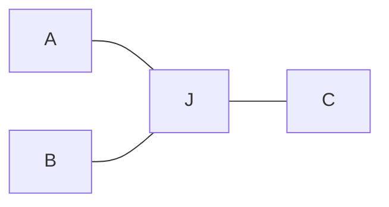

# Pipe Smooth Roadmap

Downstream of discrete multi-group pipe routing (`pipe_design`): topology and coarse paths are given; this module refines geometry under permanent occupancy.

---

## 1. Problem definition

### 1.1 Setting

**Input (fixed):**

- Domain $\Omega$: static obstacles + committed other-group pipes (permanent clearance).
- Layout $(\mathcal{T}, P)$: connected graph per group (typically a tree) with a coarse polyline/grid embedding $P$.
- Usages $\mathcal{U}$: directed terminal–terminal flows to cost (e.g. $A\!\to\!C$, $B\!\to\!C$, $A\!\to\!B$).
- Radii / port clamps (optional end tangents).

**Output:**

- Refined centerlines (and tubular solids) that keep $\mathcal{T}$’s connectivity; junctions may split locally (cond2) if usages stay connected.

**Non-goals:** topology replanning / cross-group conflict search; hard $\kappa_{\max}$ when free space forces sharp bends.

### 1.2 Objective

> Given topology $\mathcal{T}$ and a feasible coarse layout, refine the geometric embedding so that a **weighted soft cost** over declared usages is minimized, subject to **hard geometric constraints**.

Formally (sketch; full discrete costs in §6.4):

$$
\min_{X}
\;
J_{\mathrm{path}}(X)+J_{\mathrm{clear}}(X)+J_{\mathrm{union}}(X)
\quad
\text{s.t. ports, }\mathcal{T}\text{, interface }C^{0}/C^{1}\text{ by construction.}
$$

| Symbol | Role | Soft / hard |
|--------|------|-------------|
| $X$ | Centerline parameters (shared trunk + private junction controls) | decision |
| $L,K$ | Manifold length (each Hermite **once**) + curvature (seg interiors **once**, usage **joints** once) (§6.4.1) | soft |
| $J_{\mathrm{clear}}$ | Obstacle + cross-group tube separation (§6.4.2) | soft in loop; **hard** at accept |
| $J_{\mathrm{union}}$ | Junction-bundle compactness via sample Chamfer (§6.4.3) | soft |
| Topology / ports / interface | Connectivity, fixed ends, $C^{0}/C^{1}$ clamps | **hard** (by construction) |

**Why usages matter:** shared trunk nodes couple directions. Optimizing only shared polylines can make $A \to C$, $B \to C$ smooth while $A \to B$ stays sharp. Usages $\mathcal{U}$ still drive **path assembly**, **junction private DOF**, **union**, and **which segment–segment joints** enter $K$; Stage 1 does **not** naively $\sum_u L_u$ (that multi-counts shared trunk material)—see §6.4.1.

**Feasibility first:** if free space is tight, large local curvature is allowed; $K$ only ranks feasible designs.

### 1.3 Diff. vs normal path smoothing

Classical path / trajectory smoothing (robotics TEB/CHOMP, single B-spline fairing) usually: **one** open curve, **temporary** agent footprint, cost along **that** curve only. Ours differs:

| Aspect | Normal path smoothing | This problem |
|--------|----------------------|--------------|
| Occupancy | Pass-and-release (time / moving agent) | **Permanent** tubes stay; clearance is static geometry |
| Structure | Single $s$–$t$ line | **Tree / branched** manifold: $n\!\ge\!3$ joins, and nearby branch points on one trunk (short shared segments) |
| Cost scope | One path’s length / curvature | **Usage-assembled** paths; $L$ once per shared piece, $K$ covers all usage joints (§6.4.1) |
| Geometry | Often centerline / thin agent | Finite **radius** capsules; self- and cross-group volume |
| Domain | Often open or mild | Tight $\Omega$ → large $\kappa$ may be necessary (soft $K$) |
| Ends | Usually fixed $s,t$ (pose optional) | Fixed ports **plus** line-axis alignment (terminal sits on / along a prescribed axis) |

**Direction / usage example (Y-junction).**

Topology (fixed) and usages $\mathcal{U}=\{A\!\to\!C,\; B\!\to\!C,\; A\!\to\!B\}$:



**cond1 — shared node $J$:** $A\!\to\!C$ and $B\!\to\!C$ are arc + shared straight trunk; all branches meet at one point. Good $\angle AC$, $\angle BC$ forces a hairpin $\angle AB$ on $A\!\to\!B$.


**cond2 — local split:** $A\!\to\!C$, $B\!\to\!C$ keep the same arc + straight geometry as cond1; add a dedicated $A\!\to\!B$ arc. Dashed triangle = void at join (no single shared $J$).


| | cond1 | cond2 |
|---|--------|--------|
| Geometry at join | 1 shared point $J$ | same A/C, B/C trunks + A-&gt;B arc + void |
| $A\!\to\!C$, $B\!\to\!C$ | arc + straight | **same** as cond1 |
| $A\!\to\!B$ | forced sharp at $J$ | dedicated arc; good |
| $\mathcal{T}$ | preserved | preserved (connectivity; not point-set equality) |

So the core gap is not “smoother spline fitting,” but **topology-preserving, multi-usage geometric refinement under permanent tubular occupancy**.

### 1.4 Method families to survey

Options to check before locking representation / solver (not commitments). Soft $\kappa$ preference unless noted.

| Method | Why relevant |
|--------|----------------|
| Per-edge variational splines + ADMM coupling | Fits tree + usages: one spline per edge/usage; soft agreement on shared trunks, private DOF near joins |
| Clothoid / Dubins transitions | Local primitives with explicit $\kappa$ profiles; useful for preferred bend radius (soft or hard only if space allows) |
| Elastic rod / bending energy $\int\kappa^2\,\mathrm{d}s$ | Classical global fairing; strong candidate for soft $K$ |
| CHOMP / STOMP / TEB / TrajOpt | Obstacle-aware continuous refinement; adapt from single trajectory to permanent tubes + branched $\mathcal{T}$ |
| Multi-objective optimization (Pareto / scalarization / MOEA) | Native fit for $L$,$K$,$S$ trade-offs; avoids one brittle $(\alpha,\beta,\gamma)$; report fronts under hard clearance |
| RL / multi-agent multi-objective (MORL; policy over junction/trunk edits) | Survey for sequential refine or discrete junction choices; weaker default for dense continuous control + hard tubes |
| Topology / shape / PDE-constrained opt. (fluid) | If objective later moves from geometric $S$ to pressure-drop / streamline quality |
| B-spline / other parametric curves (NURBS, Hermite, …) | Baseline centerline representation; easy $L$,$\kappa$, clearance sampling (current codebase) |

**Open questions for definition (to resolve later):**

1. Exact definition of soft $K$ (bend energy vs threshold vs both).
2. How much junction splitting is allowed while still “preserving $\mathcal{T}$”.
3. Weights $\alpha,\beta$ vs multi-objective Pareto reporting.
4. Same-group contact: **default allow** (3D-print union); optional weak same-usage fold only (§6.4.2).

### 1.5 Computational stack (gradient / AD / PDE / symbolic)

Refinement is **gradient-centric**. Objectives stay swappable, so differentiation tooling is part of the problem setup—not one library for everything. Layers:

| Layer | Role | When / notes |
|-------|------|----------------|
| Gradient-based update | Drive continuous $X$ (controls, junction patches) under soft $L,K$ + hard clearance | Default solve path for geometry refine |
| Automatic differentiation (AD) | Swap / compose objectives without hand gradients; backprop through sampling of $L$,$\kappa$ | **Default for geometric costs**; fits flexible / multi-objective scalarizations |
| PDE solve (forward) | Evaluate physics-based terms (e.g. flow, pressure drop) when objectives leave pure geometry | **Optional physics layer**; not required in the early geometric loop |
| Adjoint / PDE-constrained gradients | $\partial J/\partial X$ through FEM/CFD without full-graph AD on the PDE | Prefer over blanket AD when the forward model is a large linear/nonlinear system |
| Symbolic math | Derive exact expressions (curvature, B-spline bases, weak form, adjoint) → assemble sparse matrices / codegen kernels | Up-front derivation & FEM adjoint construction; not per-experiment objective hacking |

**Division of labor:** AD for pluggable geometry objectives; symbolic → matrices for structure/adjoint once; PDE+adjoint only when the objective truly needs physics.

**Priority:** stabilize geometry AD + hard constraints first; add PDE/adjoint and symbolic codegen when pressure-drop / streamline metrics become first-class.

---

## 2. Processing pipeline

Valve fluid pipes: discrete layout (`pipe_design` / classical stack) → `pipe_smooth` refine → CAD/FEM → physics polish. Stages do **not** share one representation or one objective.

```text
pipe_design  →  (𝒯, P, radii, ports)
      ↓
Stage 1  Centerline smooth     [geometry, JAX AD]
      ↓  parametric X
Stage 2  OCC solid + mesh      [CAD bridge]
      ↓  FEM-ready model
Stage 3  Shape / PDE opt       [adjoint FEM]
      ↓
high-performance design (+ re-export CAD)
```

| Stage | What | Objective | Hard constraints | Tooling |
|-------|------|-----------|------------------|---------|
| **0** Upstream | Multi-group routing | Feasibility | Clearance, topology | CBS/PBS/PP (`pipe_design`) |
| **1** Centerline | Hybrid trunk-share + junction-split; TEB/CHOMP-style soft refine | Soft $L,K$ per $\mathcal{U}$ | Clearance, $\mathcal{T}$, port axes | Python + JAX |
| **2** CAD / mesh | Sweep/loft tubes from parametric $X$; quality checks | Watertight solid + mesh | No self-intersection; port faces/axes | OpenCASCADE → mesh |
| **3** Physics polish | Parametric / shape opt on FEM fluid model | Pressure drop, flow quality (MOO) | Manufacturability, clearance | PETSc + deal.II\|MFEM + adjoint |

**Rules:**

- Stage 1 outputs **parametric** centerlines (not a dead polyline); Stage 2–3 must map back to the same parameters (or a controlled CAD feature set).
- Geometry first, physics later: Stage 1 does **not** call FEM each step; Stage 3 starts from Stage 1–2 as initial design with **limited DOF**.
- Topology changes → return to Stage 0; Stage 1–3 preserve connectivity.
- Usages $\mathcal{U}$ apply in Stage 1 costs and Stage 3 operating cases.

---

## 3. Methods to check

Candidate geometric parameterizations / refinement schemes. Entries are options to evaluate, not commitments.

1. **Hybrid trunk-share + junction-split**  
   Partition each usage centerline into **trunk** and **junction** zones (near degree $\ge 3$ nodes).  
   - **Trunk:** usages that share a tree edge use the **same** control points (hard equality / shared variables).  
   - **Junction:** each usage $u \in \mathcal{U}$ has **private** control points so local geometry can split (cond2).  
   - **Interface:** hard $C^0$ (shared endpoints); prefer hard $C^1$ (end tangents / clamped controls) by construction, not soft continuity costs.  
   - **Rationale:** adds DOF only where multi-usage curvature conflicts; avoids a trunk soft-coupling term and keeps the dry-pipe manifold exact on trunks.  
   - **Process:** Stage 1 pipeline **version 1** in §6; **version 2** (analytic $\kappa$) in §7.

<!-- Add further candidates below as numbered items. -->

---

## 4. Auxiliary

Background notions used when reading objectives / method notes. Entries are definitions, not commitments.

1. **Elastic rod / bending energy $\int \kappa^2\,ds$**  
   Treat the centerline as a thin elastic rod; bending energy is the soft smoothness objective  
   $$
   E_{\mathrm{bend}} = \int_{0}^{L} \kappa(s)^{2}\, ds
   $$  
   where $s$ is arc length, $\kappa(s)$ is curvature, and $L$ is total length.  
   - **Meaning:** larger local $\kappa$ costs more; minimizing $E_{\mathrm{bend}}$ spreads bends and reduces sharp corners under fixed ends / junction constraints.  
   - **Full rod model (optional):** torsion and stretch terms exist; for pipe centerlines the bending term usually dominates.  
   - **Vs TEB-style peak penalty:** TEB mainly suppresses large $\kappa$ at samples; $\int\kappa^2\,ds$ is a global fairing energy (may lengthen the path → pair with $L$).  
   - **With B-splines:** approximate $E \approx \sum_i \kappa_i^{2}\,\Delta s_i$ on samples, then differentiate w.r.t. control points.  
   - **Aggregation:** Stage 1 sums segment interiors + usage joints once each (§6.4.1); not a naive $\sum_u$ over full usage polylines.
   - **Caveat:** geometric proxy for “smoothness,” not exact hydraulic loss.

2. **CHOMP** (Covariant Hamiltonian Optimization for Motion Planning)  
   Local refinement of one trajectory $\xi$ by covariant gradient descent on
   $$
   U(\xi)=U_{\mathrm{smooth}}(\xi)+\lambda\,U_{\mathrm{obs}}(\xi).
   $$  
   - **Smooth:** $U_{\mathrm{smooth}}=\frac12\int\|\ddot\xi(t)\|^2\,dt$ (discrete: $\frac12\xi^\top A\xi$, $A=K^\top K$ from second differences). Penalizes **velocity-vector** change $v_i-v_{i-1}$, not scalar length gaps $\ell_i-\ell_{i-1}$; corners raise $\|a\|$, so curvature is affected.  
   - **Obstacle:** field $c(x)$ (high near / inside obstacles) integrated along the body / swept path, typically $\times\|\dot x\|$.  
   - **Process:** soft penalties + Riemannian GD (no explicit SQP / constraint QP):
     1. start from an initial $\xi_0$;
     2. evaluate $\nabla U_{\mathrm{smooth}}=A\xi$ and $\nabla U_{\mathrm{obs}}$ from the distance field;
     3. covariant update $\xi\leftarrow\xi-\eta A^{-1}\nabla U$;
     4. repeat until converged.  
   - **Caveat:** single open trajectory, temporary footprint; not tree + per-usage costs.

3. **TrajOpt**  
   Cast **all waypoints of the whole trajectory as one nonlinear program**, then solve it by **sequential convexification** (SQP-like): each outer iteration builds a convex approximation around the current $\xi$ and solves a QP / SOCP.  
   - **Variables:** the full discrete path (and optional times / controls) in one vector.  
   - **Objective:** usually quadratic smooth terms (velocity / acceleration) plus hinge collision penalties.  
   - **Constraints:** collision via signed distance; nonconvex parts are linearized / convexified in a trust region about the current iterate.  
   - **Process:** each iteration **re-solves an optimized subproblem** (unlike CHOMP’s single gradient step):
     1. initialize $\xi$;
     2. form one complete problem over all waypoints;
     3. linearize / convexify at $\xi$;
     4. solve the convex subproblem for a step $\Delta\xi$;
     5. accept / reject under trust-region rules;
     6. repeat.  
   - **Vs CHOMP:** same “smooth + collision” goal; TrajOpt is constraint-oriented sequential convex, often sharper on collisions.  
   - **Caveat:** still typically one configuration chain; junction / multi-usage DOF must be modeled separately.

4. **STOMP** (Stochastic Trajectory Optimization for Motion Planning)  
   Same soft goals as CHOMP ($U_{\mathrm{smooth}}+U_{\mathrm{obs}}$), but **derivative-free**: explore by noisy samples around the current trajectory, then merge them by **cost-weighted averaging** (closer to CEM / evolutionary strategies than to PSO voting).  
   - **Process:**
     1. keep a mean trajectory $\bar\xi$;
     2. draw $N$ noisy candidates $\xi^{(k)}=\bar\xi+\epsilon^{(k)}$ (structured multivariate noise);
     3. evaluate $U(\xi^{(k)})$ for each (no $\nabla U$ needed);
     4. map costs to probabilities (low cost $\Rightarrow$ high weight);
     5. update $\bar\xi$ as the weighted mean of samples;
     6. repeat.  
   - **Vs PSO:** PSO keeps many particles with personal/global best velocities; STOMP keeps one mean and merges a fresh noise cloud each iteration by soft weights—not discrete “votes.”  
   - **Pros / cons:** handles non-smooth or black-box costs and explores more than pure GD; usually slower / noisier than CHOMP or TrajOpt.  
   - **Caveat:** same single-path scope limitation as CHOMP for our branched-pipe setting.

<!-- Add further auxiliary items below as numbered items. -->

---

## 5. Design considerations

Brief decisions / trade-offs for Stage 1–3. Entries are commitments unless marked open.

1. **Do not skip centerline for direct shape optimization**  
   Coarse path → CAD → PDE shape opt is **not** a substitute for Stage 1.  
   - Raw / grid paths yield sharp junctions (cond1), weak clearance margins, and often non-manifold or self-intersecting sweeps—bad FEM initial designs.  
   - Free-wall / mesh shape opt does not invent junction split (cond2); without explicit local DOF it stays near a shared-node embedding.  
   - Per-step FEM is orders of magnitude costlier than geometric $L,K$ + hard clearance; physics should polish, not discover feasible centerlines.  
   - Unrestricted shape DOF fights ports, cross-group clearance, and manufacturability; Stage 3 needs **limited** parameters inherited from Stage 1–2.  
   - **Rule:** geometry conflicts (multi-usage, trunk/junction, permanent tubes) in Stage 1; fluid metrics in Stage 3 on the same parametric $X$.

<!-- Add further considerations below as numbered items. -->

---

## 6. Hybrid trunk-share + junction-split (version 1)


| | Content |
|--|---------|
| **In** | Tree $\mathcal{T}$ with coarse embedding $P$; usages $\mathcal{U}$; radii; port positions / axis clamps; obstacle + other-group tubes in $\Omega$ |
| **Out** | Parametric centerlines $X$: shared trunk controls + per-usage junction controls; sampled tubes for QA |
| **Preserve** | Connectivity of $\mathcal{T}$; every $u\in\mathcal{U}$ remains routable; ports fixed |

### 6.1 Tree from grid topology

1. Take per-group coarse paths (grid / polyline) and declared $\mathcal{U}$.  
2. Deduplicate spatial nodes; build an undirected **tree** (or forest) $\mathcal{T}$: edges = discrete segments between branch / terminal nodes.  
3. Record per-edge coarse polylines, radii, and which usages traverse each edge.

### 6.2 Junction complexes, partition, and variables

One stage: grow junction regions on $\mathcal{T}$, then assign shared vs private parametric DOF. Goal: private DOF only inside complexes; everywhere else is shared trunk.

**A. Grow zones / complexes**

1. **Seed:** all nodes with degree $\ge 3$.  
2. **Grow zone (tree path length):** a node (or sample along an edge) belongs to a seed’s zone if its tree-path length to that seed is $< \tau$, with  
   $\tau = \max(\tau_0,\; \alpha\, r_{\mathrm{local}},\; \beta\, R_{\mathrm{bend}})$.  
3. **Complex merge:** if seeds are near (tree or Euclidean), or the trunk between them is shorter than $\tau_{\mathrm{trunk}}$ / fully covered by overlapping zones, merge into one **junction complex**. Short trunks inside are labeled junction, not trunk-share.  
4. **Per-complex record $Z$:** terminals (exits into true trunk / group ports); interior edges; **interface points** (with trunk-side tangents); $\mathcal{U}_Z\subseteq\mathcal{U}$ usages that cross $Z$.


**B. Region → geometry → variables → continuity** (single layout)

| Region | Geometry role | Variables | Sharing | Continuity |
|--------|---------------|-----------|---------|------------|
| **Trunk** | Edges / portions **outside** all complexes | Cubic B-spline (or equiv.) controls | **Same** $X_{\mathrm{trunk}}$ for all usages on that edge | Intrinsic to the shared curve |
| **Junction** | Interior of complex $Z$ | Short patch per $u\in\mathcal{U}_Z$ (B-spline / Hermite) | **Private** $X_{\mathrm{junc},u}$ | Meets trunk at interface |
| **Interface** | Complex boundary on trunk side | Shared endpoints (+ clamped end controls) | Equality-tied to trunk | Hard $C^0$; prefer hard $C^1$ (end tangents / clamped controls) **by construction**, not soft loss |
| **Ports** | Group terminals | Fixed or axis-constrained | Not free | Hard clamps |

- Private patches **only for declared** $\mathcal{U}_Z$ (e.g. $A\!\to\!B$, $A\!\to\!C$, $B\!\to\!C$), not every terminal pair.  
- Keep junction patches **low-dimensional** (typically 1–2 interior controls).  
- Exported $X$ is parametric; dense waypoints are for sampling / costs only.  
- **Init:** coarse embedding (cond1-like); optional continuation unlocking junction DOF then raising $J_{\mathrm{union}}$.

### 6.3 Usage path assembly

For each $u\in\mathcal{U}$:

1. Walk $\mathcal{T}$ from $u$’s start terminal to end.  
2. Outside complexes: sample the **shared** trunk curve.  
3. Inside complex $Z$: sample the **private** junction patch $X_{\mathrm{junc},u}$.  
4. Concatenate samples (drop duplicate interface points) → path point sequence $\gamma_u$ and radii $r_u$.

All soft geometric costs below are evaluated on **path samples** $\gamma_u$, not on raw control points.

### 6.4 Cost functions

All geometric costs are defined on **path samples**, then differentiated w.r.t. parametric controls in $X$ through the sampler (JAX AD). Control points do **not** enter the loss directly except via $\gamma(X)$.

For each usage $u\in\mathcal{U}$, assemble (§6.3)

$$
\gamma_u=\{x_{u,i}\}_{i=0}^{N_u-1},\quad
r_{u,i}>0,\quad
w_{u,i}\ge 0,
$$

where $x_{u,i}\in\mathbb{R}^3$ are centerline samples, $r_{u,i}$ tube radii, and $w_{u,i}$ an **importance weight** interpolated from tree-edge (or control) weights onto samples.

Segment lengths and unit tangents (edges $i=0,\ldots,N_u-2$; interior nodes $i=1,\ldots,N_u-2$):

$$
\begin{aligned}
\Delta s_{u,i}
&=\|x_{u,i+1}-x_{u,i}\|_2,
\qquad
t_{u,i}
=\frac{x_{u,i+1}-x_{u,i}}{\Delta s_{u,i}+\varepsilon},
\qquad
\Delta \ell_{u,i}
=\tfrac12(\Delta s_{u,i-1}+\Delta s_{u,i}).
\end{aligned}
$$

**Turning angle** (for bending energy; **do not** use $\arccos(t\cdot t)$ — its derivative blows up as $\cos\to 1$):

$$
\theta_{u,i}
=
\mathrm{atan2}\big(
\|t_{u,i-1}\times t_{u,i}\|_2,\;
t_{u,i-1}\cdot t_{u,i}
\big)
\in[0,\pi].
$$

**Menger curvature** (circumcircle $1/R$ through three consecutive samples; for pointwise / threshold penalties):

$$
\kappa_{u,i}^{\mathrm{M}}
=
\frac{
2\big\|
(x_{u,i}-x_{u,i-1})\times(x_{u,i+1}-x_{u,i})
\big\|_2
}{
\|x_{u,i}-x_{u,i-1}\|_2\,
\|x_{u,i+1}-x_{u,i}\|_2\,
\|x_{u,i+1}-x_{u,i-1}\|_2
+\varepsilon
}.
$$


**Analytic curvature of a parameterized curve**:

Let $\gamma(t)=\big(x(t),\,y(t),\,z(t)\big)$ be regular ($\gamma'\neq 0$), with $\gamma'=\mathrm{d}\gamma/\mathrm{d}t$, $\gamma''=\mathrm{d}^{2}\gamma/\mathrm{d}t^{2}$.

***General parameterization (3D)***

$$
\kappa(t)
=
\frac{
\big\|
\gamma'(t)\times\gamma''(t)
\big\|_2
}{
\big\|\gamma'(t)\big\|_2^{3}
}.
$$

Component form:

$$
\kappa
=
\frac{
\sqrt{
(y'z''-z'y'')^{2}
+(z'x''-x'z'')^{2}
+(x'y''-y'x'')^{2}
}
}{
(x'^{2}+y'^{2}+z'^{2})^{3/2}
}.
$$

***Planar special case***

If $\gamma(t)=(x(t),y(t))$:

$$
\kappa(t)
=
\frac{
\big|x'(t)y''(t)-y'(t)x''(t)\big|
}{
\big(x'(t)^{2}+y'(t)^{2}\big)^{3/2}
}.
$$


**Soft hinge / softplus (smooth, AD-friendly):**

$$
[z]_+^\sigma=\sigma\log\big(1+e^{z/\sigma}\big)
\quad(\sigma>0\text{ small}).
$$

**Scalar objective:**

$$
J(X)=
J_{\mathrm{path}}(X)
+J_{\mathrm{clear}}(X)
+J_{\mathrm{union}}(X).
$$

Ports, topology, and interface $C^0/C^1$ are **hard by construction** (not in $J$). Clearance is soft in $J$ and **hard-checked** after solve.

#### 6.4.1 Path costs $J_{\mathrm{path}}$

**Production aggregation** (Hermite graph; matches `graph_length` / `graph_curvature`):

$$
J_{\mathrm{path}}
=
\alpha\,L
+\beta\,K,
\qquad
L
=
\sum_{e\in\mathcal{E}}
L_e,
\qquad
K
=
\sum_{e\in\mathcal{E}}
K_e^{\mathrm{int}}
+
\sum_{\{e,e'\}\in\mathcal{J}}
K_{e,e'}^{\mathrm{joint}}.
$$

| Symbol | Meaning |
|--------|---------|
| $\mathcal{E}$ | Hermite segments (trunk + junction); each **once** |
| $L_e$ | Sampled length of segment $e$ (same discrete $L$ as below on that piece) |
| $K_e^{\mathrm{int}}$ | Interior bend on $e$ only (polyline $k_*$ or analytic $k_{\mathrm{hermite}}$) |
| $\mathcal{J}$ | Unordered joints $\{e,e'\}$ discovered by walking usages; `seen_joint` |
| $K_{e,e'}^{\mathrm{joint}}$ | One interface turn (e.g. 3-point window $\mathrm{prev}[-2:]\mathbin{++}\mathrm{xyz}[1:2]$) |

**Why not $\sum_u L_u$:** shared trunk is one physical centerline; summing per usage multiplies its length by how many flows use it and over-pulls the trunk. **Why still walk usages for $K$:** Y-junction conflicts live at **which segments meet**; every distinct joint must enter $K$ once even if a shared segment’s interior was already scored.

Discrete kernels below define $L$ / bend on a point sequence (one segment, one joint window, or a full $\gamma_u$ if debugging). Optional per-usage weights $(\alpha_u,\beta_u)$ are **not** the Stage 1 default.

**(1) Length** (on a sample chain)

$$
L
=
\sum_{i}
\bar w_{i}\,\Delta s_{i},
\qquad
\bar w_{i}=\tfrac12(w_{i}+w_{i+1}).
$$

Optional excess-length vs a reference $L^{0}$: $L^{\mathrm{ex}}=[L-L^{0}]_+^\sigma$. Default Stage 1: plain $L$ over $\mathcal{E}$.

**(2) Curvature** (soft preference, not hard $\kappa_{\max}$; **radius-aware**)

Same centerline bend is worse for a fatter tube. Stage 1 uses the dimensionless bend measure $\kappa r$ (manufacturing bend ratio), not bare $\kappa$. Structural stiffness $\sim r^{4}$ is **out of scope** here.

On each Hermite segment / joint window, the discrete proxies below apply (implementation: `k_bend`, `k_menger`, …). **Aggregate** with $K_e^{\mathrm{int}}$ + $K_{e,e'}^{\mathrm{joint}}$ as above—not $\sum_u K_u$ over full usage polylines (that multi-counts shared interiors).


$$
\int \kappa(s)^{2}\,\mathrm{d}s
=
\int
\left(\frac{\mathrm{d}\theta}{\mathrm{d}s}\right)^{2}
\mathrm{d}s.
$$

Piecewise (constant $\kappa$ on a short span, $\Delta\theta=\kappa\,\Delta s$):

$$
\int_{\Delta s}\kappa^{2}\,\mathrm{d}s
=
\frac{(\Delta\theta)^{2}}{\Delta s}.
$$

Per-sample radius and dimensionless curvatures:

$$
\begin{aligned}
\tilde\theta_{u,i}
&=
\theta_{u,i}\, r_{u,i},
\qquad
\tilde\kappa_{u,i}
&=
\kappa_{u,i}^{\mathrm{M}}\, r_{u,i},
\qquad
c_{\mathrm{pref}}
=
\frac{r}{R_{\mathrm{bend}}^{\mathrm{pref}}}
\;\text{(typical constant, e.g. }1/n\text{)}.
\end{aligned}
$$

Use local $r_{u,i}$ along the path (variable radius OK). Split into **bending energy** (turning angle) and optional **threshold** (Menger):

$$
\begin{aligned}
K_u^{\mathrm{bend}}
&=
\sum_{i=1}^{N_u-2}
w_{u,i}\,
\frac{\tilde\theta_{u,i}^{2}}{\Delta \ell_{u,i}+\varepsilon}
=
\sum_{i=1}^{N_u-2}
w_{u,i}\,
\frac{(\theta_{u,i}\, r_{u,i})^{2}}{\Delta \ell_{u,i}+\varepsilon},
\\[0.5em]
K_u^{\mathrm{thr}}
&=
\sum_{i=1}^{N_u-2}
w_{u,i}\,
\big[\tilde\kappa_{u,i}-c_{\mathrm{pref}}\big]_+^\sigma{}^{2}
\,\Delta \ell_{u,i}
=
\sum_{i=1}^{N_u-2}
w_{u,i}\,
\big[\kappa_{u,i}^{\mathrm{M}} r_{u,i}-c_{\mathrm{pref}}\big]_+^\sigma{}^{2}
\,\Delta \ell_{u,i},
\\[0.5em]
K_u
&=
K_u^{\mathrm{bend}}
+\rho\,K_u^{\mathrm{thr}}.
\end{aligned}
$$

| Piece | Discrete proxy | Why |
|-------|----------------|-----|
| $K^{\mathrm{bend}}$ | $(\theta\, r)^{2}/\Delta\ell$, $\theta=\mathrm{atan2}(\|\times\|,\cdot)$ | $\approx\int(\kappa r)^{2}\,\mathrm{d}s$; thicker pipe → higher cost at same $\theta$ |
| $K^{\mathrm{thr}}$ | softplus on $\kappa^{\mathrm{M}} r$ vs $c_{\mathrm{pref}}$ | dimensionless bend-ratio threshold |
| Avoid | $\theta=\arccos(t\cdot t)$; bare $\kappa$ without $r$ | AD singularity; unfair across radii |

**MVP shortcut:** replace $\theta^{2}$ by $\|t_{u,i}-t_{u,i-1}\|_2^{2}=4\sin^{2}(\theta/2)$, still multiply by $r_{u,i}^{2}$ (no `atan2`; same small-angle behavior).

Equivalent view of the threshold: $\kappa_{\mathrm{pref},i}=c_{\mathrm{pref}}/r_{u,i}$ (larger radius $\Rightarrow$ lower allowed centerline $\kappa$). If free space forces sharper bends, $K$ stays finite—feasibility is left to clearance, not a hard $\kappa$ cap.

**(3) Importance weight line**

- Assign a scalar weight per tree edge (or per trunk/junction control).  
- Interpolate to samples $\rightarrow w_{u,i}$.  
- Use $w$ only inside $L,K$ (not inside clearance / union, unless intentionally biased).

#### 6.4.2 Clearance $J_{\mathrm{clear}}$

Tube–obstacle and tube–tube gaps use the same hinge on **signed clearance residual**. For two capsules / balls with centers $a,b$ and radii $r_a,r_b$, required separation $d_{\mathrm{req}}=r_a+r_b+\delta_{\mathrm{margin}}$:

$$
\phi(a,b;r_a,r_b)
=
\big[
d_{\mathrm{req}}-\|a-b\|_2
\big]_+^\sigma{}^{2}.
$$

**(1) Obstacle conflict**

Let obstacle samples (or sphere covers) be $\{(o_j,r_j^{\mathrm{obs}})\}$. Sum over path samples that are not fixed ports:

$$
J_{\mathrm{obs}}
=
\mu_{\mathrm{obs}}
\sum_{u\in\mathcal{U}}
\sum_{i\in\mathcal{I}_u^{\mathrm{free}}}
\sum_{j\in\mathcal{N}(x_{u,i})}
\phi\big(x_{u,i},o_j;\,r_{u,i},r_j^{\mathrm{obs}}\big).
$$

$\mathcal{N}(x)$ is a neighbor set from a radius query (KD-tree); refreshed every $k$ iterations.

**(2) Cross-group conflict**

For group $g\neq g'$, path samples of group $g$ vs group $g'$:

$$
J_{\mathrm{grp}}
=
\mu_{\mathrm{grp}}
\sum_{g<g'}
\sum_{u\in\mathcal{U}_g}
\sum_{v\in\mathcal{U}_{g'}}
\sum_{(i,j)\in\mathcal{P}_{u,v}}
\phi\big(x_{u,i},x_{v,j};\,r_{u,i},r_{v,j}\big).
$$

$\mathcal{P}_{u,v}$ = active near pairs from broadphase.

**(3) Same-group contact** (default: **off**)

Usages in one group are **operating cases** (typically one active at a time), not mutually exclusive solids. Parts are **3D-printed**: Stage 2 may boolean-union same-group tubes into one manifold. Therefore same-group centerline overlap / crossing is **allowed** by default (shared trunks, cond2 bundles, and even path crossings as in a printed multi-channel body).

- Do **not** treat shared-trunk coincidence, junction-union proximity, or same-group crossings as illegal.  
- Clearance budget stays on **obstacles** and **other groups**.  
- Optional later: a weak same-usage self-contact term only for a single $\gamma_u$ folding on itself at long arc-length separation (print wall thickness); **default** $\mu_{\mathrm{self}}=0$ so $J_{\mathrm{self}}$ is omitted in MVP.

$$
J_{\mathrm{self}}
=
\mu_{\mathrm{self}}
\sum \phi(\cdot)
\quad\text{(optional; }\mu_{\mathrm{self}}=0\text{ by default)}.
$$

**Total soft clearance**

$$
J_{\mathrm{clear}}
=
J_{\mathrm{obs}}+J_{\mathrm{grp}}+J_{\mathrm{self}}.
$$

After optimization: compute max penetration $\max(d_{\mathrm{req}}-\|a-b\|)$; **accept only if** $\le 0$ (or $\le \epsilon_{\mathrm{tol}}$). Else raise $\mu$ / tighten and re-solve.

#### 6.4.3 Junction union $J_{\mathrm{union}}$

Private junction patches are under-determined under $L,K$ alone. $J_{\mathrm{union}}$ pulls co-located usage tubes in each complex $Z$ toward a **compact bundle** (smaller union volume for CAD / Stage 3).

Let $\gamma_u^{Z}=\{x_{u,i}:i\in\mathcal{I}_u^{Z}\}$ be samples of usage $u$ **inside** complex $Z$, and $\mathcal{U}_Z$ the usages through $Z$.

**Symmetric Chamfer on centerlines** (radius-scaled threshold)

Large separation inside $Z$ is often a **real branch** (cond2), not a bundling failure. Use a pairwise cutoff so union acts only while centerlines are still “the same bundle”:

$$
d_{\mathrm{hi}}(x_{u,i},\gamma_v)
=
\alpha\,(r_{u,i}+r_{v,\star}),
\qquad
\psi(d;d_{\mathrm{hi}})
=
\begin{cases}
d^{2} & d < d_{\mathrm{hi}}, \\
0 & d \ge d_{\mathrm{hi}},
\end{cases}
$$

with $r_{v,\star}$ the radius at the nearest sample on $\gamma_v$, and $\alpha\sim O(1)$ an open knob.  
**Root $\to$ branch without an explicit root field:** near the join, usages stay within $d_{\mathrm{hi}}$ so Chamfer keeps pulling (bundle core); as paths split, $d$ exceeds the local radius scale and $\psi=0$ (force releases along the branch). Same rule works in multi-seed complexes—no single seed weight required.

$$
\begin{aligned}
d(x,\gamma)
&=
\min_{y\in\gamma}\|x-y\|_2,
\qquad
\Delta s_{u,i}
=
\tfrac12\big(\|x_{u,i}-x_{u,i-1}\|_2+\|x_{u,i+1}-x_{u,i}\|_2\big),
\\[0.4em]
\mathrm{Ch}(\gamma_u^{Z},\gamma_v^{Z})
&=
\sum_{i\in\mathcal{I}_u^{Z}}
\psi\big(d(x_{u,i},\gamma_v^{Z});\,d_{\mathrm{hi}}(x_{u,i},\gamma_v^{Z})\big)\,
\Delta s_{u,i}
\;+\;
\sum_{j\in\mathcal{I}_v^{Z}}
\psi\big(d(x_{v,j},\gamma_u^{Z});\,d_{\mathrm{hi}}(x_{v,j},\gamma_u^{Z})\big)\,
\Delta s_{v,j},
\\[0.4em]
J_{\mathrm{union}}
&=
\lambda
\sum_{Z}
\sum_{\{u,v\}\subset\mathcal{U}_Z}
\mathrm{Ch}(\gamma_u^{Z},\gamma_v^{Z}).
\end{aligned}
$$

Optional tube-aware residual (encourage overlap of solids, not only centerlines):

$$
d^{\mathrm{tube}}(x_{u,i},\gamma_v)
=
\big[
d(x_{u,i},\gamma_v)-(r_{u,i}+r_{v,\star})
\big]_+^\sigma,
$$

with $r_{v,\star}$ the radius at the nearest sample on $\gamma_v$; substitute $d^{2}$ by $(d^{\mathrm{tube}})^{2}$ in $\mathrm{Ch}$ if desired.


**Balance:** large $\lambda$ collapses toward cond1 (sharp $A\!\to\!B$); small $\lambda$ allows fat non-overlapping bows. Tune against $K_u$ on the sharpest usage; prefer continuation (raise $\lambda$ after junction DOF are unlocked).

**Do not** use unpaired control-point distances as the primary union term.


### 6.5 Trajectory representation


#### 6.5.1 polynomial (Hermite)

**Idea:** optimize $G^{1}$ nodes $(p,v)$ (position + unit tangent); each trunk/junction segment is a polynomial fixed by its two end nodes. Shared nodes $\Rightarrow$ hard $C^{0}/C^{1}$ by construction. Plug $\gamma',\gamma''$ into §7.1 for analytic $\kappa$.

**Cubic Hermite** on $t\in[0,1]$, ends $(p_0,v_0)$, $(p_1,v_1)$, scales $\sigma_0,\sigma_1>0$ (tangent magnitudes):

$$
\gamma(t)
=
H_{00}(t)\,p_0
+ H_{10}(t)\,(\sigma_0 v_0)
+ H_{01}(t)\,p_1
+ H_{11}(t)\,(\sigma_1 v_1),
$$

$$
\begin{aligned}
H_{00}(t) &= 2t^{3}-3t^{2}+1, \\
H_{10}(t) &= t^{3}-2t^{2}+t, \\
H_{01}(t) &= -2t^{3}+3t^{2}, \\
H_{11}(t) &= t^{3}-t^{2}.
\end{aligned}
$$

Then $\gamma(0)=p_0$, $\gamma(1)=p_1$, $\gamma'(0)=\sigma_0 v_0$, $\gamma'(1)=\sigma_1 v_1$.


#### 6.5.2 circular arc

**Idea:** same $G^{1}$ nodes $(p,v)$, but each segment is a **circular arc** (straight = $R\to\infty$). Unlike Hermite, an arbitrary pair $(p_0,v_0)$, $(p_1,v_1)$ is **not** always an arc — consecutive nodes must satisfy a **hard arc-feasibility constraint** (TEB-style kinematics, lifted to 3D geometry). Then $\kappa\equiv 1/R$ (or $0$).

**2D hard constraint (TEB / planar arc).**  
Let $\delta=p_1-p_0$, $\hat{u}=\delta/\|\delta\|$ ($\|\delta\|>0$). For a circular arc (or straight), the chord makes **equal angles** with the two unit tangents:

$$
\hat{u}\times(v_0+v_1)=0
\quad\text{(2D scalar cross)}
\qquad\Longleftrightarrow\qquad
\delta\times(v_0+v_1)=0.
$$

and consistent forward orientation, e.g. $\hat{u}\cdot v_0>0$, $\hat{u}\cdot v_1>0$ (short arc).

**Heading turn $\Delta\theta$ from the node pair.**  
On a feasible circular arc, $\Delta\theta$ is the signed rotation from $v_0$ to $v_1$ in the arc plane (also equal to the central angle). With plane normal $n$ (2D: out-of-plane unit; 3D: $n\parallel v_0\times v_1$ when $v_0\nparallel v_1$):

$$
\Delta\theta
=
\mathrm{atan2}\big(
n\cdot(v_0\times v_1),\;
v_0\cdot v_1
\big)
\in(-\pi,\pi].
$$

Equivalent via the chord (equal-angle property): the angle from $v_0$ to $\hat{u}$ is $\Delta\theta/2$,

$$
\Delta\theta
=
2\,\mathrm{atan2}\big(
n\cdot(v_0\times\hat{u}),\;
v_0\cdot\hat{u}
\big).
$$

Only $(p_0,p_1)$ enter through $\hat{u}=\delta/\|\delta\|$ (and through enforcing the hard constraints). Straight segment: $v_0=v_1$ and $\hat{u}\parallel v_0$ $\Rightarrow$ $\Delta\theta=0$.

**Curvature / radius** from $\Delta\theta$ and chord length $L=\|\delta\|$:

$$
\kappa=\frac{1}{R}=\frac{2\sin(\Delta\theta/2)}{L},
\qquad
\text{straight: }\Delta\theta=0,\;\kappa=0.
$$

**GD-friendly form without $\mathrm{atan2}$ / $\arccos$.**  
From $v_0\cdot v_1=\cos\Delta\theta$ and $1-2\sin^{2}(\Delta\theta/2)=\cos\Delta\theta$:

$$
\sin^{2}\frac{\Delta\theta}{2}
=
\frac{1-v_0\cdot v_1}{2}
\qquad\Rightarrow\qquad
\left|\sin\frac{\Delta\theta}{2}\right|
=
\sqrt{\frac{1-v_0\cdot v_1}{2}}
\quad(|\Delta\theta|\le\pi).
$$

Hence (unsigned curvature; short arc)

$$
\kappa
=
\frac{2}{L}
\sqrt{\frac{1-v_0\cdot v_1}{2}}
=
\frac{\sqrt{2(1-v_0\cdot v_1)}}{L}.
$$

Prefer this in the cost / AD path: only a dot product and a square root — no $\mathrm{atan2}$, and **avoid** $\Delta\theta=\arccos(v_0\cdot v_1)$ (derivative singular as $v_0\cdot v_1\to 1$). Use the $\mathrm{atan2}$ form above only when a **signed** $\Delta\theta$ is required.

**3D hard constraints**  
Pipes need geometric $G^{1}$ arcs. For a single circular arc in $\mathbb{R}^{3}$:

1. **Coplanar:** $v_0$, $v_1$, $\delta$ in one plane  
   $$
   \delta\cdot(v_0\times v_1)=0
   \quad(v_0\nparallel v_1;\ \text{if }v_0\parallel v_1\text{ then straight or undefined plane}).
   $$
2. **In-plane TEB condition:** equal chord–tangent angles $\Leftrightarrow$ $(v_0+v_1)\parallel\delta$, i.e. the hard equality  
   $$
   (v_0+v_1)\times\delta
   =
   \mathbf{0}.
   $$
   (Under coplanarity this is the 2D TEB constraint embedded in $\mathbb{R}^{3}$; do **not** replace it by “$\parallel(v_0\times v_1)$”, which is automatic once (1) holds.)


### 6.6 Optimize

1. Pack free variables: movable trunk controls + junction interior controls (interfaces / ports clamped).  
2. Each iteration: assemble $\gamma_u$ → evaluate $J$ → $\nabla_X J$ via AD (JAX) → update.  
3. Refresh broadphase neighbor sets $\mathcal{N}$, $\mathcal{P}$ every $k$ steps; optionally adapt sample density.  
4. Stop on relative $J$ decrease, step size, or iteration cap.


---

## 7. Hybrid trunk-share + junction-split (version 2)


**Limitation of sample-only costs (v1).**  
If $J$ is assembled only from discrete points $\{x_i\}$ on $\gamma$, the optimizer only “sees” those locations. A thin high-cost feature between samples—e.g. a sharp curvature spike, or a narrow clearance violation where the curve grazes a sphere or another tube—can be missed. The reported path then looks smooth and feasible at samples while being unsafe or overly bent in between. Refining the sample set reduces but **does not eliminate** this blind spot, and makes $J$ depend on sample count unless every term is a consistent quadrature.

**Limitation of forcing every term into one analytic scalar.**  
Conversely, not every objective is naturally a single integral or a single global $\min$

### 7.1 Sampling / parameterization regularizers (reference)

Uniform-$t$ Hermite samples can be **evaded** in two coupled ways: stretch $\|\gamma'(t)\|$ so $\Delta s$ balloons between samples, or grow end derivatives $\|v\|=\|\gamma'\|$ (old $\sigma\hat{v}$) so long Bézier handles create short high-$\kappa$ spikes that sparse samples miss. Both §7.1.1 and §7.1.2 target that family of failure; they are **complementary** (symptom vs handle scale), not substitutes.

#### 7.1.1 Sample spacing $J_{\mathrm{space}}$

**Failure mode (v1).** With fixed-$N$ samples in parameter $t$, the optimizer can enlarge $\|\gamma'(t)\|$ (hence $\Delta s$) in high-cost regions so fewer samples land there—clearance at samples drops while the continuous curve still grazes or tunnels. Point-only $J_{\mathrm{clear}}$ without $\Delta s$ weight makes this worse; total length $L$ does not block short tunnels between safe samples.

**Dual representation.** Same intent (nearly uniform spacing); form depends on the solver.

**(1) Gradient / AD — soft cost** (Stage-1 main loop)

$$
\overline{\Delta s}_u
=
\frac{1}{N_u-1}\sum_{i=0}^{N_u-2}\Delta s_{u,i},
\qquad
J_{\mathrm{space}}
=
\eta
\sum_{u\in\mathcal{U}}
\sum_{i=0}^{N_u-2}
\big(\Delta s_{u,i}-\overline{\Delta s}_u\big)^{2}.
$$

Optional: hinge only large gaps, $\eta\sum_u\sum_i[\Delta s_{u,i}-\Delta s_{\max}]_+^{\sigma\,2}$. Keep soft—do **not** hard-fix $\Delta s_i=\mathrm{const}$ under GD (fights Hermite $\|v\|$ / bends). Pair with $\sum\phi_i\Delta s_i$ when clearance is still point-based.

**(2) SQP — inequality band** (hard accept / Phase-3)

Prefer a **relative** band about the mean (or about $L_u/(N_u-1)$), not a frozen absolute `avg`:

$$
(1-\varepsilon)\,\overline{\Delta s}_u
\;\le\;
\Delta s_{u,i}
\;\le\;
(1+\varepsilon)\,\overline{\Delta s}_u,
\qquad
\varepsilon\in(0,1)
\;\text{(e.g.\ }0.1\text{–}0.3\text{)}.
$$

$\overline{\Delta s}_u$ depends on all $\Delta s_{u,\cdot}$: in each SQP step, **linearize** at the current iterate (TrajOpt-style), or use the equivalent form $\big|\Delta s_{u,i}-L_u/(N_u-1)\big|\le\varepsilon\,L_u/(N_u-1)$ and linearize $L_u$.

**Anti-evasion first:** if full two-sided bands cause infeasibility with clearance / Hermite $\|v\|$, keep only the **upper** bound $\Delta s_{u,i}\le(1+\varepsilon)\overline{\Delta s}_u$ (blocks long gaps); leave the lower bound soft or omit. If SQP fails, **widen $\varepsilon$ before** tightening geometry.

#### 7.1.2 Hermite end-derivative scale $J_{v}$

**Failure mode.** Production packs raw end derivatives $v=\gamma'$ (no separate unit tangent + $\sigma$). Large $\|v\|$ relative to the chord length $\|p_1-p_0\|$ lengthens Bézier handles: uniform-$t$ $\Delta s$ becomes unbalanced, and tiny high-$\kappa$ lobes can sit between samples. $J_{\mathrm{space}}$ sees the $\Delta s$ symptom; $J_v$ caps the handle scale at the parameter root.

**(1) Gradient / AD — soft hinge** (Stage-1; `graph_tangent_reg`)

Per Hermite segment with ends $(p_0,v_0)$, $(p_1,v_1)$ (port clamps as in assemble / `hermite_ends`):

$$
v_{\max}
=
\beta\,\|p_1-p_0\|_2,
\qquad
J_{v}
=
\mu_{v}
\sum_{\mathrm{seg}}
\Big(
\big[\|v_0\|-v_{\max}\big]_+^{\sigma\,2}
+
\big[\|v_1\|-v_{\max}\big]_+^{\sigma\,2}
\Big),
$$

with $\beta\sim 0.3$–$1$ (default lean tight, e.g.\ $0.5$). Note $\beta=1$ is the
**straight** uniform-$t$ scale $\|v\|=\|p_1-p_0\|$; circular arcs need
$\|v\|\sim$ arc length $>$ chord (e.g.\ $90^\circ\!:\sim 1.11$, semicircle $\sim 1.57$),
so $\beta\ge 1$ still permits long handles and can hide short high-$\kappa$ lobes.
Prefer $\beta<1$ when $J_v$ is an anti-spike barrier; raise $\beta$ only if bends
look too chord-locked. Prefer this chord-relative hinge over a global absolute
$\|v\|\le\mathrm{const}$.

**(2) SQP (optional)**

Hard inequalities $\|v_0\|\le\beta\|p_1-p_0\|$, $\|v_1\|\le\beta\|p_1-p_0\|$ (linearize norms / chords at the iterate), or keep the soft hinge only in the merit / quadratic model.


### 7.2 Continuous clearance proxies (capsule / hull)

**Do not put the full collision pipeline inside AD.** Broadphase, feature branches (which endpoints / GJK witness), and pair membership are discrete and non-smooth; forcing them through JAX is brittle, expensive (whole-space pairs every step), and clutters $J$. Prefer a black-box detector.

**Shared pipeline** (both §7.2.1 and §7.2.2; AD soft cost or SQP hard constraint):

1. **Detect** — broadphase → narrow phase (capsule kernels or GJK/EPA).  
2. **Active set** — keep pairs with $d_{\mathrm{geom}} < d_{\mathrm{req}}$ (same threshold as the soft hinge; $\delta_{\mathrm{margin}}$ inside $d_{\mathrm{req}}$ is the look-ahead pad). Refresh every $k$ steps.  
3. **Cost / constraint** — only on $\mathcal{A}$: soft $\phi=[d_{\mathrm{req}}-d_{\mathrm{geom}}]_+^{\sigma\,2}$, or $d_{\mathrm{geom}}\ge d_{\mathrm{req}}$. AD differentiates the continuous $d$/$\phi$ with the current $\mathcal{A}$ (and contact features) **held fixed**.

#### 7.2.1 Polyline capsule clearance (simpler continuous proxy)

**Idea.** Approximate each Hermite / arc segment by one or more **straight chords**. Treat every chord as a **capsule** (line segment Minkowski-summed with ball of local tube radius). Evaluate clearance on capsules, not only on sample points—closes the main v1 blind spot between samples at low cost.

**Segment set.** For usage $u$, let edges $\mathcal{E}_u=\{(a_e,b_e,r_e)\}$ where $a_e,b_e\in\mathbb{R}^3$ are chord endpoints (waypoint pair, or uniform-$t$ / arc-length splits of one Hermite/arc piece) and $r_e$ is the tube radius on that piece (use $\max(r_a,r_b)$ if varying). Finer splits → tighter proxy to the true curve; one chord per piece is the MVP.

**Primitive distances** (narrow phase; broadphase still via $\mathcal{N}$, AABB, etc.):

| Pair | Distance $d$ | Use |
|------|----------------|-----|
| Capsule–capsule | segment–segment distance, then $d-(r_e+r_{e'})$ | cross-group tubes |
| Capsule–point / ball | segment–point distance, then $d-(r_e+r^{\mathrm{obs}})$ | sphere / sample obstacles |
| Capsule–AABB | segment–AABB distance, then $d-r_e$ (AABB as solid obst.) | box obstacles / coarse obst. BV |

Reuse the soft hinge of §6.4.2 on the signed residual:

$$
\phi_{\mathrm{cap}}
=
\big[d_{\mathrm{req}}-d_{\mathrm{geom}}\big]_+^\sigma{}^{2},
\qquad
J_{\mathrm{clear}}^{\mathrm{cap}}
=
\mu\sum\phi_{\mathrm{cap}}
\quad\text{(sum active pairs)}.
$$

**Hard accept:** same primitives on a denser split (or exact curve query later); accept only if all residuals $\le\epsilon_{\mathrm{tol}}$.

#### Distance kernels (narrow phase)

Notation: segment $e$ has ends $a,b$, direction $d=b-a$, $L=\|d\|_2$. Point on segment: $p(\alpha)=a+\alpha d$ with $\alpha\in[0,1]$. Capsule = segment ⊕ ball of radius $r$.

**(1) Capsule–capsule** (segments $e=(a,b,r)$, $e'=(a',b',r')$)

Let $d=b-a$, $d'=b'-a'$, $w=a-a'$, $p(\alpha)=a+\alpha d$, $p'(\beta)=a'+\beta d'$.

**Step A — infinite lines** ($\Delta=AC-B^{2}>\varepsilon$; non-parallel):

$$
\begin{aligned}
A&=d\cdot d,& B&=d\cdot d',& C&=d'\cdot d',&
D&=d\cdot w,& E&=d'\cdot w,
\\
\alpha_{0}&=(BE-CD)/\Delta,&
\beta_{0}&=(AE-BD)/\Delta.
\end{aligned}
$$

**Step B — restrict to segments** (no iterative loop). Do **not** clip $(\alpha_{0},\beta_{0})$ independently.

- **Both in range** ($\alpha_{0},\beta_{0}\in[0,1]$): $\alpha^{\star}=\alpha_{0}$, $\beta^{\star}=\beta_{0}$.
- **Only $\alpha_{0}$ out** ($\beta_{0}\in[0,1]$):  
  $\alpha^{\star}=\mathrm{clip}(\alpha_{0},0,1)$,  
  $\beta^{\star}=\mathrm{clip}\big((p(\alpha^{\star})-a')\cdot d'/(C+\varepsilon),\,0,1\big)$.
- **Only $\beta_{0}$ out** ($\alpha_{0}\in[0,1]$):  
  $\beta^{\star}=\mathrm{clip}(\beta_{0},0,1)$,  
  $\alpha^{\star}=\mathrm{clip}\big((p'(\beta^{\star})-a)\cdot d/(A+\varepsilon),\,0,1\big)$.
- **Both out:** one clamp + one projection on a **single** side is **not** enough (which side you pin can change the result). Take the better of the two candidates above, or equivalently  
  $\min\{d^{2}(a,e'),d^{2}(b,e'),d^{2}(a',e),d^{2}(b',e)\}$ (same as Step C’s point–segment set).

Geometric fact (true): a closest pair lies on some feature pair (edge–edge / vertex–edge / vertex–vertex). Algorithmic shortcut (false): that this is always found by clamping whichever of $\alpha_{0},\beta_{0}$ is out first.

**Step C — parallel / $\Delta\le\varepsilon$ (discrete branch).** Test $\Delta\le\varepsilon$ like active-pair membership: **not** differentiated across the branch. If parallel, **degrade to Capsule–point** (§7.2.1(2)): 

$$
d_{\mathrm{geom}}^{2}
=
\min\big\{
d^{2}(a,e'),\;
d^{2}(b,e'),\;
d^{2}(a',e),\;
d^{2}(b',e)
\big\}
$$

This covers overlap and endpoint–endpoint cases for parallel segments. Non-parallel pairs stay on Step A–B only.

$$
d_{\mathrm{req}}=r+r'+\delta_{\mathrm{margin}}.
$$

Use $d_{\mathrm{geom}}=\sqrt{d_{\mathrm{geom}}^{2}+\varepsilon}$ only if a non-squared hinge is required.

**(2) Capsule–point / ball** (segment $e=(a,b,r)$, obstacle center $c$ with radius $r^{\mathrm{obs}}\ge 0$; point $\Rightarrow r^{\mathrm{obs}}=0$)

$$
\alpha^{\star}
=
\mathrm{clip}\!\Big(
\frac{(c-a)\cdot d}{d\cdot d+\varepsilon},\,0,1
\Big),
\qquad
d_{\mathrm{seg}}=\|p(\alpha^{\star})-c\|_2,
\qquad
d_{\mathrm{geom}}=d_{\mathrm{seg}},
\qquad
d_{\mathrm{req}}=r+r^{\mathrm{obs}}+\delta_{\mathrm{margin}}.
$$

**(3) Capsule–AABB** (segment $e=(a,b,r)$, solid box $\mathcal{B}=[\underline{x},\overline{x}]$)

Point–AABB signed gap ($>0$ outside, $<0$ inside). Closest point in $\mathcal{B}$ by per-axis clip:

$$
q^{\star}(q)_j=\mathrm{clip}(q_j,\underline{x}_j,\overline{x}_j),
\qquad
d_{\square}(q)
=
\begin{cases}
\|q-q^{\star}(q)\|_2 & q\notin\mathcal{B}, \\[0.3em]
-\displaystyle\min_{j}\min(q_j-\underline{x}_j,\,\overline{x}_j-q_j) & q\in\mathcal{B}.
\end{cases}
$$

Segment–AABB gap:

$$
d_{\mathrm{geom}}
=
\min_{\alpha\in[0,1]}
d_{\square}\big(p(\alpha)\big),
\qquad
d_{\mathrm{req}}=r+\delta_{\mathrm{margin}}.
$$

#### 7.2.2 Subdivided convex hulls + GJK/EPA (TrajOpt-style)

**Hermite → subdivided Bézier hulls.**

1. **One waypoint pair → one Hermite segment** with ends $(p_0,v_0,\sigma_0)$, $(p_1,v_1,\sigma_1)$ (§6.5.1). Same geometry as the cubic Bézier with controls

$$
C_0=p_0,
\quad
C_1=p_0+\tfrac{1}{3}\sigma_0 v_0,
\quad
C_2=p_1-\tfrac{1}{3}\sigma_1 v_1,
\quad
C_3=p_1.
$$

Bézier convex-hull property: the centerline lies in $H=\mathrm{CH}\{C_0,C_1,C_2,C_3\}$.

2. That single $H$ is a valid outer bound but often **large** when $\sigma_0,\sigma_1$ are big ($C_1,C_2$ far from the chord) → GJK gap too conservative. So treat each Hermite segment as **$m$ sub-pieces**, not one hull.

3. Partition $t\in[0,1]$ into $m$ intervals $[t_k,t_{k+1}]$. On each interval, obtain a sub-cubic (de Casteljau split of $\{C_i\}$, or re-Hermite at the split nodes) with its own four Bézier controls $C_0^{(k)},\ldots,C_3^{(k)}$. Set

$$
H_k=\mathrm{CH}\big\{C_0^{(k)},C_1^{(k)},C_2^{(k)},C_3^{(k)}\big\}.
$$

Each $H_k$ bounds only that sub-arc of the centerline; the pipe piece is represented by the set $\{H_k\}_{k=0}^{m-1}$. Larger $m$ → tighter bounds, more GJK pairs.

**Arc → subdivided AABBs.** One circular-arc segment between waypoints is split in parameter (angle / $t$) into $m$ short sub-arcs. Each sub-arc is replaced by an **axis-aligned bounding box** (AABB) that contains that sub-arc (e.g. from its endpoints and a mid sample, or the exact arc AABB). The arc’s centerline outer bounds are then the set of boxes $\{B_k\}_{k=0}^{m-1}$; GJK/EPA treats each $B_k$ as a convex hull like Hermite’s $H_k$. Larger $m$ → smaller boxes, tighter gap, more pairs. (Optional later: replace AABB by a tighter chord–bulge polyhedron; AABB alone is the MVP and doubles as broadphase.)

**Obstacles.** Assume a convex hull (box, polyhedron, etc.)

**Clearance.** GJK/EPA → closest points $q_A,q_B$ on hulls $H_A,H_B$, geometric gap $d_{\mathrm{geom}}=\|q_A-q_B\|_2$ (penetration depth from EPA if overlapping). Soft hinge / hard constraint uses

$$
d_{\mathrm{req}}
=
\begin{cases}
r_{\mathrm{pipe}}+r_{\mathrm{pipe}}'+\delta_{\mathrm{margin}} & \text{pipe–pipe (both hulls are centerlines)}, \\[0.2em]
r_{\mathrm{pipe}}+\delta_{\mathrm{margin}} & \text{pipe–obstacle (coal shape already has obstacle size)},
\end{cases}
\qquad
\phi=\big[d_{\mathrm{req}}-d_{\mathrm{geom}}\big]_+^{\sigma\,2}
\;\text{or}\;
d_{\mathrm{geom}}\ge d_{\mathrm{req}}.
$$

Hulls bound **centerlines**; pipe radii enter $d_{\mathrm{req}}$. Obstacle radius/size is in the coal sphere/capsule/box—do **not** add $r_{\mathrm{shell}}$ again. Sufficient because $\mathrm{curve}\subset H\Rightarrow d(H_A,H_B)\le d(\mathrm{curve}_A,\mathrm{curve}_B)$ for pipe–pipe.

### 7.3 Discrete Langevin exploration

**Role.** Sampling-based escape from bad local minima on the AD path (overdamped Langevin); then anneal $T\to 0$ and resume noiseless GD.

**Continuous ideal** (no step size; invariant $\pi\propto e^{-J/T}$):

$$
\mathrm{d}X=-\nabla J(X)\,\mathrm{d}t+\sqrt{2T}\,\mathrm{d}W.
$$

Computers only simulate **discrete** Euler–Maruyama. With step $\eta$ and $\xi\sim\mathcal{N}(0,I)$:

$$
X\leftarrow X-\eta\nabla J+\sqrt{2\eta T}\,\xi.
$$

Small $\eta$ + matched $\sqrt{2\eta T}$ noise $\Rightarrow$ approximate the continuous law (hence $\approx e^{-J/T}$). Large $\eta$ or mismatched noise $\Rightarrow$ bias and instability. $T$ is the exploration knob; anneal $T\to 0$ before final accept.

**Time-varying step $\eta(t)$ (discrete only).** The continuous SDE has **no** step-size parameter—only $J$ and $T$. In code, $\eta$ is solely the Euler time increment. If the schedule depends on time / iteration alone, $\eta_k=\eta(t_k)$ (not on $X$), each step is still EM on the **same** continuous Langevin; the target invariant remains $e^{-J/T}$. Under standard EM weak-error intuition, the gap between the discrete chain and that analytic law is controlled by how large the steps are: with $T$ fixed and noise $\sqrt{2\eta_k T}$, the discrepancy stays on the order of

$$
O\big(\eta_{\mathrm{cap}}\big),
\qquad
\eta_{\mathrm{cap}}=\max_k\eta(t_k)
$$

(when all $\eta_k$ are small). Shrinking or growing $\eta(t)$ over time only changes mixing speed and local truncation; it does **not** introduce a second temperature. Hence a reasonable small $\eta_{\mathrm{cap}}$ is enough, in practice, to keep the discrete simulation close to $e^{-J/T}$. (Real machines only ever run discrete steps; the SDE is the continuum ideal.)

**Adaptive $\eta$ (bound drift; tame large $\nabla J$).** Instantaneous $\|\nabla J\|$ can explode (deep penetration hinges). Use a capped, gradient-normalized step so one update cannot blow up, while $\|\nabla J\|$ small does not make $\eta$ unbounded:

$$
\eta_k
=
\min\!\left(
\eta_{\max},\;
\frac{\delta}{\|\nabla J(X_k)\|_2+\varepsilon}
\right)
\quad\Rightarrow\quad
\|\eta_k\nabla J\|\le\delta.
$$

Same $\eta_k$ in the diffusion term: $X\leftarrow X-\eta_k\nabla J+\sqrt{2\eta_k T}\,\xi$. Steep regions $\Rightarrow$ smaller $\eta_k$ (finer local integration); flat regions $\Rightarrow$ $\eta_k=\eta_{\max}$. Choose $\delta$ from a trust length (control / radius scale); $\eta_{\max}$ small enough for a usable $e^{-J/T}$ approximation.

**Notes.**

- Time-only $\eta(t)$ with small $\eta_{\mathrm{cap}}=\max\eta(t)$: same continuous target $e^{-J/T}$; discrete–analytic gap scales as $O(\eta_{\mathrm{cap}})$ (EM weak error).
- State-dependent $\eta_k$ (the $\delta/\|\nabla J\|$ rule above) is a practical discrete scheme: stable and usually close to Langevin when $\eta_{\max},\delta$ are modest—not an exact MCMC guarantee (different from pure $\eta(t)$).
- Optional diagonal preconditioner $M$ (fixed scales): replace $\nabla J$ by $M^{-1}\nabla J$ and noise by $M^{-1/2}\xi$ with matching factors; constant $M$ keeps the same invariant in the continuous limit. Adam-style adaptive $M$ is fine for optimization escape, not for exact $e^{-J/T}$.
- Two concrete upgrades: §7.3.1 keeps Langevin character (EMA on $\eta$); §7.3.2 is Adam with annealed noise (escape / scaling).

#### 7.3.1 EMA-smoothed step (keep Langevin)

**Goal.** Reduce jitter in state-dependent $\eta_k$ without Adam preconditioning, so the schedule behaves like a **slow time-varying** $\eta(t)$ and stays closer to $e^{-J/T}$.

Raw capped step, then exponential moving average (momentum on the **scalar** $\eta$, not on the gradient):

$$
\eta_k^{\mathrm{raw}}
=
\min\!\left(
\eta_{\max},\;
\frac{\delta}{\|\nabla J(X_k)\|_2+\varepsilon}
\right),
\qquad
\bar\eta_k
=
\beta\,\bar\eta_{k-1}
+
(1-\beta)\,\eta_k^{\mathrm{raw}},
\qquad
\beta\in[0,1).
$$

Update with the smoothed step only:

$$
X\leftarrow X-\bar\eta_k\nabla J+\sqrt{2\bar\eta_k T}\,\xi.
$$

**Properties.** Advantage: $\bar\eta$ is smoother than raw $\eta_k^{\mathrm{raw}}$, so the discrete chain behaves more like classical Langevin with a slow $\eta(t)$ (closer to $e^{-J/T}$). Escape still needs $T>0$; this only stabilizes the step, it does not add exploration by itself.

#### 7.3.2 Adam with annealed noise (escape-oriented)

**Goal.** Better conditioning across $p$ / $\sigma$ / junction DOF and stabler escape from bad basins; **not** exact $e^{-J/T}$ MCMC.

Adam moments and preconditioned direction ($g=\nabla J$):

$$
\begin{aligned}
m&\leftarrow\beta_1 m+(1-\beta_1)g,
&
v&\leftarrow\beta_2 v+(1-\beta_2)\,g\odot g,
\\
\hat m&=\frac{m}{1-\beta_1^k},
&
\hat v&=\frac{v}{1-\beta_2^k},
\\
\hat u&=\frac{\hat m}{\sqrt{\hat v}+\varepsilon_{\mathrm{A}}}.
\end{aligned}
$$

Global step length from $\|\hat u\|$, then clip (same spirit as §7.4 adaptive $\eta$):

$$
\eta_k
=
\min\!\left(
\eta_{\max},\;
\frac{\delta}{\|\hat u\|_2+\varepsilon}
\right),
\qquad
X\leftarrow X-\eta_k\hat u+\sqrt{2\eta_k T_k}\,\xi
$$

**Properties.** This is **Adam with temperature annealing**, not exact Langevin / $e^{-J/T}$ MCMC: the drift is Adam’s $\hat u$, while isotropic noise scaled by $\sqrt{2\eta_k T_k}$ adds exploration. Schedule $T_k\downarrow 0$ (exploration $\rightarrow$ refinement); at $T=0$ it reduces to clipped Adam / noiseless GD. Prefer when **geometry quality / robustness** matters more than sampling correctness. Related prior art: preconditioned SGLD (pSGLD), Adam-SGLD (ASGLD), and annealed adaptive SG-MCMC (e.g. SANTA)—same family (adaptive drift + annealed noise), adapted here to pipe $X$ with an explicit norm clip on $\eta_k$.

**Which to use.** Langevin-first / analysis $\rightarrow$ §7.3.1; production escape on poorly scaled $X$ $\rightarrow$ §7.3.2. Do not stack both at full strength; either is an optional AD-path module before hard accept / SQP.

---

## 8. Production choices (Stage 1 lock)

Commitments for the first production implementation of `pipe_smooth` Stage 1. Survey options in §1.4 / §6.5.2 remain reference only unless promoted here.

### 8.1 Locked stack

| Item | Choice | Notes |
|------|--------|-------|
| Centerline | **Cubic Hermite** $G^{1}$ nodes $(p,v,\sigma)$ (§6.5.1) | Trunk share + junction private patches; $C^{0}/C^{1}$ by construction. **Not** circular-arc MVP (arc constraints deferred). |
| Differentiation | **JAX AD** | $\nabla J$ for GD / Langevin; $\nabla J$ and constraint Jacobians for SQP / IPOPT. Collision **detection** stays outside the AD graph (§7.2). |
| Optimizers | **One method per run** | Choose among Adam, Adam-annealed (§7.3.2), Langevin (§7.3), elastic SQP, or IPOPT — not a fixed soft→hard chain. |
| Clearance proxies | **Both** §7.2.1 and §7.2.2 available | Pick capsule and/or hull via `clear_kind` (see §8.2); same active-set pipeline. |
| $J_{\mathrm{path}}$ aggregation | **$L$ once / seg**; **$K$ = interiors once + `seen_joint`** (§6.4.1) | Not $\sum_u(L_u+K_u)$. Usages still assemble paths and discover joints. |

### 8.2 Clearance roles

| Proxy | Role |
|-------|------|
| **§7.2.1 Polyline capsules** | Cheap continuous clearance (chords); default for AD / Langevin-style loops. |
| **§7.2.2 Hull + GJK/EPA** | Conservative outer bounds; natural with SQP / IPOPT inequalities and dense accept. |

Shared rule (§7.2): broadphase → active set $\mathcal{A}=\{d_{\mathrm{geom}}<d_{\mathrm{req}}\}$ ($d_{\mathrm{req}}$ includes $\delta_{\mathrm{margin}}$) → cost/constraint only on $\mathcal{A}$; AD differentiates continuous $d$/$\phi$ with $\mathcal{A}$ fixed for the step.

### 8.3 Solve schedule

```text
init Hermite X from coarse P
    → pick one optimizer (Adam | Adam-annealed | Langevin | elastic SQP | IPOPT)
         J_path + J_clear(clear_kind) + optional J_union / J_space / J_v
    → accept: clearance check with chosen (or denser) proxy; else retune and retry
```

Run **one** method per pipeline call. Multi-start = several seeds / methods, keep best feasible — not a mandated soft-then-hard cascade.

### 8.4 Explicit non-goals (this production cut)

- Circular-arc segment representation as default (§6.5.2).
- Full CD inside JAX; differentiating GJK branches.
- Stage 2 CAD / Stage 3 FEM inside the Stage 1 loop.
- Same-group hard clearance ($\mu_{\mathrm{self}}=0$ default).

### 8.5 Repository layout (Stage 1)

Align packages with §6 data flow. Keep a thin `pipeline.py`; defer Langevin / SQP / GJK to a second wave.

```text
pipe_smooth/
  ROADMAP.md
  example_load_env.py       # CLI → io; or move under examples/
  data/                     # prepared instance YAML (obstacles optional later)
  examples/                 # run one instance, plots
  tests/
  pipe_smooth/              # importable package
    __init__.py
    io/
      load_instance.py      # YAML → meta/grid/groups/paths/usages
    topology/
      tree.py               # §6.1 coarse paths → 𝒯
      junction.py           # §6.2 complexes, trunk / junction partition
    geometry/
      hermite.py            # §6.5.1 nodes (p,v,σ), evaluate / sample one segment
      assemble.py           # Hermite optimize graph from trunk/junction edges + port tangents
    costs/
      path.py               # §6.4.1 L, K
      clear.py              # §6.4.2 MVP point / short capsule
      union.py              # §6.4.3
      space.py              # §7.1.1 J_space + §7.1.2 J_v
    collision/              # second wave
      capsule.py            # §7.2.1
      gjk.py                # §7.2.2
    optimize/
      pack.py               # free vars; ports / interface clamped
      adam.py               # Adam / Adam-annealed
      langevin.py           # §7.3
      sqp.py                # elastic SQP
      ipopt.py              # interior NLP
    pipeline.py             # load → tree → junction → Hermite → one method → accept
```
