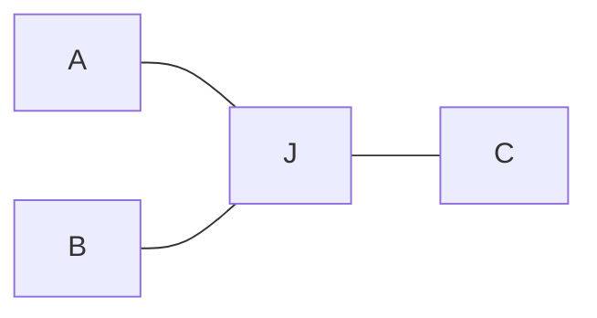

# Pipe Smooth Roadmap

Downstream of discrete multi-group pipe routing (`pipe_design`): topology and coarse paths are given; this module refines geometry under permanent occupancy.

---

## 1. Problem definition

### 1.1 Setting

**Input (fixed):**

- Domain $\Omega$: static obstacles + committed other-group pipes (permanent clearance).
- Layout $(\mathcal{T}, P)$: connected graph per group (typically a tree) with a coarse polyline/grid embedding $P$.
- Usages $\mathcal{U}$: directed terminal–terminal flows to cost (e.g. $A\!\to\!C$, $B\!\to\!C$, $A\!\to\!B$).
- Radii / port clamps (optional end tangents).

**Output:**

- Refined centerlines (and tubular solids) that keep $\mathcal{T}$’s connectivity; junctions may split locally (cond2) if usages stay connected.

**Non-goals:** topology replanning / cross-group conflict search; hard $\kappa_{\max}$ when free space forces sharp bends.

### 1.2 Objective (improved statement)

> Given topology $\mathcal{T}$ and a feasible coarse layout, refine the geometric embedding so that a **weighted soft cost** over declared usages is minimized, subject to **hard geometric constraints**.

Formally (sketch; full discrete costs in §6.7):

$$
\min_{X}
\;
J_{\mathrm{path}}(X)+J_{\mathrm{clear}}(X)+J_{\mathrm{union}}(X)
\quad
\text{s.t. ports, }\mathcal{T}\text{, interface }C^{0}/C^{1}\text{ by construction.}
$$

| Symbol | Role | Soft / hard |
|--------|------|-------------|
| $X$ | Centerline parameters (shared trunk + private junction controls) | decision |
| $L,K,S$ | Per-usage length / **radius-aware** curvature ($\kappa r$) / fairing on path samples (§6.7.1) | soft |
| $J_{\mathrm{clear}}$ | Obstacle + cross-group tube separation (§6.7.2) | soft in loop; **hard** at accept |
| $J_{\mathrm{union}}$ | Junction-bundle compactness via sample Chamfer (§6.7.3) | soft |
| Topology / ports / interface | Connectivity, fixed ends, $C^{0}/C^{1}$ clamps | **hard** (by construction) |

**Why usages matter:** shared trunk nodes couple directions. Optimizing only shared polylines can make $A \to C$, $B \to C$ smooth while $A \to B$ stays sharp. Cost must be evaluated **per usage** $u \in \mathcal{U}$, with geometry free enough at junctions to trade off those costs.

**Feasibility first:** if free space is tight, large local curvature is allowed; $K$ and $S$ only rank feasible designs.

### 1.3 Diff. vs normal path smoothing

Classical path / trajectory smoothing (robotics TEB/CHOMP, single B-spline fairing) usually: **one** open curve, **temporary** agent footprint, cost along **that** curve only. Ours differs:

| Aspect | Normal path smoothing | This problem |
|--------|----------------------|--------------|
| Occupancy | Pass-and-release (time / moving agent) | **Permanent** tubes stay; clearance is static geometry |
| Structure | Single $s$–$t$ line | **Tree / branched** manifold: $n\!\ge\!3$ joins, and nearby branch points on one trunk (short shared segments) |
| Cost scope | One path’s length / curvature | **Per-usage** costs over $\mathcal{U}$, not only shared edges |
| Geometry | Often centerline / thin agent | Finite **radius** capsules; self- and cross-group volume |
| Domain | Often open or mild | Tight $\Omega$ → large $\kappa$ may be necessary (soft $K$) |
| Ends | Usually fixed $s,t$ (pose optional) | Fixed ports **plus** line-axis alignment (terminal sits on / along a prescribed axis) |

**Direction / usage example (Y-junction).**

Topology (fixed) and usages $\mathcal{U}=\{A\!\to\!C,\; B\!\to\!C,\; A\!\to\!B\}$:



**cond1 — shared node $J$:** $A\!\to\!C$ and $B\!\to\!C$ are arc + shared straight trunk; all branches meet at one point. Good $\angle AC$, $\angle BC$ forces a hairpin $\angle AB$ on $A\!\to\!B$.


**cond2 — local split:** $A\!\to\!C$, $B\!\to\!C$ keep the same arc + straight geometry as cond1; add a dedicated $A\!\to\!B$ arc. Dashed triangle = void at join (no single shared $J$).


| | cond1 | cond2 |
|---|--------|--------|
| Geometry at join | 1 shared point $J$ | same A/C, B/C trunks + A-&gt;B arc + void |
| $A\!\to\!C$, $B\!\to\!C$ | arc + straight | **same** as cond1 |
| $A\!\to\!B$ | forced sharp at $J$ | dedicated arc; good |
| $\mathcal{T}$ | preserved | preserved (connectivity; not point-set equality) |

So the core gap is not “smoother spline fitting,” but **topology-preserving, multi-usage geometric refinement under permanent tubular occupancy**.

### 1.4 Method families to survey

Options to check before locking representation / solver (not commitments). Soft $\kappa$ preference unless noted.

| Method | Why relevant |
|--------|----------------|
| Per-edge variational splines + ADMM coupling | Fits tree + usages: one spline per edge/usage; soft agreement on shared trunks, private DOF near joins |
| Clothoid / Dubins transitions | Local primitives with explicit $\kappa$ profiles; useful for preferred bend radius (soft or hard only if space allows) |
| Elastic rod / bending energy $\int\kappa^2\,\mathrm{d}s$ | Classical global fairing; strong candidate for $K$ / $S$ |
| CHOMP / STOMP / TEB / TrajOpt | Obstacle-aware continuous refinement; adapt from single trajectory to permanent tubes + branched $\mathcal{T}$ |
| Multi-objective optimization (Pareto / scalarization / MOEA) | Native fit for $L$,$K$,$S$ trade-offs; avoids one brittle $(\alpha,\beta,\gamma)$; report fronts under hard clearance |
| RL / multi-agent multi-objective (MORL; policy over junction/trunk edits) | Survey for sequential refine or discrete junction choices; weaker default for dense continuous control + hard tubes |
| Topology / shape / PDE-constrained opt. (fluid) | If objective later moves from geometric $S$ to pressure-drop / streamline quality |
| B-spline / other parametric curves (NURBS, Hermite, …) | Baseline centerline representation; easy $L$,$\kappa$, clearance sampling (current codebase) |

**Open questions for definition (to resolve later):**

1. Exact definition of $S$ (fairing energy vs discrete tangent variation vs flow proxy).
2. How much junction splitting is allowed while still “preserving $\mathcal{T}$”.
3. Weights $\alpha,\beta,\gamma$ vs multi-objective Pareto reporting.
4. Same-group self-intersection: hard clearance or soft with threshold.

### 1.5 Computational stack (gradient / AD / PDE / symbolic)

Refinement is **gradient-centric**. Objectives stay swappable, so differentiation tooling is part of the problem setup—not one library for everything. Layers:

| Layer | Role | When / notes |
|-------|------|----------------|
| Gradient-based update | Drive continuous $X$ (controls, junction patches) under soft $L,K,S$ + hard clearance | Default solve path for geometry refine |
| Automatic differentiation (AD) | Swap / compose objectives without hand gradients; backprop through sampling of $L$,$\kappa$,$S$ | **Default for geometric costs**; fits flexible / multi-objective scalarizations |
| PDE solve (forward) | Evaluate physics-based terms (e.g. flow, pressure drop) when $S$ or constraints leave pure geometry | **Optional physics layer**; not required in the early geometric loop |
| Adjoint / PDE-constrained gradients | $\partial J/\partial X$ through FEM/CFD without full-graph AD on the PDE | Prefer over blanket AD when the forward model is a large linear/nonlinear system |
| Symbolic math | Derive exact expressions (curvature, B-spline bases, weak form, adjoint) → assemble sparse matrices / codegen kernels | Up-front derivation & FEM adjoint construction; not per-experiment objective hacking |

**Division of labor:** AD for pluggable geometry objectives; symbolic → matrices for structure/adjoint once; PDE+adjoint only when the objective truly needs physics.

**Priority:** stabilize geometry AD + hard constraints first; add PDE/adjoint and symbolic codegen when pressure-drop / streamline metrics become first-class.

---

## 2. Processing pipeline

Valve fluid pipes: discrete layout (`pipe_design` / classical stack) → `pipe_smooth` refine → CAD/FEM → physics polish. Stages do **not** share one representation or one objective.

```text
pipe_design  →  (𝒯, P, radii, ports)
      ↓
Stage 1  Centerline smooth     [geometry, JAX AD]
      ↓  parametric X
Stage 2  OCC solid + mesh      [CAD bridge]
      ↓  FEM-ready model
Stage 3  Shape / PDE opt       [adjoint FEM]
      ↓
high-performance design (+ re-export CAD)
```

| Stage | What | Objective | Hard constraints | Tooling |
|-------|------|-----------|------------------|---------|
| **0** Upstream | Multi-group routing | Feasibility | Clearance, topology | CBS/PBS/PP (`pipe_design`) |
| **1** Centerline | Hybrid trunk-share + junction-split; TEB/CHOMP-style soft refine | Soft $L,K,S$ per $\mathcal{U}$ | Clearance, $\mathcal{T}$, port axes | Python + JAX |
| **2** CAD / mesh | Sweep/loft tubes from parametric $X$; quality checks | Watertight solid + mesh | No self-intersection; port faces/axes | OpenCASCADE → mesh |
| **3** Physics polish | Parametric / shape opt on FEM fluid model | Pressure drop, flow quality (MOO) | Manufacturability, clearance | PETSc + deal.II\|MFEM + adjoint |

**Rules:**

- Stage 1 outputs **parametric** centerlines (not a dead polyline); Stage 2–3 must map back to the same parameters (or a controlled CAD feature set).
- Geometry first, physics later: Stage 1 does **not** call FEM each step; Stage 3 starts from Stage 1–2 as initial design with **limited DOF**.
- Topology changes → return to Stage 0; Stage 1–3 preserve connectivity.
- Usages $\mathcal{U}$ apply in Stage 1 costs and Stage 3 operating cases.

---

## 3. Methods to check

Candidate geometric parameterizations / refinement schemes. Entries are options to evaluate, not commitments.

1. **Hybrid trunk-share + junction-split**  
   Partition each usage centerline into **trunk** and **junction** zones (near degree $\ge 3$ nodes).  
   - **Trunk:** usages that share a tree edge use the **same** control points (hard equality / shared variables).  
   - **Junction:** each usage $u \in \mathcal{U}$ has **private** control points so local geometry can split (cond2).  
   - **Interface:** hard $C^0$ (shared endpoints); prefer hard $C^1$ (end tangents / clamped controls) by construction, not soft continuity costs.  
   - **Rationale:** adds DOF only where multi-usage curvature conflicts; avoids a trunk soft-coupling term and keeps the dry-pipe manifold exact on trunks.  
   - **Process:** full Stage 1 pipeline in §6.

<!-- Add further candidates below as numbered items. -->

---

## 4. Auxiliary

Background notions used when reading objectives / method notes. Entries are definitions, not commitments.

1. **Elastic rod / bending energy $\int \kappa^2\,ds$**  
   Treat the centerline as a thin elastic rod; bending energy is the soft smoothness objective  
   $$
   E_{\mathrm{bend}} = \int_{0}^{L} \kappa(s)^{2}\, ds
   $$  
   where $s$ is arc length, $\kappa(s)$ is curvature, and $L$ is total length.  
   - **Meaning:** larger local $\kappa$ costs more; minimizing $E_{\mathrm{bend}}$ spreads bends and reduces sharp corners under fixed ends / junction constraints.  
   - **Full rod model (optional):** torsion and stretch terms exist; for pipe centerlines the bending term usually dominates.  
   - **Vs TEB-style peak penalty:** TEB mainly suppresses large $\kappa$ at samples; $\int\kappa^2\,ds$ is a global fairing energy (may lengthen the path → pair with $L$).  
   - **With B-splines:** approximate $E \approx \sum_i \kappa_i^{2}\,\Delta s_i$ on samples, then differentiate w.r.t. control points.  
   - **Per-usage:** compute one energy per $u \in \mathcal{U}$ and weight-sum (fits $S$ / soft $K$ in §1.2).  
   - **Caveat:** geometric proxy for “smoothness,” not exact hydraulic loss.

2. **CHOMP** (Covariant Hamiltonian Optimization for Motion Planning)  
   Local refinement of one trajectory $\xi$ by covariant gradient descent on
   $$
   U(\xi)=U_{\mathrm{smooth}}(\xi)+\lambda\,U_{\mathrm{obs}}(\xi).
   $$  
   - **Smooth:** $U_{\mathrm{smooth}}=\frac12\int\|\ddot\xi(t)\|^2\,dt$ (discrete: $\frac12\xi^\top A\xi$, $A=K^\top K$ from second differences). Penalizes **velocity-vector** change $v_i-v_{i-1}$, not scalar length gaps $\ell_i-\ell_{i-1}$; corners raise $\|a\|$, so curvature is affected.  
   - **Obstacle:** field $c(x)$ (high near / inside obstacles) integrated along the body / swept path, typically $\times\|\dot x\|$.  
   - **Process:** soft penalties + Riemannian GD (no explicit SQP / constraint QP):
     1. start from an initial $\xi_0$;
     2. evaluate $\nabla U_{\mathrm{smooth}}=A\xi$ and $\nabla U_{\mathrm{obs}}$ from the distance field;
     3. covariant update $\xi\leftarrow\xi-\eta A^{-1}\nabla U$;
     4. repeat until converged.  
   - **Caveat:** single open trajectory, temporary footprint; not tree + per-usage costs.

3. **TrajOpt**  
   Cast **all waypoints of the whole trajectory as one nonlinear program**, then solve it by **sequential convexification** (SQP-like): each outer iteration builds a convex approximation around the current $\xi$ and solves a QP / SOCP.  
   - **Variables:** the full discrete path (and optional times / controls) in one vector.  
   - **Objective:** usually quadratic smooth terms (velocity / acceleration) plus hinge collision penalties.  
   - **Constraints:** collision via signed distance; nonconvex parts are linearized / convexified in a trust region about the current iterate.  
   - **Process:** each iteration **re-solves an optimized subproblem** (unlike CHOMP’s single gradient step):
     1. initialize $\xi$;
     2. form one complete problem over all waypoints;
     3. linearize / convexify at $\xi$;
     4. solve the convex subproblem for a step $\Delta\xi$;
     5. accept / reject under trust-region rules;
     6. repeat.  
   - **Vs CHOMP:** same “smooth + collision” goal; TrajOpt is constraint-oriented sequential convex, often sharper on collisions.  
   - **Caveat:** still typically one configuration chain; junction / multi-usage DOF must be modeled separately.

4. **STOMP** (Stochastic Trajectory Optimization for Motion Planning)  
   Same soft goals as CHOMP ($U_{\mathrm{smooth}}+U_{\mathrm{obs}}$), but **derivative-free**: explore by noisy samples around the current trajectory, then merge them by **cost-weighted averaging** (closer to CEM / evolutionary strategies than to PSO voting).  
   - **Process:**
     1. keep a mean trajectory $\bar\xi$;
     2. draw $N$ noisy candidates $\xi^{(k)}=\bar\xi+\epsilon^{(k)}$ (structured multivariate noise);
     3. evaluate $U(\xi^{(k)})$ for each (no $\nabla U$ needed);
     4. map costs to probabilities (low cost $\Rightarrow$ high weight);
     5. update $\bar\xi$ as the weighted mean of samples;
     6. repeat.  
   - **Vs PSO:** PSO keeps many particles with personal/global best velocities; STOMP keeps one mean and merges a fresh noise cloud each iteration by soft weights—not discrete “votes.”  
   - **Pros / cons:** handles non-smooth or black-box costs and explores more than pure GD; usually slower / noisier than CHOMP or TrajOpt.  
   - **Caveat:** same single-path scope limitation as CHOMP for our branched-pipe setting.

<!-- Add further auxiliary items below as numbered items. -->

---

## 5. Design considerations

Brief decisions / trade-offs for Stage 1–3. Entries are commitments unless marked open.

1. **Do not skip centerline for direct shape optimization**  
   Coarse path → CAD → PDE shape opt is **not** a substitute for Stage 1.  
   - Raw / grid paths yield sharp junctions (cond1), weak clearance margins, and often non-manifold or self-intersecting sweeps—bad FEM initial designs.  
   - Free-wall / mesh shape opt does not invent junction split (cond2); without explicit local DOF it stays near a shared-node embedding.  
   - Per-step FEM is orders of magnitude costlier than geometric $L,K,S$ + hard clearance; physics should polish, not discover feasible centerlines.  
   - Unrestricted shape DOF fights ports, cross-group clearance, and manufacturability; Stage 3 needs **limited** parameters inherited from Stage 1–2.  
   - **Rule:** geometry conflicts (multi-usage, trunk/junction, permanent tubes) in Stage 1; fluid metrics in Stage 3 on the same parametric $X$.

<!-- Add further considerations below as numbered items. -->

---

## 6. Stage 1 algorithm process (Hybrid trunk-share + junction-split)

End-to-end process for centerline refinement. Input is a **grid / discrete tree** embedding from Stage 0; output is **parametric** $X$ (shared trunk + private junction controls) for Stage 2.

```text
(𝒯, P, 𝒰, radii, ports, Ω)
        ↓
[1] Build tree graph from coarse grid paths
        ↓
[2] Seed junctions → grow zones → merge close complexes
        ↓
[3] Label trunk vs junction; fix interface C⁰ / C¹
        ↓
[4] Allocate variables: shared X_trunk + private X_junc,u
        ↓
[5] Assemble each usage path (trunk samples ‖ junction samples)
        ↓
[6] Evaluate costs on path samples → scalar J(X)
        ↓
[7] Gradient update (JAX) until converged
        ↓
[8] Hard clearance check → export parametric X
```

### 6.1 Inputs / outputs

| | Content |
|--|---------|
| **In** | Tree $\mathcal{T}$ with coarse embedding $P$; usages $\mathcal{U}$; radii; port positions / axis clamps; obstacle + other-group tubes in $\Omega$ |
| **Out** | Parametric centerlines $X$: shared trunk controls + per-usage junction controls; sampled tubes for QA |
| **Preserve** | Connectivity of $\mathcal{T}$; every $u\in\mathcal{U}$ remains routable; ports fixed |

### 6.2 Step 1 — Tree from grid topology

1. Take per-group coarse paths (grid / polyline) and declared $\mathcal{U}$.  
2. Deduplicate spatial nodes; build an undirected **tree** (or forest) $\mathcal{T}$: edges = discrete segments between branch / terminal nodes.  
3. Record per-edge coarse polylines, radii, and which usages traverse each edge.

### 6.3 Step 2 — Junction zones and complexes

**Goal:** mark where private DOF are allowed; everywhere else stays shared trunk.

1. **Seed:** all nodes with degree $\ge 3$.  
2. **Grow zone (primary rule — tree path length):** a node (or sample along an edge) belongs to a seed’s zone if its **tree-path length** to that seed is $< \tau$. Prefer  
   $\tau = \max(\tau_0,\; \alpha\, r_{\mathrm{local}},\; \beta\, R_{\mathrm{bend}})$  
   rather than a single absolute length.  
3. **Close branches (complex merge):** if several seeds are near each other (tree or Euclidean distance), or the trunk between them is shorter than $\tau_{\mathrm{trunk}}$ / fully covered by overlapping zones, **merge into one junction complex**. Short trunks inside the complex are labeled **junction**, not trunk-share.  
4. **Zone record** for each complex $Z$:  
   - terminals (ports where $\mathcal{T}$ exits $Z$ into true trunk or group terminals);  
   - interior edges / samples;  
   - **interface points** on the complex boundary (with trunk-side tangents);  
   - subset $\mathcal{U}_Z \subseteq \mathcal{U}$ of usages that cross $Z$.

Do **not** grow zones by a pure Euclidean ball alone (can clip unrelated bends); use Euclidean only for merge decisions.

### 6.4 Step 3 — Trunk / junction partition and interface

1. **Trunk:** edges (or portions) outside all complexes → **shared** geometry among all usages that use that edge.  
2. **Junction:** interior of each complex → **private** geometry per usage in $\mathcal{U}_Z$.  
3. **Interface (by construction, not soft loss):**  
   - hard $C^0$: usage curves meet shared interface endpoints;  
   - prefer hard $C^1$: clamp end tangents to the trunk tangent (clamped controls / Hermite ends).

### 6.5 Step 4 — Variable layout

| Region | Variables | Sharing |
|--------|-----------|---------|
| Trunk | Control points of a parametric curve (default: cubic B-spline) | **Same** $X_{\mathrm{trunk}}$ for all usages on that edge |
| Junction (per $u\in\mathcal{U}_Z$) | Short parametric patch (few interior controls; cubic B-spline or Hermite) | **Private** $X_{\mathrm{junc},u}$ |
| Ports / interfaces | Fixed or equality-tied | Not free (or only along allowed axis) |

- Build private patches **only for declared usages** in $\mathcal{U}_Z$ (e.g. $A\!\to\!B$, $A\!\to\!C$, $B\!\to\!C$), not every terminal pair.  
- Keep junction patches **low-dimensional** (typically 1–2 interior controls) to limit out-of-plane DOF.  
- Exported $X$ stays parametric (Stage 2 sweeps); dense waypoints are for sampling / costs only.

**Init:** start from the coarse embedding (cond1-like shared join); optionally continuation: gradually free junction controls while enabling union cost (§6.7).

### 6.6 Step 5 — Usage path assembly

For each $u\in\mathcal{U}$:

1. Walk $\mathcal{T}$ from $u$’s start terminal to end.  
2. Outside complexes: sample the **shared** trunk curve.  
3. Inside complex $Z$: sample the **private** junction patch $X_{\mathrm{junc},u}$.  
4. Concatenate samples (drop duplicate interface points) → path point sequence $\gamma_u$ and radii $r_u$.

All soft geometric costs below are evaluated on **path samples** $\gamma_u$, not on raw control points.

### 6.7 Step 6 — Cost functions (redesign)

All geometric costs are defined on **path samples**, then differentiated w.r.t. parametric controls in $X$ through the sampler (JAX AD). Control points do **not** enter the loss directly except via $\gamma(X)$.

#### 6.7.0 Notation

For each usage $u\in\mathcal{U}$, assemble (§6.6)

$$
\gamma_u=\{x_{u,i}\}_{i=0}^{N_u-1},\quad
r_{u,i}>0,\quad
w_{u,i}\ge 0,
$$

where $x_{u,i}\in\mathbb{R}^3$ are centerline samples, $r_{u,i}$ tube radii, and $w_{u,i}$ an **importance weight** interpolated from tree-edge (or control) weights onto samples.

Segment lengths and unit tangents (edges $i=0,\ldots,N_u-2$; interior nodes $i=1,\ldots,N_u-2$):

$$
\begin{aligned}
\Delta s_{u,i}
&=\|x_{u,i+1}-x_{u,i}\|_2,
\qquad
t_{u,i}
=\frac{x_{u,i+1}-x_{u,i}}{\Delta s_{u,i}+\varepsilon},
\qquad
\Delta \ell_{u,i}
=\tfrac12(\Delta s_{u,i-1}+\Delta s_{u,i}).
\end{aligned}
$$

**Turning angle** (for bending energy; **do not** use $\arccos(t\cdot t)$ — its derivative blows up as $\cos\to 1$):

$$
\theta_{u,i}
=
\mathrm{atan2}\big(
\|t_{u,i-1}\times t_{u,i}\|_2,\;
t_{u,i-1}\cdot t_{u,i}
\big)
\in[0,\pi].
$$

**Menger curvature** (circumcircle $1/R$ through three consecutive samples; for pointwise / threshold penalties):

$$
\kappa_{u,i}^{\mathrm{M}}
=
\frac{
\big\|
(x_{u,i}-x_{u,i-1})\times(x_{u,i+1}-x_{u,i})
\big\|_2
}{
\|x_{u,i}-x_{u,i-1}\|_2\,
\|x_{u,i+1}-x_{u,i}\|_2\,
\|x_{u,i+1}-x_{u,i-1}\|_2
+\varepsilon
}.
$$

Soft hinge / softplus (smooth, AD-friendly):

$$
[z]_+^\sigma=\sigma\log\big(1+e^{z/\sigma}\big)
\quad(\sigma>0\text{ small}).
$$

Scalar objective:

$$
J(X)=
J_{\mathrm{path}}(X)
+J_{\mathrm{clear}}(X)
+J_{\mathrm{union}}(X).
$$

Ports, topology, and interface $C^0/C^1$ are **hard by construction** (not in $J$). Clearance is soft in $J$ and **hard-checked** after solve (§6.9).

#### 6.7.1 Path costs $J_{\mathrm{path}}$

$$
J_{\mathrm{path}}
=
\sum_{u\in\mathcal{U}}
\Big(
\alpha_u\,L_u
+\beta_u\,K_u
+\gamma_u\,S_u
\Big).
$$

Weights $(\alpha_u,\beta_u,\gamma_u)$ may be global or per-usage. Physics velocity / pressure-drop terms are **out of scope** for Stage 1.

**(1) Length**

$$
L_u
=
\sum_{i=0}^{N_u-2}
\bar w_{u,i}\,\Delta s_{u,i},
\qquad
\bar w_{u,i}=\tfrac12(w_{u,i}+w_{u,i+1}).
$$

Optional excess-length form (penalize stretch vs coarse path length $L_u^{0}$):

$$
L_u^{\mathrm{ex}}
=
\big[L_u-L_u^{0}\big]_+^\sigma.
$$

Default Stage 1: use $L_u$ (or a mix $L_u+\eta L_u^{\mathrm{ex}}$).

**(2) Curvature** (soft preference, not hard $\kappa_{\max}$; **radius-aware**)

Same centerline bend is worse for a fatter tube. Stage 1 uses the dimensionless bend measure $\kappa r$ (manufacturing bend ratio), not bare $\kappa$. Structural stiffness $\sim r^{4}$ is **out of scope** here.

Per-sample radius and dimensionless curvatures:

$$
\begin{aligned}
\tilde\theta_{u,i}
&=
\theta_{u,i}\, r_{u,i},
\qquad
\tilde\kappa_{u,i}
&=
\kappa_{u,i}^{\mathrm{M}}\, r_{u,i},
\qquad
c_{\mathrm{pref}}
=
\frac{r}{R_{\mathrm{bend}}^{\mathrm{pref}}}
\;\text{(typical constant, e.g. }1/n\text{)}.
\end{aligned}
$$

Use local $r_{u,i}$ along the path (variable radius OK). Split into **bending energy** (turning angle) and optional **threshold** (Menger):

$$
\begin{aligned}
K_u^{\mathrm{bend}}
&=
\sum_{i=1}^{N_u-2}
w_{u,i}\,
\frac{\tilde\theta_{u,i}^{2}}{\Delta \ell_{u,i}+\varepsilon}
=
\sum_{i=1}^{N_u-2}
w_{u,i}\,
\frac{(\theta_{u,i}\, r_{u,i})^{2}}{\Delta \ell_{u,i}+\varepsilon},
\\[0.5em]
K_u^{\mathrm{thr}}
&=
\sum_{i=1}^{N_u-2}
w_{u,i}\,
\big[\tilde\kappa_{u,i}-c_{\mathrm{pref}}\big]_+^\sigma{}^{2}
\,\Delta \ell_{u,i}
=
\sum_{i=1}^{N_u-2}
w_{u,i}\,
\big[\kappa_{u,i}^{\mathrm{M}} r_{u,i}-c_{\mathrm{pref}}\big]_+^\sigma{}^{2}
\,\Delta \ell_{u,i},
\\[0.5em]
K_u
&=
K_u^{\mathrm{bend}}
+\rho\,K_u^{\mathrm{thr}}.
\end{aligned}
$$

| Piece | Discrete proxy | Why |
|-------|----------------|-----|
| $K^{\mathrm{bend}}$ | $(\theta\, r)^{2}/\Delta\ell$, $\theta=\mathrm{atan2}(\|\times\|,\cdot)$ | $\approx\int(\kappa r)^{2}\,\mathrm{d}s$; thicker pipe → higher cost at same $\theta$ |
| $K^{\mathrm{thr}}$ | softplus on $\kappa^{\mathrm{M}} r$ vs $c_{\mathrm{pref}}$ | dimensionless bend-ratio threshold |
| Avoid | $\theta=\arccos(t\cdot t)$; bare $\kappa$ without $r$ | AD singularity; unfair across radii |

**MVP shortcut:** replace $\theta^{2}$ by $\|t_{u,i}-t_{u,i-1}\|_2^{2}=4\sin^{2}(\theta/2)$, still multiply by $r_{u,i}^{2}$ (no `atan2`; same small-angle behavior).

Equivalent view of the threshold: $\kappa_{\mathrm{pref},i}=c_{\mathrm{pref}}/r_{u,i}$ (larger radius $\Rightarrow$ lower allowed centerline $\kappa$). If free space forces sharper bends, $K$ stays finite—feasibility is left to clearance, not a hard $\kappa$ cap.

**(3) Streamline / fairing** $S$ (optional; usually off in MVP)

$$
S_u
=
\sum_{i=1}^{N_u-2}
w_{u,i}\,
\big\|t_{u,i}-t_{u,i-1}\big\|_2^{2}.
$$

$S_u$ overlaps strongly with $K_u^{\mathrm{bend}}$ (especially the $\|\Delta t\|^2/\Delta\ell$ shortcut). **Default:** $\gamma_u=0$ and rely on $K_u^{\mathrm{bend}}$; enable $S$ only if an extra tangent-regularizer is still needed. Optional torsion on successive binormals can be added later.

**(4) Importance weight line**

- Assign a scalar weight per tree edge (or per trunk/junction control).  
- Interpolate to samples $\rightarrow w_{u,i}$.  
- Use $w$ only inside $L,K,S$ (not inside clearance / union, unless intentionally biased).

#### 6.7.2 Clearance $J_{\mathrm{clear}}$

Tube–obstacle and tube–tube gaps use the same hinge on **signed clearance residual**. For two capsules / balls with centers $a,b$ and radii $r_a,r_b$, required separation $d_{\mathrm{req}}=r_a+r_b+\delta_{\mathrm{margin}}$:

$$
\phi(a,b;r_a,r_b)
=
\big[
d_{\mathrm{req}}-\|a-b\|_2
\big]_+^\sigma{}^{2}.
$$

**(1) Obstacle conflict**

Let obstacle samples (or sphere covers) be $\{(o_j,r_j^{\mathrm{obs}})\}$. Sum over path samples that are not fixed ports:

$$
J_{\mathrm{obs}}
=
\mu_{\mathrm{obs}}
\sum_{u\in\mathcal{U}}
\sum_{i\in\mathcal{I}_u^{\mathrm{free}}}
\sum_{j\in\mathcal{N}(x_{u,i})}
\phi\big(x_{u,i},o_j;\,r_{u,i},r_j^{\mathrm{obs}}\big).
$$

$\mathcal{N}(x)$ is a neighbor set from a radius query (KD-tree); refreshed every $k$ iterations.

**(2) Cross-group conflict**

For group $g\neq g'$, path samples of group $g$ vs group $g'$:

$$
J_{\mathrm{grp}}
=
\mu_{\mathrm{grp}}
\sum_{g<g'}
\sum_{u\in\mathcal{U}_g}
\sum_{v\in\mathcal{U}_{g'}}
\sum_{(i,j)\in\mathcal{P}_{u,v}}
\phi\big(x_{u,i},x_{v,j};\,r_{u,i},r_{v,j}\big).
$$

$\mathcal{P}_{u,v}$ = active near pairs from broadphase.

**(3) Same-group illegal contact (optional, careful)**

Do **not** penalize the intentional cond2 void inside a junction complex. If used, restrict to pairs that are:

- on the same usage and far in arc length (true self-contact), or  
- on different usages but **outside** junction complexes (parallel trunk interference),

$$
J_{\mathrm{self}}
=
\mu_{\mathrm{self}}
\sum \phi(\cdot)
\quad\text{over allowed pairs only}.
$$

**Total soft clearance**

$$
J_{\mathrm{clear}}
=
J_{\mathrm{obs}}+J_{\mathrm{grp}}+J_{\mathrm{self}}.
$$

After optimization: compute max penetration $\max(d_{\mathrm{req}}-\|a-b\|)$; **accept only if** $\le 0$ (or $\le \epsilon_{\mathrm{tol}}$). Else raise $\mu$ / tighten and re-solve.

#### 6.7.3 Junction union $J_{\mathrm{union}}$

Private junction patches are under-determined under $L,K,S$ alone. $J_{\mathrm{union}}$ pulls co-located usage tubes in each complex $Z$ toward a **compact bundle** (smaller union volume for CAD / Stage 3).

Let $\gamma_u^{Z}=\{x_{u,i}:i\in\mathcal{I}_u^{Z}\}$ be samples of usage $u$ **inside** complex $Z$, and $\mathcal{U}_Z$ the usages through $Z$.

**(Default) Symmetric Chamfer on centerlines**

$$
\begin{aligned}
d(x,\gamma)
&=
\min_{y\in\gamma}\|x-y\|_2,
\\[0.4em]
\mathrm{Ch}(\gamma_u^{Z},\gamma_v^{Z})
&=
\frac{1}{|\mathcal{I}_u^{Z}|}
\sum_{i\in\mathcal{I}_u^{Z}}
d(x_{u,i},\gamma_v^{Z})^{2}
\;+\;
\frac{1}{|\mathcal{I}_v^{Z}|}
\sum_{j\in\mathcal{I}_v^{Z}}
d(x_{v,j},\gamma_u^{Z})^{2},
\\[0.4em]
J_{\mathrm{union}}
&=
\lambda
\sum_{Z}
\sum_{\{u,v\}\subset\mathcal{U}_Z}
\mathrm{Ch}(\gamma_u^{Z},\gamma_v^{Z}).
\end{aligned}
$$

Optional tube-aware residual (encourage overlap of solids, not only centerlines):

$$
d^{\mathrm{tube}}(x_{u,i},\gamma_v)
=
\big[
d(x_{u,i},\gamma_v)-(r_{u,i}+r_{v,\star})
\big]_+^\sigma,
$$

with $r_{v,\star}$ the radius at the nearest sample on $\gamma_v$; substitute $d^{2}$ by $(d^{\mathrm{tube}})^{2}$ in $\mathrm{Ch}$ if desired.

**(Optional later)** Soft occupancy / union-volume proxy on a local grid of $Z$; not required for MVP.

**Balance:** large $\lambda$ collapses toward cond1 (sharp $A\!\to\!B$); small $\lambda$ allows fat non-overlapping bows. Tune against $K_u$ on the sharpest usage; prefer continuation (raise $\lambda$ after junction DOF are unlocked).

**Do not** use unpaired control-point distances as the primary union term.

#### 6.7.4 Full objective (summary)

$$
\begin{aligned}
J(X)
&=
\sum_{u}
\Big(
\alpha_u L_u+\beta_u K_u+\gamma_u S_u
\Big)
\\
&\quad
+\mu_{\mathrm{obs}}J_{\mathrm{obs}}^{0}
+\mu_{\mathrm{grp}}J_{\mathrm{grp}}^{0}
+\mu_{\mathrm{self}}J_{\mathrm{self}}^{0}
+\lambda\sum_{Z}\sum_{\{u,v\}\subset\mathcal{U}_Z}\mathrm{Ch}(\gamma_u^{Z},\gamma_v^{Z}),
\end{aligned}
$$

where $J^{0}$ denotes the unweighted sum of $\phi$ terms in §6.7.2.

| Term | Soft / hard | Role |
|------|-------------|------|
| $L,K,S$ | soft | per-usage geometric quality |
| $J_{\mathrm{clear}}$ | soft in loop; hard at accept | permanent tube separation |
| $J_{\mathrm{union}}$ | soft | compact junction bundle |
| ports / $C^0$–$C^1$ / $\mathcal{T}$ | hard by construction | feasibility structure |

### 6.8 Step 7 — Optimize

1. Pack free variables: movable trunk controls + junction interior controls (interfaces / ports clamped).  
2. Each iteration: assemble $\gamma_u$ → evaluate $J$ → $\nabla_X J$ via AD (JAX) → update.  
3. Refresh broadphase neighbor sets $\mathcal{N}$, $\mathcal{P}$ every $k$ steps; optionally adapt sample density.  
4. Stop on relative $J$ decrease, step size, or iteration cap.

### 6.9 Step 8 — Validate and export

1. Hard clearance: $\max(d_{\mathrm{req}}-\|a-b\|)\le\epsilon_{\mathrm{tol}}$ for obstacle and cross-group pairs.  
2. Sanity: interface $C^0/C^1$, port axes, every $u\in\mathcal{U}$ connected.  
3. Export parametric $X$ for Stage 2; keep $\gamma_u$ for debug / QA only.

### 6.10 Open knobs

| Knob | Role |
|------|------|
| $\tau$, $\tau_{\mathrm{trunk}}$ | zone / complex size |
| $(\alpha_u,\beta_u,\gamma_u)$, $w_{u,i}$ | path quality emphasis |
| $c_{\mathrm{pref}}$, $\rho$, $\sigma$ | dimensionless bend-ratio threshold ($\tilde\kappa=\kappa r$); bend uses $\theta=\mathrm{atan2}$ (not $\arccos$) |
| $\gamma_u$ | fairing $S$; default $0$ (overlaps $K^{\mathrm{bend}}$) |
| $\mu_{\mathrm{obs}},\mu_{\mathrm{grp}},\mu_{\mathrm{self}}$ | clearance vs quality |
| $\lambda$, Chamfer vs tube-aware $d^{\mathrm{tube}}$ | junction compactness |
| continuation on junction DOF / $\lambda$ | avoid early collapse or fly-apart |

---

<!-- Later sections: experiments, migration from `scripts_py/mapf_pkg/smooth_*` -->
