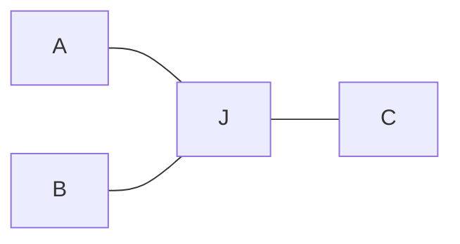
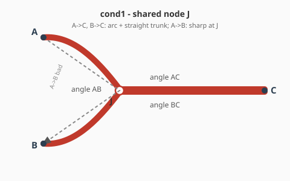
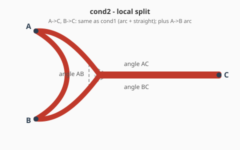

# Pipe Smooth Roadmap

Downstream of discrete multi-group pipe routing (`pipe_design`): topology and coarse paths are given; this module refines geometry under permanent occupancy.

---

## 1. Problem definition

### 1.1 Setting

**Input (fixed):**

- Domain $\Omega$: static obstacles + committed other-group pipes (permanent clearance).
- Layout $(\mathcal{T}, P)$: connected graph per group (typically a tree) with a coarse polyline/grid embedding $P$.
- Usages $\mathcal{U}$: directed terminal–terminal flows to cost (e.g. $A\!\to\!C$, $B\!\to\!C$, $A\!\to\!B$).
- Radii / port clamps (optional end tangents).

**Output:**

- Refined centerlines (and tubular solids) that keep $\mathcal{T}$’s connectivity; junctions may split locally (cond2) if usages stay connected.

**Non-goals:** topology replanning / cross-group conflict search; hard $\kappa_{\max}$ when free space forces sharp bends.

### 1.2 Objective (improved statement)

> Given topology $\mathcal{T}$ and a feasible coarse layout, refine the geometric embedding so that a **weighted soft cost** over declared usages is minimized, subject to **hard geometric constraints**.

Formally (sketch):

$$
\min_{X}
\sum_{u \in \mathcal{U}}
\Big(
  \alpha\, L(u;X)
  + \beta\, K(u;X)
  + \gamma\, S(u;X)
\Big)
\quad
\text{s.t. hard constraints on } X.
$$

| Symbol | Role | Soft / hard |
|--------|------|-------------|
| $X$ | Centerline parameters (control points, junction patches, …) | decision |
| $L$ | Path length (or excess length vs coarse path) | soft |
| $K$ | Curvature penalty (mean / peak / preference-threshold softplus; **not** a hard $\kappa_{\max}$ unless space allows) | soft |
| $S$ | Streamline-like regularity (tangent / curvature variation, fairing energy, optional torsion) | soft |
| Clearance | Pipe–obstacle and cross-group tube separation | **hard** |
| Topology | Same connectivity as $\mathcal{T}$; usages remain routable along the manifold | **hard** |
| Ports | Fixed terminals; optional end tangent clamps | **hard** |

**Why usages matter:** shared trunk nodes couple directions. Optimizing only shared polylines can make $A \to C$, $B \to C$ smooth while $A \to B$ stays sharp. Cost must be evaluated **per usage** $u \in \mathcal{U}$, with geometry free enough at junctions to trade off those costs.

**Feasibility first:** if free space is tight, large local curvature is allowed; $K$ and $S$ only rank feasible designs.

### 1.3 Diff. vs normal path smoothing

Classical path / trajectory smoothing (robotics TEB/CHOMP, single B-spline fairing) usually: **one** open curve, **temporary** agent footprint, cost along **that** curve only. Ours differs:

| Aspect | Normal path smoothing | This problem |
|--------|----------------------|--------------|
| Occupancy | Pass-and-release (time / moving agent) | **Permanent** tubes stay; clearance is static geometry |
| Structure | Single $s$–$t$ line | **Tree / branched** manifold: $n\!\ge\!3$ joins, and nearby branch points on one trunk (short shared segments) |
| Cost scope | One path’s length / curvature | **Per-usage** costs over $\mathcal{U}$, not only shared edges |
| Geometry | Often centerline / thin agent | Finite **radius** capsules; self- and cross-group volume |
| Domain | Often open or mild | Tight $\Omega$ → large $\kappa$ may be necessary (soft $K$) |
| Ends | Usually fixed $s,t$ (pose optional) | Fixed ports **plus** line-axis alignment (terminal sits on / along a prescribed axis) |

**Direction / usage example (Y-junction).**

Topology (fixed) and usages $\mathcal{U}=\{A\!\to\!C,\; B\!\to\!C,\; A\!\to\!B\}$:

**cond1 — shared node $J$:** $A\!\to\!C$ and $B\!\to\!C$ are arc + shared straight trunk; all branches meet at one point. Good $\angle AC$, $\angle BC$ forces a hairpin $\angle AB$ on $A\!\to\!B$.

**cond2 — local split:** $A\!\to\!C$, $B\!\to\!C$ keep the same arc + straight geometry as cond1; add a dedicated $A\!\to\!B$ arc. Dashed triangle = void at join (no single shared $J$).

| | cond1 | cond2 |
|---|--------|--------|
| Geometry at join | 1 shared point $J$ | same A/C, B/C trunks + A-&gt;B arc + void |
| $A\!\to\!C$, $B\!\to\!C$ | arc + straight | **same** as cond1 |
| $A\!\to\!B$ | forced sharp at $J$ | dedicated arc; good |
| $\mathcal{T}$ | preserved | preserved (connectivity; not point-set equality) |

So the core gap is not “smoother spline fitting,” but **topology-preserving, multi-usage geometric refinement under permanent tubular occupancy**.

### 1.4 Method families to survey

Options to check before locking representation / solver (not commitments). Soft $\kappa$ preference unless noted.

| Method | Why relevant |
|--------|----------------|
| Per-edge variational splines + ADMM coupling | Fits tree + usages: one spline per edge/usage; soft agreement on shared trunks, private DOF near joins |
| Clothoid / Dubins transitions | Local primitives with explicit $\kappa$ profiles; useful for preferred bend radius (soft or hard only if space allows) |
| Elastic rod / bending energy $\int\kappa^2\,\mathrm{d}s$ | Classical global fairing; strong candidate for $K$ / $S$ |
| CHOMP / STOMP / TEB / TrajOpt | Obstacle-aware continuous refinement; adapt from single trajectory to permanent tubes + branched $\mathcal{T}$ |
| Multi-objective optimization (Pareto / scalarization / MOEA) | Native fit for $L$,$K$,$S$ trade-offs; avoids one brittle $(\alpha,\beta,\gamma)$; report fronts under hard clearance |
| RL / multi-agent multi-objective (MORL; policy over junction/trunk edits) | Survey for sequential refine or discrete junction choices; weaker default for dense continuous control + hard tubes |
| Topology / shape / PDE-constrained opt. (fluid) | If objective later moves from geometric $S$ to pressure-drop / streamline quality |
| B-spline / other parametric curves (NURBS, Hermite, …) | Baseline centerline representation; easy $L$,$\kappa$, clearance sampling (current codebase) |

**Open questions for definition (to resolve later):**

1. Exact definition of $S$ (fairing energy vs discrete tangent variation vs flow proxy).
2. How much junction splitting is allowed while still “preserving $\mathcal{T}$”.
3. Weights $\alpha,\beta,\gamma$ vs multi-objective Pareto reporting.
4. Same-group self-intersection: hard clearance or soft with threshold.

---

## 2. Methods to check

Candidate geometric parameterizations / refinement schemes. Entries are options to evaluate, not commitments.

1. **Hybrid trunk-share + junction-split**  
   Partition each usage centerline into **trunk** and **junction** zones (near degree $\ge 3$ nodes).  
   - **Trunk:** usages that share a tree edge use the **same** control points (hard equality / shared variables).  
   - **Junction:** each usage $u \in \mathcal{U}$ has **private** control points so local geometry can split (cond2).  
   - **Interface:** hard $C^0$ (shared endpoints); prefer hard $C^1$ (end tangents / clamped controls) by construction, not soft continuity costs.  
   - **Rationale:** adds DOF only where multi-usage curvature conflicts; avoids a trunk soft-coupling term and keeps the dry-pipe manifold exact on trunks.  
   - **Open:** junction length rule; continuity order; how $A\!\to\!B$-like usages attach when they are mostly junction.

<!-- Add further candidates below as numbered items. -->

---

## 3. Auxiliary

Background notions used when reading objectives / method notes. Entries are definitions, not commitments.

1. **Elastic rod / bending energy $\int \kappa^2\,ds$**  
   Treat the centerline as a thin elastic rod; bending energy is the soft smoothness objective  
   $$
   E_{\mathrm{bend}} = \int_{0}^{L} \kappa(s)^{2}\, ds
   $$  
   where $s$ is arc length, $\kappa(s)$ is curvature, and $L$ is total length.  
   - **Meaning:** larger local $\kappa$ costs more; minimizing $E_{\mathrm{bend}}$ spreads bends and reduces sharp corners under fixed ends / junction constraints.  
   - **Full rod model (optional):** torsion and stretch terms exist; for pipe centerlines the bending term usually dominates.  
   - **Vs TEB-style peak penalty:** TEB mainly suppresses large $\kappa$ at samples; $\int\kappa^2\,ds$ is a global fairing energy (may lengthen the path → pair with $L$).  
   - **With B-splines:** approximate $E \approx \sum_i \kappa_i^{2}\,\Delta s_i$ on samples, then differentiate w.r.t. control points.  
   - **Per-usage:** compute one energy per $u \in \mathcal{U}$ and weight-sum (fits $S$ / soft $K$ in §1.2).  
   - **Caveat:** geometric proxy for “smoothness,” not exact hydraulic loss.

2. **CHOMP** (Covariant Hamiltonian Optimization for Motion Planning)  
   Local refinement of one trajectory $\xi$ by covariant gradient descent on
   $$
   U(\xi)=U_{\mathrm{smooth}}(\xi)+\lambda\,U_{\mathrm{obs}}(\xi).
   $$  
   - **Smooth:** $U_{\mathrm{smooth}}=\frac12\int\|\ddot\xi(t)\|^2\,dt$ (discrete: $\frac12\xi^\top A\xi$, $A=K^\top K$ from second differences). Penalizes **velocity-vector** change $v_i-v_{i-1}$, not scalar length gaps $\ell_i-\ell_{i-1}$; corners raise $\|a\|$, so curvature is affected.  
   - **Obstacle:** field $c(x)$ (high near / inside obstacles) integrated along the body / swept path, typically $\times\|\dot x\|$.  
   - **Process:** soft penalties + Riemannian GD (no explicit SQP / constraint QP):
     1. start from an initial $\xi_0$;
     2. evaluate $\nabla U_{\mathrm{smooth}}=A\xi$ and $\nabla U_{\mathrm{obs}}$ from the distance field;
     3. covariant update $\xi\leftarrow\xi-\eta A^{-1}\nabla U$;
     4. repeat until converged.  
   - **Caveat:** single open trajectory, temporary footprint; not tree + per-usage costs.

3. **TrajOpt**  
   Cast **all waypoints of the whole trajectory as one nonlinear program**, then solve it by **sequential convexification** (SQP-like): each outer iteration builds a convex approximation around the current $\xi$ and solves a QP / SOCP.  
   - **Variables:** the full discrete path (and optional times / controls) in one vector.  
   - **Objective:** usually quadratic smooth terms (velocity / acceleration) plus hinge collision penalties.  
   - **Constraints:** collision via signed distance; nonconvex parts are linearized / convexified in a trust region about the current iterate.  
   - **Process:** each iteration **re-solves an optimized subproblem** (unlike CHOMP’s single gradient step):
     1. initialize $\xi$;
     2. form one complete problem over all waypoints;
     3. linearize / convexify at $\xi$;
     4. solve the convex subproblem for a step $\Delta\xi$;
     5. accept / reject under trust-region rules;
     6. repeat.  
   - **Vs CHOMP:** same “smooth + collision” goal; TrajOpt is constraint-oriented sequential convex, often sharper on collisions.  
   - **Caveat:** still typically one configuration chain; junction / multi-usage DOF must be modeled separately.

4. **STOMP** (Stochastic Trajectory Optimization for Motion Planning)  
   Same soft goals as CHOMP ($U_{\mathrm{smooth}}+U_{\mathrm{obs}}$), but **derivative-free**: explore by noisy samples around the current trajectory, then merge them by **cost-weighted averaging** (closer to CEM / evolutionary strategies than to PSO voting).  
   - **Process:**
     1. keep a mean trajectory $\bar\xi$;
     2. draw $N$ noisy candidates $\xi^{(k)}=\bar\xi+\epsilon^{(k)}$ (structured multivariate noise);
     3. evaluate $U(\xi^{(k)})$ for each (no $\nabla U$ needed);
     4. map costs to probabilities (low cost $\Rightarrow$ high weight);
     5. update $\bar\xi$ as the weighted mean of samples;
     6. repeat.  
   - **Vs PSO:** PSO keeps many particles with personal/global best velocities; STOMP keeps one mean and merges a fresh noise cloud each iteration by soft weights—not discrete “votes.”  
   - **Pros / cons:** handles non-smooth or black-box costs and explores more than pure GD; usually slower / noisier than CHOMP or TrajOpt.  
   - **Caveat:** same single-path scope limitation as CHOMP for our branched-pipe setting.

<!-- Add further auxiliary items below as numbered items. -->

---

<!-- Later sections: formulation, experiments, migration from `scripts_py/mapf_pkg/smooth_*` -->
